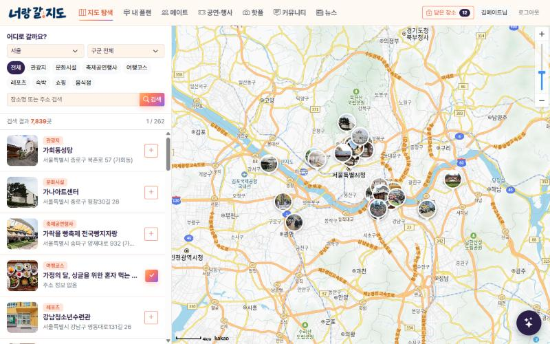
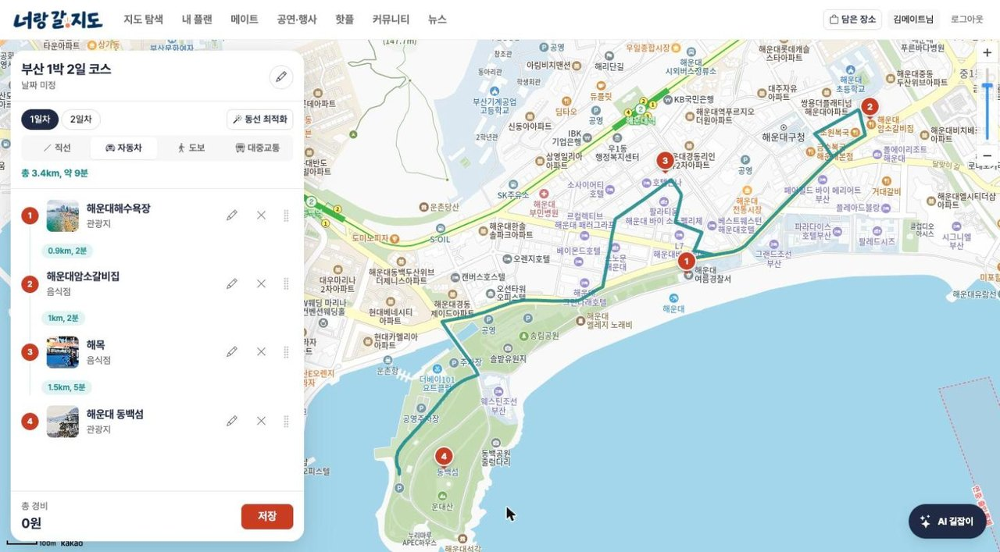
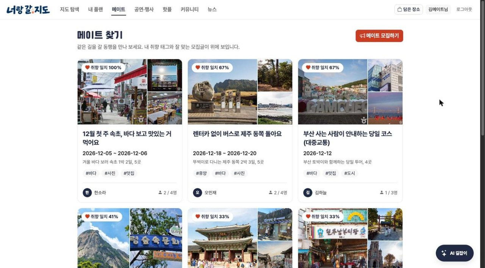
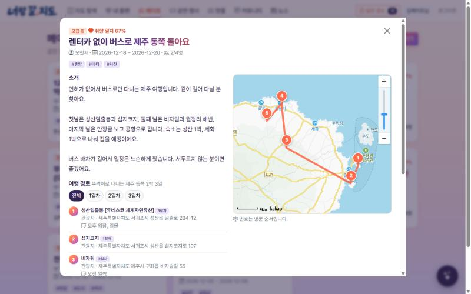
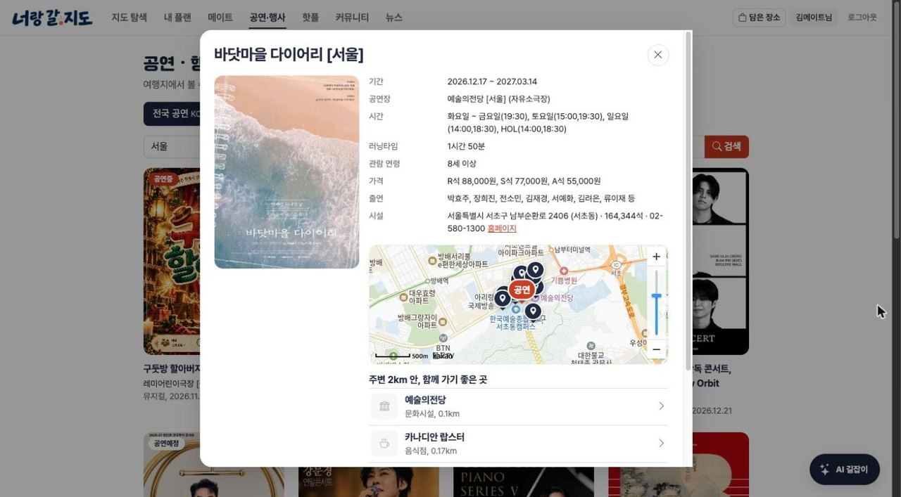
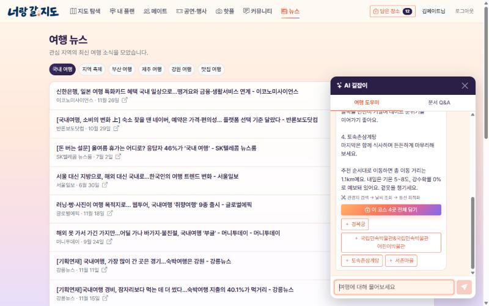

# 너랑 갈.지도 (mapmates)


> **너랑 갈 다음 여행을 지도 위에** · Find your route. Meet your mates.
>
> 지도 한 장 위에서 여행 경로를 짜고, 같이 갈 동행(메이트)을 만나는 여행 플래너입니다.

<br />

## 사용한 기술

| 구분 | 기술 |
|---|---|
| Frontend | Vue 3, Vite, Pinia, Vue Router, Bootstrap 5, Kakao Maps SDK |
| Backend | Java 21, Spring Boot 4, MyBatis, Spring AI 2 |
| AI 서버 | Python, FastAPI, ChromaDB (RAG) |
| Database | MySQL 8 |
| 인증 | JWT(HS256), PBKDF2 비밀번호 해시 |
| 외부 데이터 | 한국관광공사 관광정보, 기상청 단기예보, 한국환경공단 전기차 충전소, KOPIS 공연 정보, 서울 열린데이터 광장, OSRM 경로 탐색, 뉴스 RSS |
| LLM | SSAFY GMS (OpenAI 호환) |
| 협업 | GitLab, GitHub |

### 저장소 구성

| 폴더 | 내용 |
|---|---|
| [`front/`](front) | Vue 프론트엔드 |
| [`back/`](back) | Spring Boot 백엔드 (REST API, Spring AI Tool·Planner) |
| [`allfiles/`](allfiles) | 설계 산출물, DDL·더미 데이터, FastAPI RAG 서버, 발표 자료 |

<br />

## 실행 화면

| 지도 탐색 | 플랜 보드 |
|---|---|
|  |  |
| 장소 사진이 지도 핀으로 표시되고, 지도를 옮기면 보이는 영역 안에서 필터가 적용됩니다. | 드래그로 순서를 바꾸고, 동선 최적화와 자동차·도보·대중교통 경로를 확인합니다. |

| 메이트 찾기 | 메이트 모집 상세 |
|---|---|
|  |  |
| 내 여행 취향과의 일치도(%)가 높은 모집글부터 보여줍니다. | 소개 글과 일차별 여행 경로를 지도와 함께 확인하고 참여를 신청합니다. |

| 공연·행사 | AI 길잡이 |
|---|---|
|  |  |
| 공연장 주변 2km의 음식점·관광지를 추천하고 바로 플랜에 담습니다. | 조건에 맞는 코스를 일차별로 짜서 지도에 바로 보여주고, 그대로 플랜으로 만듭니다. |

### 주요 기능

- **지도 탐색**: 시도·구군·유형별 관광지 5만여 건, 날씨, 일출·일몰, 주변 축제·상권, 전기차 충전소
- **플랜 보드**: 일차별 일정, 경비·예산, 동선 최적화(비트마스크 DP / 2-opt), 이동 수단별 경로
- **메이트**: 모집, 참여 신청·수락, 공동 편집, 취향 일치도(코사인 유사도), 중간 집결지(기하 중앙값)
- **공연·행사**: KOPIS 공연 목록·상세·시설, 주변 장소 추천
- **커뮤니티**: 공지사항, 공유 게시판, 댓글, 핫플레이스 사진 등록, 여행 뉴스
- **AI 길잡이**: AI가 장소를 추천하고 서버가 실제 등록된 장소인지 확인(Spring AI Tool·Planner), 문서 업로드 기반 Q&A(RAG)

<br />

## 실행 방법

사전 준비: JDK 21, Node 20+, Python 3.12, MySQL 8

```bash
# 1) DB 생성과 데이터 적재
mysql -u<계정> -p --default-character-set=utf8mb4 < back/src/main/resources/sql/schema.sql
mysql -u<계정> -p --default-character-set=utf8mb4 < back/src/main/resources/sql/data.sql

# 2) 백엔드 (http://localhost:8080)
cd back
cp src/main/resources/application-private.properties.example src/main/resources/application-private.properties   # 키 입력
./mvnw spring-boot:run

# 3) AI 서버 (http://localhost:8000)
cd allfiles/ai-server
pip install -r requirements.txt
cp .env.example .env    # 키 입력
uvicorn main:app --port 8000

# 4) 프론트엔드 (http://localhost:5173)
cd front
npm install
cp .env.example .env.local    # 카카오 지도 키 입력
npm run dev
```

- 관광지 데이터는 SSAFY 제공 `ssafy_trip` DB에서 복사합니다. (`data.sql`)
- 시연용 글과 모집글을 넣으려면 서버를 한 번 실행한 뒤 `dummy_community.sql`, `dummy_mates.sql`을 차례로 실행합니다.
- 필요한 키: SSAFY GMS, 공공데이터포털(기상청·한국환경공단), KOPIS, 서울 열린데이터 광장, 카카오 지도 JavaScript 키(Web 플랫폼에 `http://localhost:5173` 등록). 키는 저장소에 포함되어 있지 않습니다.
- 사용 방법: 지도에서 장소를 찾아 **담기** → 상단 **담은 장소**에서 플랜 만들기 → **동선 최적화** → 플랜을 공개하고 **메이트 모집하기**. 화면 오른쪽 아래 버튼으로 **AI 길잡이**를 열 수 있습니다.

자세한 설명은 [back/README.md](back/README.md), [front/README.md](front/README.md), [allfiles/README.md](allfiles/README.md)에 있습니다.

<br />

## 만든 이유와 목표

**만든 이유**

여행을 준비할 때 관광지, 날씨, 공연, 충전소 정보를 서비스마다 따로 찾아야 했고, 담아 둔 장소를 어떤 순서로 돌지는 손으로 정해야 했습니다. 같이 갈 사람을 구하더라도 계획은 메신저로 따로 맞춰야 했습니다. 이 세 가지를 지도 한 장 위에서 해결해 보려고 만들었습니다.

**목표**

- 흩어진 여행 정보를 지도 위에 모은다.
- 버튼 하나로 동선을 정리한다.
- 계획 자체를 매개로 동행을 만나고, 같은 계획을 함께 고친다.
- AI가 추측이 아니라 실제 데이터에 근거해 코스를 제안하게 한다.

**배운 점**

- **알고리즘은 입력 크기에 맞춰 고른다.** 방문지 12곳 이하는 비트마스크 DP로 최적해를, 그보다 많으면 2-opt로 근사해를 구했습니다.
- **LLM에게 맡길 일과 서버가 할 일을 나눈다.** 처음에는 DB 검색 결과를 AI가 설명만 해서 질문이 달라도 같은 코스가 나왔습니다. AI가 장소를 추천하고 서버가 DB로 확인하는 구조로 바꾸면서, 조건은 반영하되 없는 장소를 지어내지 못하게 했습니다.
- **프롬프트 구성이 결과를 바꾼다.** 규칙과 데이터를 한 메시지에 섞었더니 모델이 규칙을 답변에 되풀이했고, 역할별로 분리해 해결했습니다.
- **공공데이터는 그대로 믿을 수 없다.** 좌표가 국내 범위를 벗어난 데이터, 잘못된 분류명, 빠진 사진을 만나 검증과 보충 로직을 넣었습니다.
- **RAG는 검색 품질이 답의 상한이다.** 청크 크기와 유사도 기준에 따라 문서 참고 여부가 달라지는 것을 확인했습니다.

설계 문서와 고찰은 [allfiles/docs](allfiles/docs)에 정리했습니다.

<br />

## 만든 사람

<table>
  <tr>
    <td align="center">
      <a href="https://github.com/77romin">
        <br />
        <b>김강민 (77romin)</b>
      </a>
    </td>
    <td align="center">
      <a href="https://github.com/yeeunma">
        <br />
        <b>마예은 (yeeunma)</b>
      </a>
    </td>
  </tr>
</table>

### 역할 분담

| 영역 | 김강민 ([77romin](https://github.com/77romin)) | 마예은 ([yeeunma](https://github.com/yeeunma)) |
|---|---|---|
| 핵심 주제 | **경로(Route)와 AI** | **동행(Mates)과 커뮤니티** |
| 지도 | 지도 탐색, 사진 핀, 지도 영역 검색, 관광지 상세 | 핫플레이스 등록(지도 위치 선택, 사진 업로드) |
| 여행 계획 | 플랜 보드, 동선 최적화, 이동 수단별 경로 | 메이트 모집·신청·수락, 공동 편집, 모집 상세(지도·경로) |
| 알고리즘 | 동선 최적화(비트마스크 DP, 2-opt) | 취향 일치도(코사인 유사도), 중간 집결지(기하 중앙값) |
| 외부 데이터 | 날씨, 일출·일몰, 충전소, 경로 탐색(OSRM), 관광공사 사진 보충 | KOPIS 공연·서울 문화행사, 주변 장소 팝업, 여행 뉴스 수집 |
| AI | Spring AI Tool·Planner, AI 코스 추천, RAG 서버(FastAPI·ChromaDB), 문서 Q&A | AI 길잡이 챗봇 화면(대화 UI, 코스 전체 담기) |
| 회원·게시판 | - | 회원 가입·로그인·비밀번호 찾기, JWT 인증, 마이페이지, 공지사항, 공유 게시판, 댓글 |
| 공통 | DB 설계(관광지·플랜), 백엔드 구조, 저장소 관리 | DB 설계(회원·메이트·커뮤니티), 해질녘 테마·모션, 로고·화면 디자인 |
| 문서 | API 설계서, 클래스 다이어그램, 알고리즘 기획서, AI 고찰 보고서 | 요구사항 정의서, 유스케이스, 화면 정의서, ERD, WBS, 발표 자료 |

<br />

## 감사 인사

- **SSAFY(삼성 청년 SW·AI 아카데미)**: 프로젝트 명세, 관광지 데이터, GMS(LLM 게이트웨이)
- **공공데이터포털**: [한국관광공사 국문 관광정보](https://www.data.go.kr/), 기상청 단기예보, 한국환경공단 전기자동차 충전소 정보
- **[KOPIS 공연예술통합전산망](https://www.kopis.or.kr/)**: 공연 목록·상세·시설 정보
- **[서울 열린데이터 광장](https://data.seoul.go.kr/)**: 서울시 문화행사 정보
- **[Kakao Maps API](https://apis.map.kakao.com/)**: 지도와 길찾기 연결
- **[OpenStreetMap](https://www.openstreetmap.org/) · [OSRM](https://project-osrm.org/)**: 자동차·도보 경로 탐색
- **[모션 UI 메뉴판](https://motion-ui.altolab.ai/)**: 순차 등장, 커서 조명 카드 등 화면 모션의 바탕이 된 데모 코드
- **[Spring AI](https://docs.spring.io/spring-ai/reference/) · [Bootstrap](https://getbootstrap.com/) · [Pretendard](https://github.com/orioncactus/pretendard)**

<br />

---

이 저장소의 이전 프로젝트(2026-11-08까지의 작업)는 커밋 이력과 `db-project` 브랜치에 남아 있습니다.
