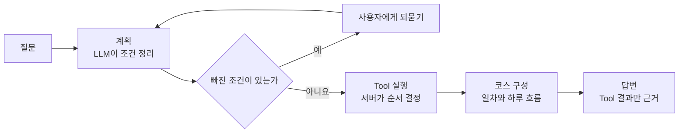

<div align="center">


# 너랑 갈.지도 · mapmates

**너랑 갈 다음 여행을 지도 위에**

지도 한 장 위에서 여행 경로를 짜고, 같이 갈 메이트를 만나고, AI에게 코스를 묻는 여행 플래너


</div>

## 왜 만들었나

여행을 준비할 때 관광지, 날씨, 공연, 충전소 정보를 서비스마다 따로 찾아야 했고, 담아 둔 장소를 어떤 순서로 돌지는 손으로 정해야 했습니다. 같이 갈 사람을 구하더라도 계획은 메신저로 따로 맞춰야 했습니다.

너랑 갈.지도는 이 세 가지를 지도 한 장 위에서 해결합니다.

- 흩어진 여행 정보를 지도 위에 모읍니다.
- 버튼 하나로 동선을 정리합니다.
- 계획 자체를 매개로 동행을 만나고, 같은 계획을 함께 고칩니다.
- AI가 추측이 아니라 실제 데이터에 근거해 코스를 제안합니다.

## Route · 지도 위에서 경로 짜기

장소를 찾아 담고, 일정으로 엮고, 순서와 이동 수단까지 정합니다.


| 기능 | 설명 |
| --- | --- |
| 지도 탐색 | 시도·구군·유형별 관광지 5만여 건을 사진 핀으로 봅니다. 가까운 핀은 묶어서 개수로 보여주고, 지도를 옮기면 보이는 영역 안에서 필터가 적용됩니다. |
| 장소 상세 | 사진, 날씨, 일출·일몰, 소개 글과 함께 주변 축제·상권, 전기차 충전소를 확인합니다. |
| 플랜 보드 | 일차 탭으로 일정을 나누고 드래그로 순서를 바꿉니다. 방문지별 경비를 더해 예산과 비교합니다. |
| 동선 최적화 | 방문지 12곳 이하는 비트마스크 DP로 최적해를, 그보다 많으면 최근접 이웃 + 2-opt로 근사해를 구합니다. |
| 이동 수단별 경로 | 자동차·도보는 실제 도로 경로와 구간별 거리·시간을 보여주고, 대중교통은 구간별 길찾기로 연결합니다. |

## Mates · 함께 갈 사람 만나기

플랜을 공개해 메이트를 모으고, 수락된 메이트와 같은 계획을 함께 고칩니다.

<table>
<tr>
<td width="50%"></td>
<td width="50%"></td>
</tr>
<tr>
<td align="center">메이트 찾기 · 취향 일치도가 높은 모집글부터</td>
<td align="center">모집 상세 · 소개 글과 일차별 경로</td>
</tr>
</table>

| 기능 | 설명 |
| --- | --- |
| 취향 일치도 | 내 취향 태그와 모집글 태그의 코사인 유사도를 %로 보여주고 높은 순으로 정렬합니다. |
| 모집과 신청 | 모집글에서 경로를 확인하고 한마디를 남겨 신청합니다. 모집자가 수락하거나 거절합니다. |
| 공동 편집 | 수락된 메이트는 같은 플랜을 함께 고칩니다. |
| 중간 집결지 | 메이트들의 출발지에서 이동 거리 합이 가장 작은 지점(기하 중앙값)을 구하고 그 주변 장소를 추천합니다. |

## AI 길잡이 · 근거 있는 코스 추천

코스를 일차별로 짜서 지도에 바로 보여주고, 그대로 플랜으로 만듭니다.


| 기능 | 설명 |
| --- | --- |
| 되묻기 | 지역, 일수, 여행 속도, 동행이 빠져 있으면 임의로 정하지 않고 사용자에게 묻습니다. |
| 하루 구성 | 오전, 점심, 오후, 저녁 순서로 배치합니다. 여행 속도에 따라 하루 볼거리가 3곳, 5곳, 6곳으로 달라집니다. |
| 지도 표시 | 만든 코스를 메인 지도에 번호 핀과 경로선으로 그리고, 일차별 일정과 소개 글을 함께 보여줍니다. |
| 코스로 플랜 만들기 | 일차 구분을 유지한 채 플랜으로 생성합니다. |
| 문서 Q&A | 업로드한 문서를 근거로 답하고, 근거가 약하면 일반 답변으로 구분합니다(RAG). |



LLM은 계획과 문장을 맡고, 데이터 조회와 순서 계산은 서버가 합니다. DB에 등록된 장소만 사용하므로 없는 장소를 지어내지 않습니다.

## 공연·행사와 커뮤니티


| 기능 | 설명 |
| --- | --- |
| 공연·행사 | KOPIS의 공연 목록·상세·시설 정보와 서울시 문화행사를 보여줍니다. 공연장 주변 2km의 음식점·관광지를 추천하고 바로 플랜에 담습니다. |
| 커뮤니티 | 공지사항, 공유 게시판, 댓글. 게시글 조회수는 같은 사용자에 대해 24시간에 한 번만 셉니다. |
| 핫플레이스 | 지도에서 위치를 고르고 사진을 올려 다녀온 곳을 등록합니다. |
| 여행 뉴스 | 주제별 여행 뉴스를 모아 보여줍니다. |

## 구조


| 구분 | 기술 |
| --- | --- |
| Frontend | Vue 3, Vite, Pinia, Vue Router, Bootstrap 5, Kakao Maps SDK |
| Backend | Java 21, Spring Boot 4, MyBatis, Spring AI 2 |
| AI 서버 | Python, FastAPI, ChromaDB (RAG) |
| Database | MySQL 8 (14개 테이블) |
| 인증 | JWT(HS256), PBKDF2 비밀번호 해시 |
| 외부 데이터 | 한국관광공사 관광정보, 기상청 단기예보, 한국환경공단 전기차 충전소, KOPIS 공연 정보, 서울 열린데이터 광장, OSRM 경로 탐색, 뉴스 RSS |
| LLM | SSAFY GMS (OpenAI 호환) |
| 협업 | GitHub, GitLab |

| 경로 | 내용 |
| --- | --- |
| [`front/`](front) | Vue 프론트엔드. 디자인 기준은 [DESIGN.md](front/DESIGN.md) |
| [`back/`](back) | Spring Boot 백엔드 (REST API, Spring AI Tool·Planner) |
| [`allfiles/`](allfiles) | 설계 산출물, DDL·더미 데이터, FastAPI RAG 서버 |
| [`allfiles/docs`](allfiles/docs) | 요구사항, 유스케이스, ERD, API 설계서, 클래스 다이어그램, 화면 정의서, 알고리즘 기획서, AI 고찰 보고서 |
| [`allfiles/presentation`](allfiles/presentation) | 발표 자료와 시연 영상 |

## 실행 방법

사전 준비: JDK 21, Node 20+, Python 3.12, MySQL 8

```bash
# 1) DB 생성과 데이터 적재
mysql -u<계정> -p --default-character-set=utf8mb4 < back/src/main/resources/sql/schema.sql
mysql -u<계정> -p --default-character-set=utf8mb4 < back/src/main/resources/sql/data.sql

# 2) 백엔드 (http://localhost:8080)
cd back
cp src/main/resources/application-private.properties.example src/main/resources/application-private.properties   # 키 입력
./mvnw spring-boot:run

# 3) AI 서버 (http://localhost:8000)
cd allfiles/ai-server
pip install -r requirements.txt
cp .env.example .env    # 키 입력
uvicorn main:app --port 8000

# 4) 프론트엔드 (http://localhost:5173)
cd front
npm install
cp .env.example .env.local    # 카카오 지도 키 입력
npm run dev
```

- 관광지 데이터는 SSAFY 제공 `ssafy_trip` DB에서 복사합니다. (`data.sql`)
- 시연용 글과 모집글을 넣으려면 서버를 한 번 실행한 뒤 `dummy_community.sql`, `dummy_mates.sql`을 차례로 실행합니다.
- 필요한 키: SSAFY GMS, 공공데이터포털(기상청·한국환경공단), KOPIS, 서울 열린데이터 광장, 카카오 지도 JavaScript 키(Web 플랫폼에 `http://localhost:5173` 등록). 키는 저장소에 포함되어 있지 않습니다.
- 사용 방법: 지도에서 장소를 찾아 **담기** → 상단 **담은 장소**에서 플랜 만들기 → **동선 최적화** → 플랜을 공개하고 **메이트 모집하기**. 화면 오른쪽 아래 버튼으로 **AI 길잡이**를 열 수 있습니다.

자세한 설명은 [back/README.md](back/README.md), [front/README.md](front/README.md), [allfiles/README.md](allfiles/README.md)에 있습니다.

## 검증한 것과 남은 일

**확인한 것**

- 로컬에서 MySQL, 백엔드, 프론트엔드를 띄워 Chrome으로 각 화면의 동작을 확인했습니다.
- 플랜 → 모집 → 신청 → 수락 → 집결지 흐름
- 권한 오류 응답 (401, 403, 404, 409)
- 날씨, 충전소, KOPIS 공연, 서울시 문화행사 실데이터
- AI 코스의 되묻기, 일차 구성, 지도 표시, 플랜 생성

**남은 일**

- 휴대폰 폭(390px) 화면은 검증하지 않았습니다.
- 게시판 상세·글쓰기 화면은 새 디자인으로 개편하지 않았습니다.
- AI 코스의 이동 거리는 도로가 아니라 직선 기준입니다.
- 식사 자리에 카페가 배정되는 경우가 있습니다.
- 대중교통은 실제 노선을 그리지 않고 길찾기로 연결합니다.
- 자동화 테스트 코드와 RAG 정량 평가가 없습니다.

## 배운 점

- **알고리즘은 입력 크기에 맞춰 고른다.** 방문지 12곳 이하는 비트마스크 DP로 최적해를, 그보다 많으면 2-opt로 근사해를 구했습니다.
- **LLM에게 맡길 일과 서버가 할 일을 나눈다.** 처음에는 DB 검색 결과를 AI가 설명만 해서 질문이 달라도 같은 코스가 나왔습니다. AI가 장소를 추천하고 서버가 DB로 확인하는 구조로 바꾸면서, 조건은 반영하되 없는 장소를 지어내지 못하게 했습니다.
- **프롬프트 구성이 결과를 바꾼다.** 규칙과 데이터를 한 메시지에 섞었더니 모델이 규칙을 답변에 되풀이했고, 역할별로 분리해 해결했습니다.
- **공공데이터는 그대로 믿을 수 없다.** 좌표가 국내 범위를 벗어난 데이터, 잘못된 분류명, 빠진 사진을 만나 검증과 보충 로직을 넣었습니다.
- **RAG는 검색 품질이 답의 상한이다.** 청크 크기와 유사도 기준에 따라 문서 참고 여부가 달라지는 것을 확인했습니다.

설계 문서와 고찰은 [allfiles/docs](allfiles/docs)에 정리했습니다.

## 만든 사람

<table>
  <tr>
    <td align="center">
      <a href="https://github.com/77romin">
        <br />
        <b>김강민 (77romin)</b>
      </a>
    </td>
    <td align="center">
      <a href="https://github.com/yeeunma">
        <br />
        <b>마예은 (yeeunma)</b>
      </a>
    </td>
  </tr>
</table>

### 역할 분담

| 영역 | 김강민 ([77romin](https://github.com/77romin)) | 마예은 ([yeeunma](https://github.com/yeeunma)) |
|---|---|---|
| 핵심 주제 | **경로(Route)와 AI** | **동행(Mates)과 커뮤니티** |
| 지도 | 지도 탐색, 사진 핀, 지도 영역 검색, 관광지 상세 | 핫플레이스 등록(지도 위치 선택, 사진 업로드) |
| 여행 계획 | 플랜 보드, 동선 최적화, 이동 수단별 경로 | 메이트 모집·신청·수락, 공동 편집, 모집 상세(지도·경로) |
| 알고리즘 | 동선 최적화(비트마스크 DP, 2-opt) | 취향 일치도(코사인 유사도), 중간 집결지(기하 중앙값) |
| 외부 데이터 | 날씨, 일출·일몰, 충전소, 경로 탐색(OSRM), 관광공사 사진 보충 | KOPIS 공연·서울 문화행사, 주변 장소 팝업, 여행 뉴스 수집 |
| AI | Spring AI Tool·Planner, AI 코스 추천, RAG 서버(FastAPI·ChromaDB), 문서 Q&A | AI 길잡이 챗봇 화면(대화 UI, 코스 전체 담기) |
| 회원·게시판 | - | 회원 가입·로그인·비밀번호 찾기, JWT 인증, 마이페이지, 공지사항, 공유 게시판, 댓글 |
| 공통 | DB 설계(관광지·플랜), 백엔드 구조, 저장소 관리 | DB 설계(회원·메이트·커뮤니티), 초기 화면 테마·모션, 로고 |
| 문서 | API 설계서, 클래스 다이어그램, 알고리즘 기획서, AI 고찰 보고서 | 요구사항 정의서, 유스케이스, 화면 정의서, ERD, WBS, 발표 자료 |

## 감사 인사

- **SSAFY(삼성 청년 SW·AI 아카데미)**: 프로젝트 명세, 관광지 데이터, GMS(LLM 게이트웨이)
- **공공데이터포털**: [한국관광공사 국문 관광정보](https://www.data.go.kr/), 기상청 단기예보, 한국환경공단 전기자동차 충전소 정보
- **[KOPIS 공연예술통합전산망](https://www.kopis.or.kr/)**: 공연 목록·상세·시설 정보
- **[서울 열린데이터 광장](https://data.seoul.go.kr/)**: 서울시 문화행사 정보
- **[Kakao Maps API](https://apis.map.kakao.com/)**: 지도와 길찾기 연결
- **[OpenStreetMap](https://www.openstreetmap.org/) · [OSRM](https://project-osrm.org/)**: 자동차·도보 경로 탐색
- **[모션 UI 메뉴판](https://motion-ui.altolab.ai/)**: 순차 등장, 커서 조명 카드 등 화면 모션의 바탕이 된 데모 코드
- **[Spring AI](https://docs.spring.io/spring-ai/reference/) · [Bootstrap](https://getbootstrap.com/) · [Pretendard](https://github.com/orioncactus/pretendard)**

<br />

---

이 저장소의 이전 프로젝트(2026-11-08까지의 작업)는 커밋 이력과 `db-project` 브랜치에 남아 있습니다.
