<p align="center">
  
</p>

# 너랑 갈.지도 · MapMates

**한국어** | [English — 프론트 화면 안내](./front/README-en.md)

> 너랑 갈 다음 여행을 지도 위에 · Find your route. Meet your mates.

**MapMates**는 Map(지도)와 Mates(함께할 친구들)를 합친 영어 이름으로, ‘너랑 갈.지도’의 지도와 동행이라는 의미를 담았습니다.

지도에서 여행지를 발견하고, 나만의 일정을 만든 뒤 함께할 동행을 찾는 여행 웹앱입니다. **소개 → 지도 탐색 → 내 여행 작성 → 동행 공유·참여 → 여행 이야기 나누기** 순서로 사용할 수 있습니다.

HTML·CSS·JavaScript 화면에 **Java Servlet MVC·JDBC·MySQL 백엔드와 DB**를 연결했습니다. 회원·여행계획·찜·동행·게시글·댓글은 서버에 저장하고, 서로 다른 브라우저에서도 같은 여행과 참가 현황을 확인합니다. 브라우저에는 작성 중 초안과 지도 설정을 보관합니다.

[바로 실행하기](#실행-방법) · [화면별 사용법](#1-소개-페이지--처음-만나는-너랑-갈지도) · [시스템 구조](#시스템-구조) · [ERD](#데이터베이스-설계--erd) · [API 명세](./docs/API.md) · [검증 결과](./docs/VALIDATION.md)

## 기획 배경과 서비스 방향

여행 장소를 고르는 일과 일정을 짜는 일, 함께 떠날 동행을 구하는 일을 한 흐름으로 연결하고자 했습니다. 관광지를 따로 찾아 기록하고 다시 모집글을 작성하는 대신, **지도에 담은 장소가 여행계획이 되고 그 계획이 동행 모집글로 이어지는 서비스**를 기획했습니다.

카카오 지도와 공공 관광정보로 장소·주변 환경을 살펴보고, 날짜별 방문 시각·동선·예산을 정리합니다. 저장한 계획을 공유하면 다른 회원이 상세 일정과 참가자를 확인하고 질문한 뒤 참여할 수 있습니다. 여행 후에는 커뮤니티에서 경험을 나눕니다. 날씨·충전소·로드뷰와 동선 최적화는 이 과정에서 여행 준비를 돕는 기능입니다.

프론트 단계에서 완성한 사용 흐름에 서버 인증과 영속 저장을 더해, 한 브라우저의 체험을 넘어 **여러 회원이 계획·동행·이야기를 공유하는 플랫폼**으로 확장했습니다.

## 시스템 구조

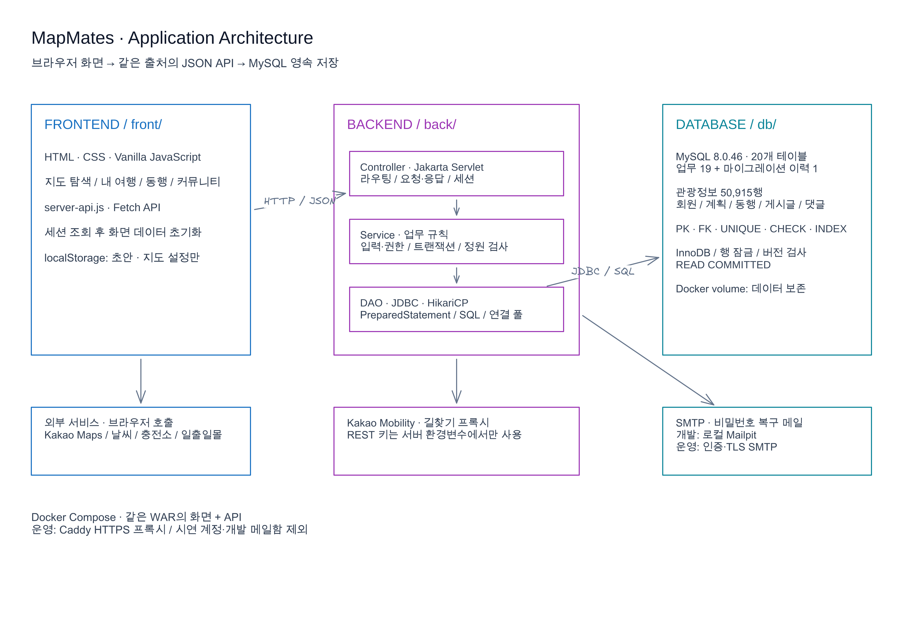

브라우저의 `front/` 화면이 `server-api.js`를 통해 같은 출처의 `/mapmates/api/*`를 호출합니다. `back/`의 Servlet·Service·DAO와 JDBC가 요청을 처리하고 `db/`의 MySQL에 저장합니다. 정적 화면과 API는 하나의 WAR로 Tomcat에 배포하며, Docker Compose로 Tomcat과 MySQL을 함께 실행합니다.

지도 SDK·날씨·충전소·일출일몰은 브라우저에서 해당 외부 API를 사용합니다. 카카오모빌리티 길찾기는 백엔드 프록시를 거치며 REST 키는 서버에만 둡니다. 구조도의 DB 연결은 JDBC 기반이며 MySQL 포트는 호스트에 공개하지 않습니다.

[구조도 원본](./docs/diagrams/architecture.excalidraw) · [상세 설계·Usecase·Class Diagram](./docs/DESIGN.md)

## 팀 현황

| GitHub 프로필 사진 | 이름 | 담당업무 |
| --- | --- | --- |
| <a href="https://github.com/77romin"></a> | [김강민](https://github.com/77romin) | **기획·지도·내 여행·외부 API 통합·동행** — 카카오맵·공공데이터 관광정보 API 연결과 주변 검색, 여행지 필터, 날씨, 일정 편집, 차량 경로, 공통 상태 관리와 통합 테스트, 동행 목록·상세·참가 권한, 서브페이지 반응형과 접근성 |
| <a href="https://github.com/yeeunma"></a> | [마예은](https://github.com/yeeunma) | **회원·커뮤니티·전기차 충전소** — 회원가입, 로그인, 프로필 관리, 게시글·댓글·대댓글 구현, 전기차 충전소 정보와 현황 |

위 표는 프론트 단계의 담당업무입니다. [기존 업무 분담](./front/docs/WORK_SPLIT.md)과 [백엔드·DB 단계 업무 분담 및 통합 기록](./docs/WORK_SPLIT.md)을 함께 참고하세요. GitLab의 팀원 스키마 보완 커밋도 기존 이력을 유지해 통합했습니다.

## 1. 소개 페이지 — 처음 만나는 너랑 갈.지도

처음 접속하면 소개 페이지가 자동으로 열립니다. 노을빛 구름 배경을 따라 서비스 설명과 ‘장소 담기 → 일정 정하기 → 동행 만나기 → 이야기 나누기’ 사용법을 확인한 뒤 지도 탐색으로 이동합니다. 이후에는 메인 왼쪽 아래 **소개 ↗** 버튼으로 다시 열 수 있습니다.

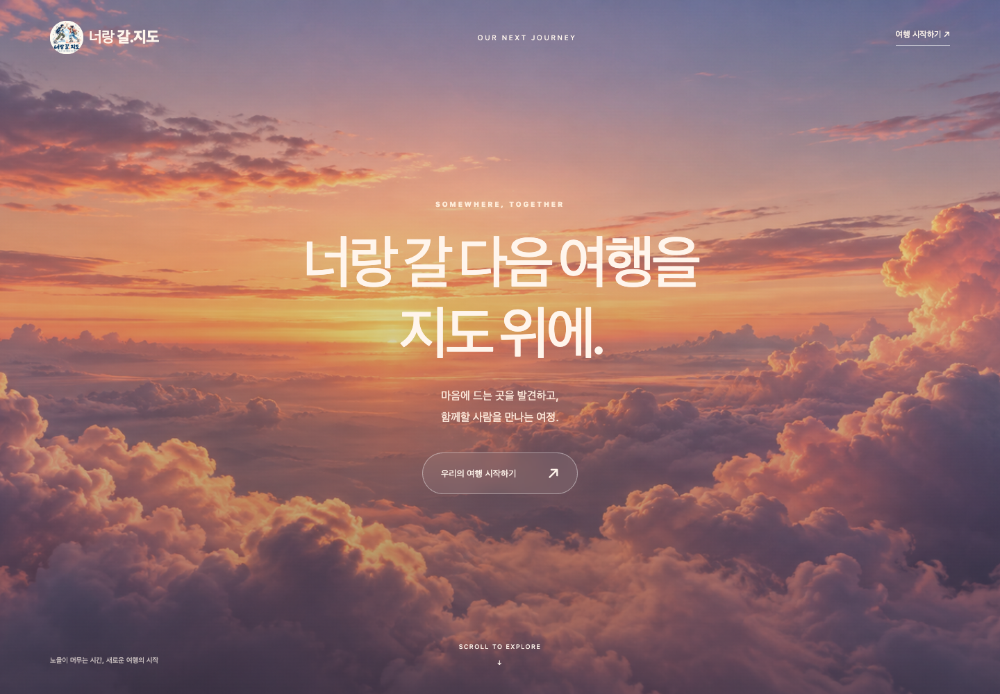

## 2. 메인 페이지 — 지도에서 발견하고 함께 떠나기

### 탐색 탭에서 주변 여행지 보기

지도를 이동하거나 장소를 검색하면 현재 지도 주변 여행지가 사진 카드와 마커로 나타납니다. 카드를 눌러 상세정보를 확인하고 **일정 추가**로 내 여행에 담습니다. 왼쪽 패널은 접기 버튼으로 숨길 수 있습니다.

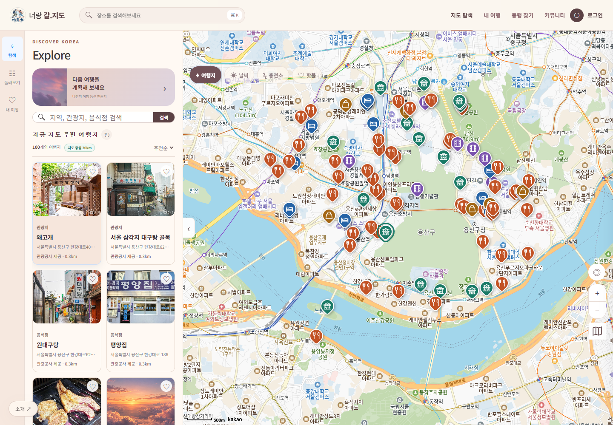

지도 핀은 종류마다 **아이콘과 색상**이 달라 장소를 구분하기 쉽습니다. 핀을 누르면 해당 장소의 상세정보가 열리고, 선택한 핀에는 테두리가 표시됩니다. 키보드로도 핀을 선택할 수 있습니다.

| 종류 | 핀 아이콘 | 색상 |
| --- | --- | --- |
| 음식점 | 포크·나이프 | 주황 |
| 숙소 | 침대 | 파랑 |
| 문화 | 영화필름 | 보라 |
| 공연·행사 | 춤추는 사람 | 분홍 |
| 관광지 | 궁궐 | 청록 |
| 쇼핑 | 쇼핑백 | 황토 |
| 여행코스·레포츠 | 경로 | 초록 |

### 여행지 버튼으로 필터링

지도 위 **여행지** 버튼에서 관광지·맛집·숙소·문화·공연/행사·쇼핑·코스를 각각 켜거나 끕니다. **전체**를 누르면 모든 종류를 켜고, 다시 누르면 모두 끕니다. 선택한 종류에 맞춰 주변 카드와 마커가 갱신됩니다.

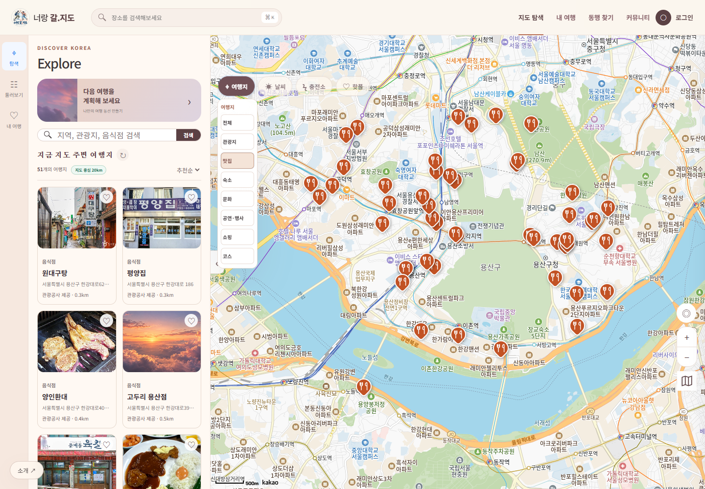

### 날씨 버튼으로 5일 예보 확인

**날씨** 버튼을 누르면 현재 지도 중심의 5일 예보를 볼 수 있습니다. 날짜별 날씨와 최저·최고기온을 확인하고 다시 누르면 숨깁니다. 실제 기상청 응답의 제공 기간에 따라 표시되는 날짜 수가 달라질 수 있습니다.

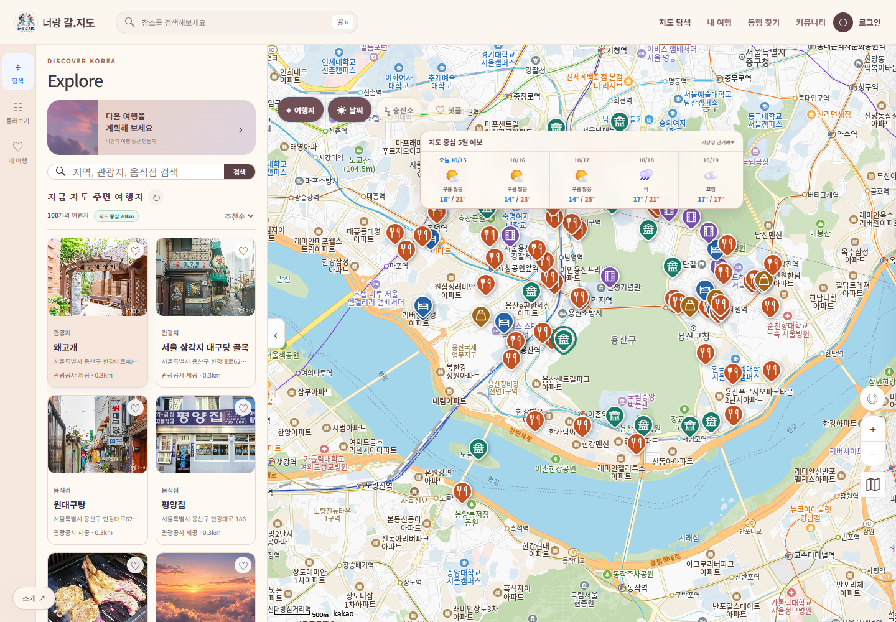

### 충전소 버튼으로 충전 현황 확인

**충전소**를 켜면 지도 주변 충전소가 표시됩니다. 번개 마커를 누르면 충전소 이름·주소, **충전 가능한 대수**, 전체 대수, 충전 중인 대수와 충전기별 상태를 확인합니다. 축척에 따른 표시 제한 없이 사용할 수 있으며, 성능을 위해 지도 중심 반경 20km 안에서 최대 80곳을 표시합니다. 지역 일부만 조회된 경우 화면에 안내합니다.

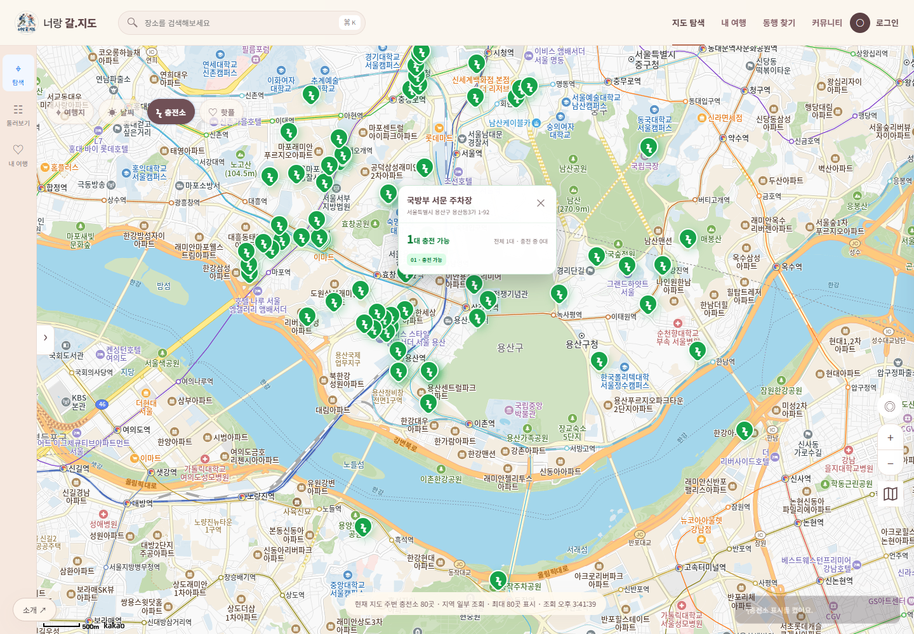

### 핫플 — 사람들이 여행계획에 많이 담은 장소

**핫플**을 켜면 현재 지도 범위에서 여행계획에 많이 추가된 장소 **최대 10곳**을 순위로 표시합니다. 장소별로 추가한 회원 수와 일정 수를 함께 볼 수 있습니다. 지도를 이동하면 범위에 맞춰 갱신되고, 장소를 누르면 정보를 보거나 내 일정에 추가할 수 있습니다. 서버 모드에서는 MySQL에 저장된 **전체 회원의 계획**을 집계하며 같은 회원과 같은 계획의 반복 추가는 각각 중복 집계하지 않습니다.

서버 모드는 관광지 ID별 회원 수·계획 수를 SQL로 집계해 상위 10곳을 반환합니다. 프론트 단독 데모에서는 기존 **최소 힙**으로 상위 10곳을 선정합니다. 데모 알고리즘의 합성 후보 10만 개 비교에서는 비교 횟수 **93.4% 감소**를 확인했습니다.

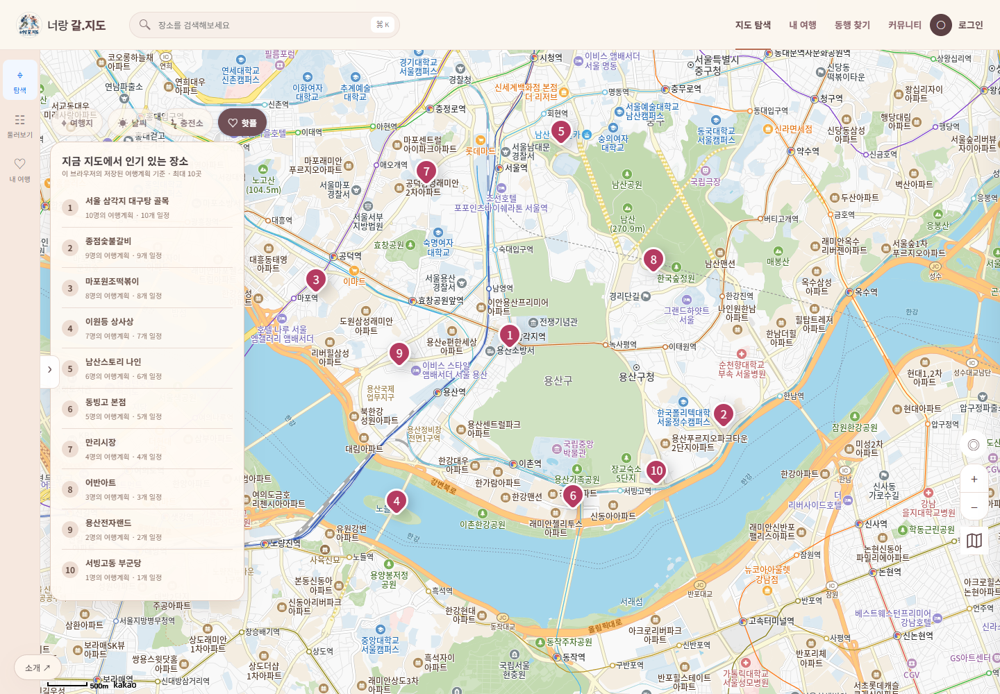

### 지도 타입 변경과 로드뷰

오른쪽 아래 **지도 아이콘**을 누르면 일반·위성·로드뷰·지형도 메뉴가 한 열로 펼쳐집니다. 장소 아이콘과 선택한 여행지는 지도 종류를 바꿔도 유지됩니다.

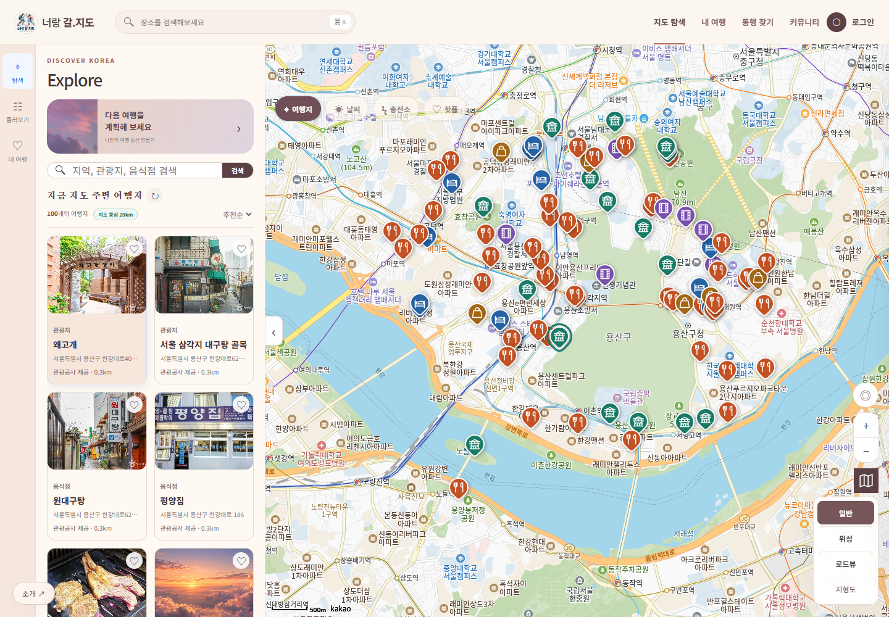

**일반 지도**는 도로·지명·시설을 확인하기 좋습니다.


**위성 지도**는 항공영상으로 건물과 공원, 강 등 주변 모습을 확인할 수 있습니다.

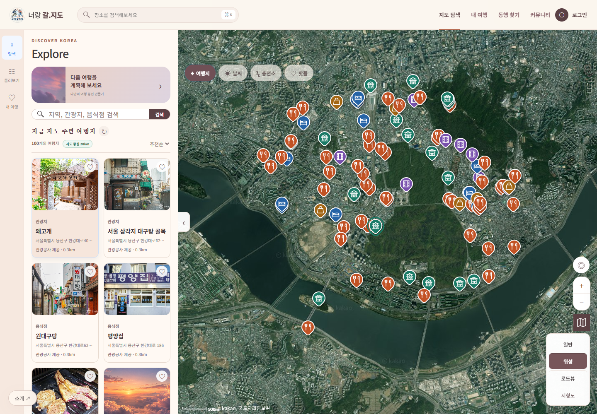

**지형도**는 기본 지도 위에 지형 정보를 겹쳐 남산과 주변 지역의 지세를 확인할 수 있습니다. 다시 누르면 지형 표시를 끕니다.

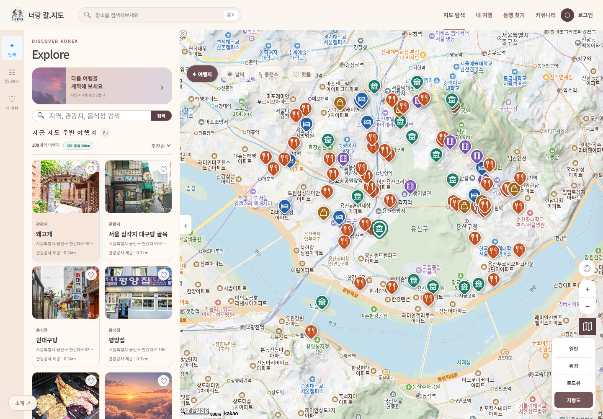

**로드뷰**를 선택하면 파란색으로 도로가 표시됩니다. 도로를 **더블클릭**하면 해당 위치의 로드뷰 팝업이 열립니다. 팝업 화면을 드래그해 방향을 바꾸거나 도로의 이동 화살표로 주변 다른 위치도 볼 수 있습니다.

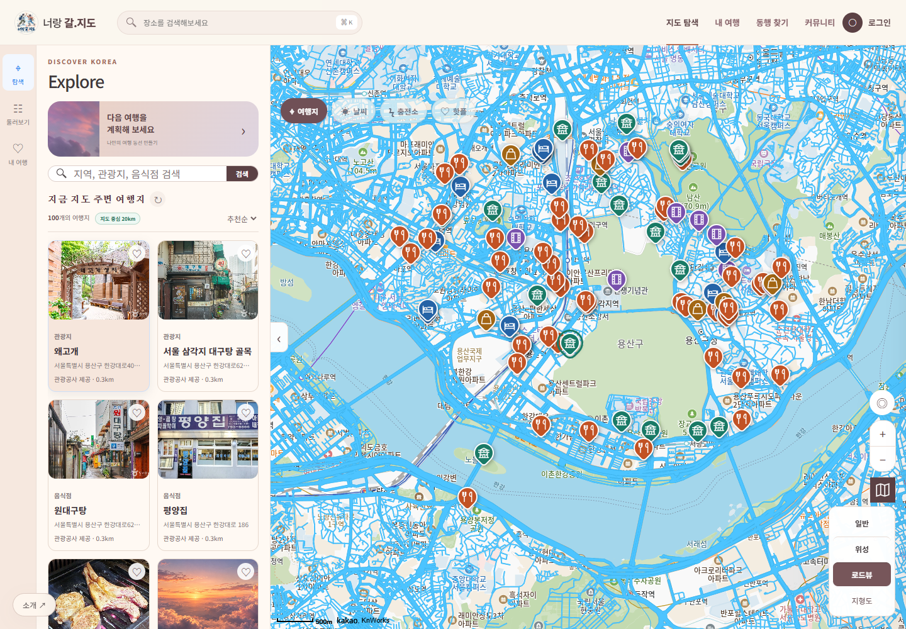

아래는 광화문광장 부근의 도로를 더블클릭하고 광화문을 바라보도록 방향을 맞춘 실제 로드뷰입니다.

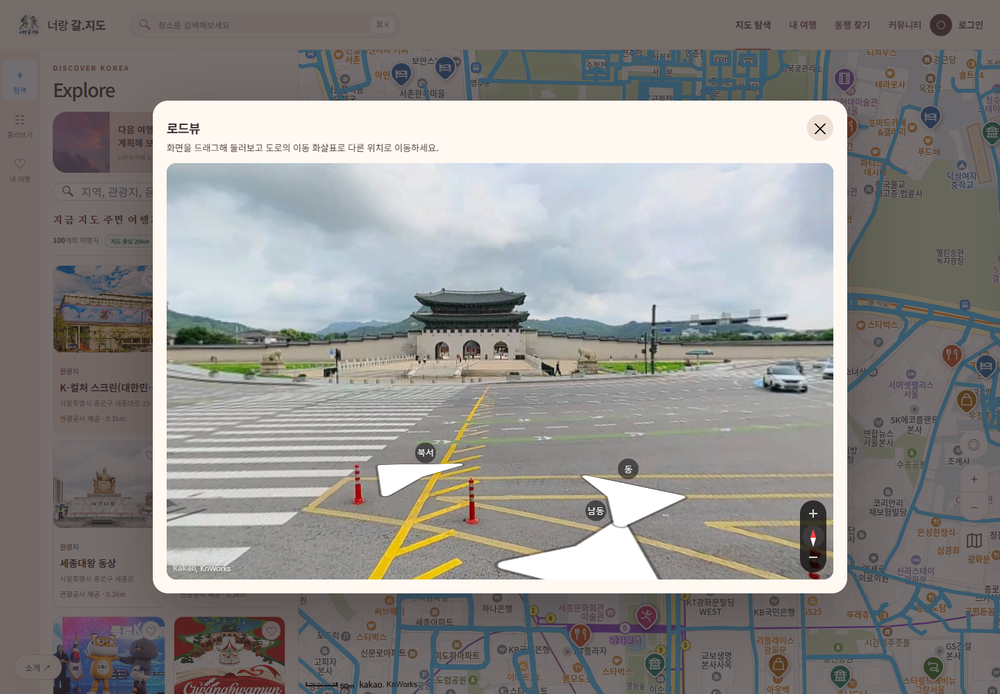

### 둘러보기 탭에서 공유 여행계획과 동행 참여

**둘러보기**에는 동행찾기에 올라온 공유 여행계획이 사진 카드로 표시됩니다. 카드를 누르면 선택한 여행의 소개·참가 인원·DAY별 일정과 날씨가 나타나며 지도도 해당 동선으로 이동합니다. 직선/차량경로를 바꿔 확인하고, **세부내용 보기**로 동행 상세 페이지를 엽니다.

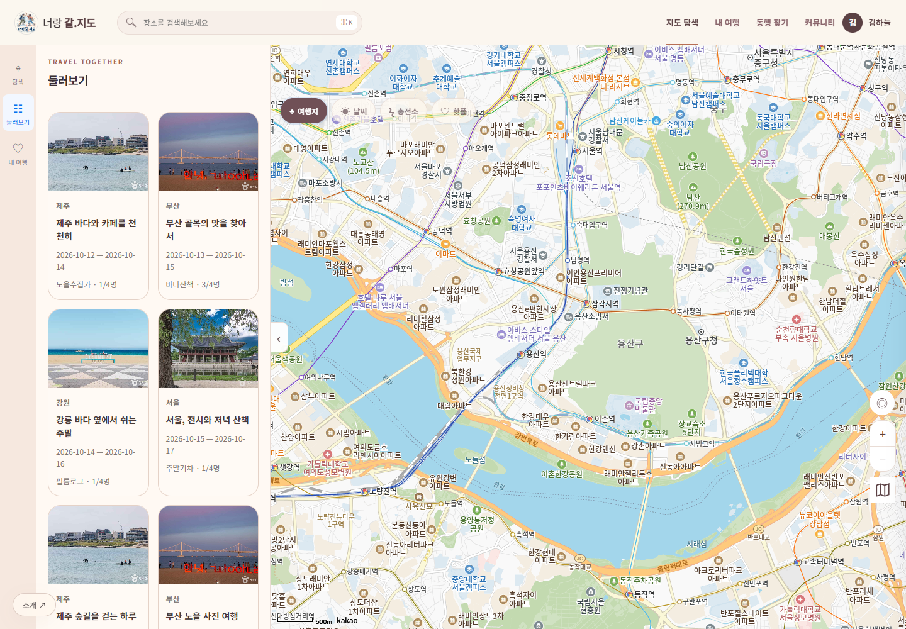

제목 옆 **동행하기**를 누르면 바로 참가하고 **참가 중**으로 바뀝니다. 참가 중 버튼을 다시 누르면 취소됩니다. 정원이 찼거나 모집자가 마감한 여행에는 새로 참가할 수 없고, 로그인 전이라면 로그인 후 선택한 여행으로 돌아옵니다.

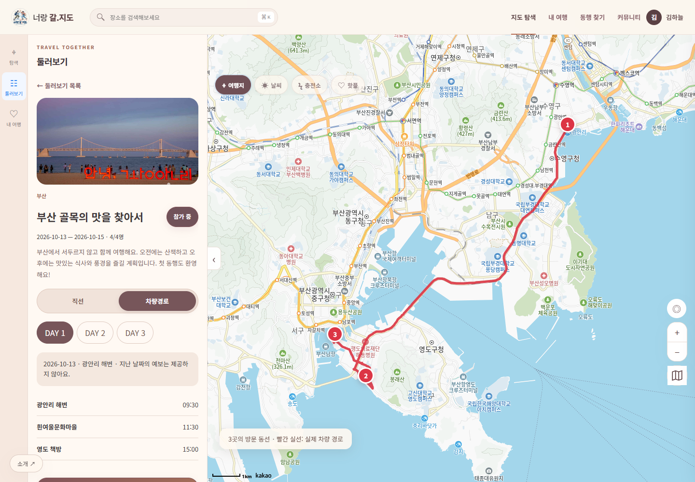

### 내 여행 탭에서 내 계획과 동선 확인

**내 여행** 탭에는 로그인한 내가 작성한 계획만 표시됩니다. 카드 선택 후 **직선 / 차량경로** 토글과 DAY 버튼으로 동선을 확인합니다. 두 경로 모두 붉은 실선으로 표시합니다. **새 여행 작성**은 내 여행 페이지의 새 계획 작성으로, **세부내용 보기**는 선택한 계획의 편집 화면으로 연결됩니다.

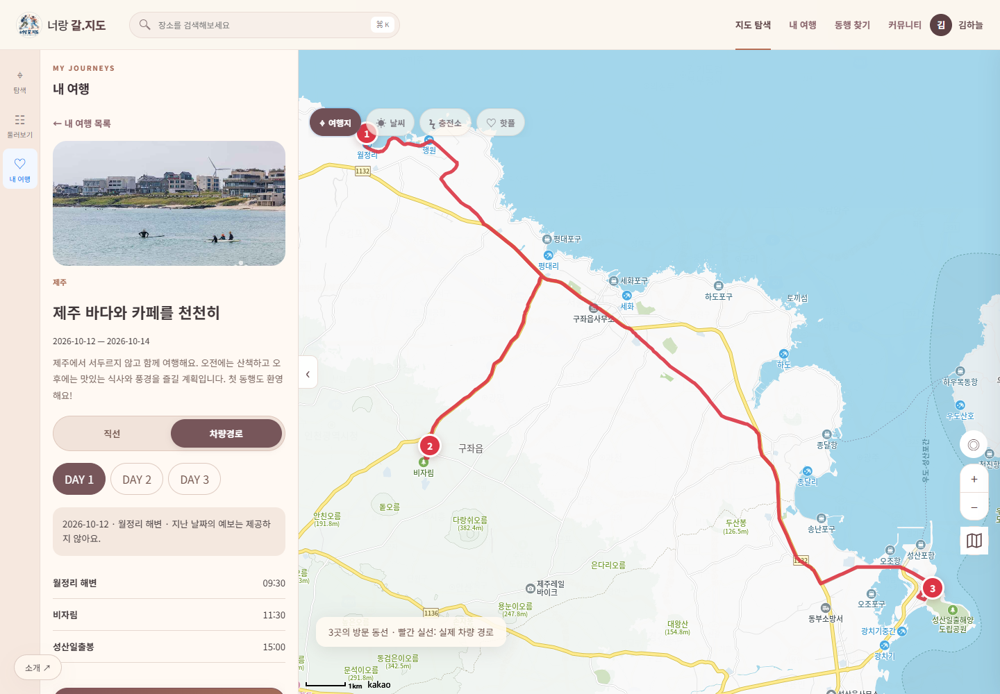

## 3. 내 여행 페이지 — 내 계획을 카드로 관리하기

### 저장 계획 목록과 세부 정보

상단 **내 여행** 메뉴에서 내가 저장한 여행을 카드로 확인합니다. 카드에는 첫 방문지 사진·여행 기간·장소 수·지역/테마·공유 여부가 표시됩니다. 카드를 누르면 해당 계획의 세부 일정과 편집 화면으로 이동합니다.

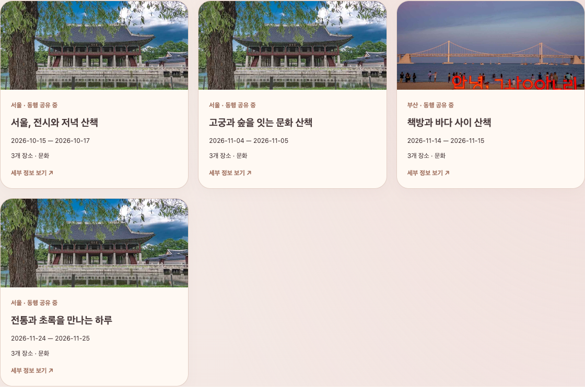

### 새 여행 작성과 날짜별 장소 추가

**＋ 새 여행**을 누르고 여행 제목, 출발일, 종료일, 동행 정원(나 포함), 예상 여행경비, 지역, 테마, 소개를 입력합니다. 지역은 서울·경기·강원·충남·충북·경남·경북·전남·전북·제주·기타 중 선택할 수 있습니다.

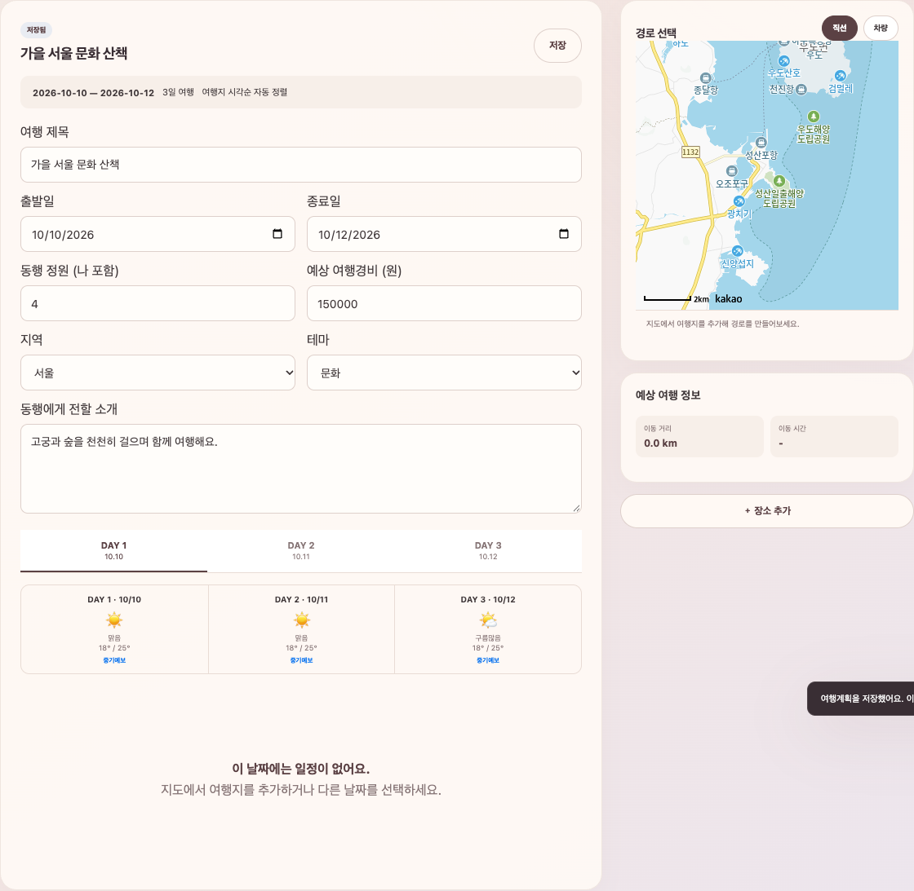

예상 여행 정보 아래 **＋ 장소 추가**를 누르면 지도 탐색으로 이동합니다. 여행지 상세에서 **일정 추가**로 담은 후 내 여행으로 돌아와 각 장소의 DAY·방문 시각·메모를 정리합니다. 일정은 방문 시각순으로 정렬되고 날짜별 날씨와 경로, 예상 이동 거리·시간을 확인할 수 있습니다.

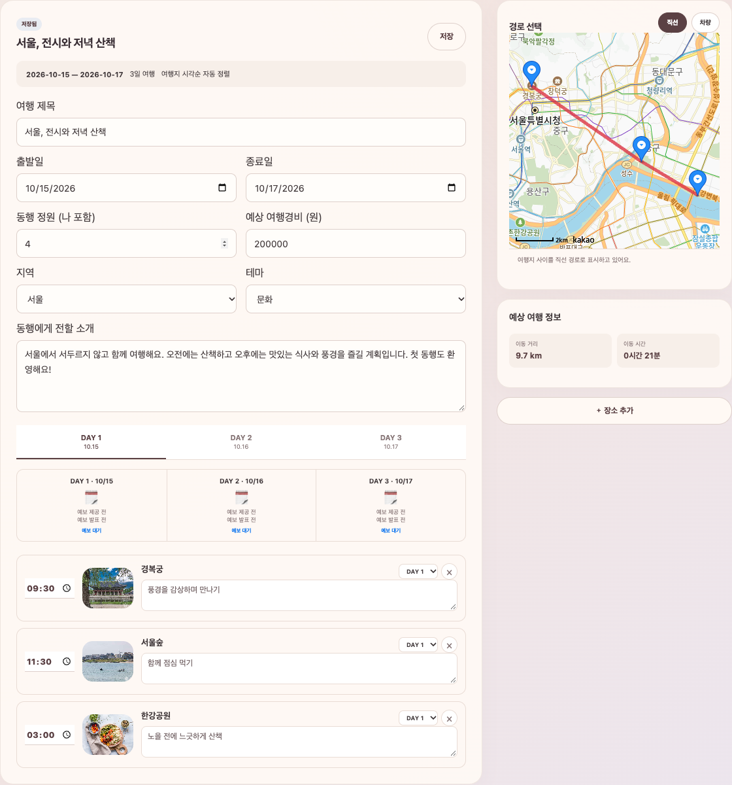

**저장 → 동행 구하기**로 계획을 공유합니다. 이미 공유한 계획은 **공유한 일정 업데이트**로 같은 모집글의 일정을 갱신하며 기존 참가자와 직접 마감한 상태를 유지합니다.

### 동선 최적화로 하루 방문 순서 추천받기

DAY를 선택하고 **동선 최적화**를 누르면 첫 장소와 마지막 장소를 유지하면서 중간 장소의 방문 순서를 추천합니다. 하루 3~12곳을 지원하며, 적용 전 직선거리와 새 방문 시각을 확인할 수 있습니다. 아래 8개 장소 예시에서는 **126.44km → 87.24km로 31.0% 감소**했습니다.

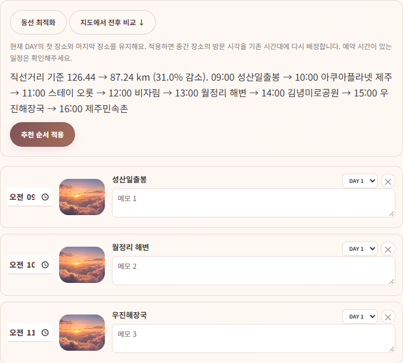

**지도에서 전후 비교 ↓**로 이동하면 기존 동선과 추천 동선을 같은 지도 범위에서 나란히 볼 수 있습니다. **빨강은 최적화 전**, **파랑은 최적화 후**이며 각 지도에 방문 순서 번호를 표시합니다. 최적화 버튼을 누르기 전에는 기존 동선이 표시되고, 누르면 추천 동선이 추가됩니다. 적용·되돌리기·날짜 전환에 맞춰 지도도 갱신됩니다.

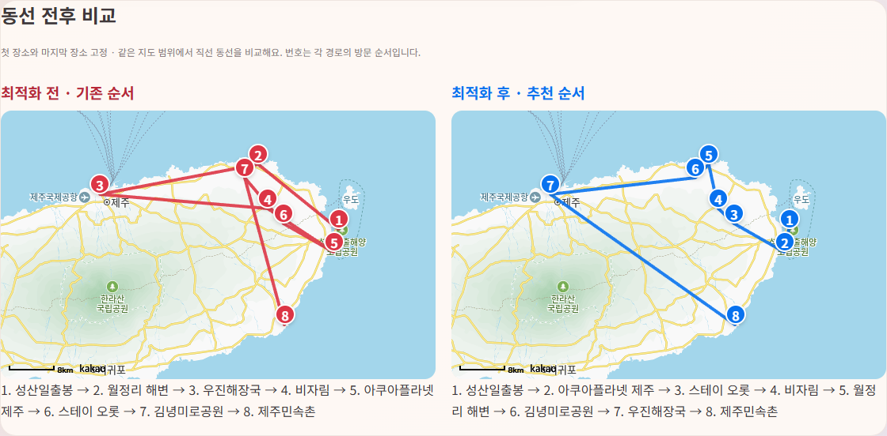

**추천 순서 적용**을 누르면 장소를 기존 시간대에 다시 배정합니다. 메모는 장소와 함께 유지되며 **최적화 되돌리기**로 적용 전 일정으로 돌아갈 수 있습니다. 변경한 일정은 **저장**으로 계획에 반영합니다. 예약 시각이 있는 장소는 적용 전에 확인하세요. 추천 기준은 직선거리이며 실제 차량 경로와 소요시간은 다를 수 있습니다.

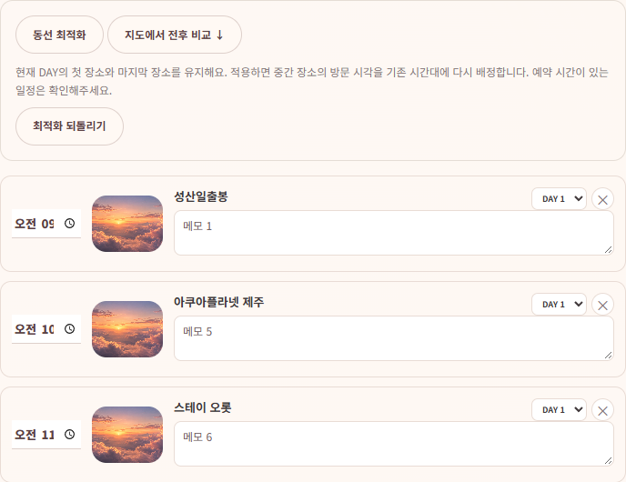

최적화 미리보기·적용 화면은 2026-10-15 별도 브라우저의 체험 일정으로 촬영했으며, 장소 사진은 공통 샘플 이미지로 대체했습니다. 동선 전후 비교는 실제 카카오 지도에 직선 동선을 표시한 화면입니다. 알고리즘과 측정 조건은 [알고리즘 적용 기획 및 정량 검증](./front/docs/ALGORITHM_IMPROVEMENTS.md)에 정리했습니다.

## 4. 동행 찾기 페이지 — 계획을 읽고 질문한 뒤 참가하기

### 공유된 계획 둘러보기

지역·테마·모집 상태·검색어로 여행을 찾습니다. 카드 썸네일은 각 여행의 일정상 첫 방문지 사진이며 모집 상태, 작성자, 참가자와 인원을 확인할 수 있습니다. **내가 참가한 동행만**으로 참여 중인 여행을 모아볼 수도 있습니다.

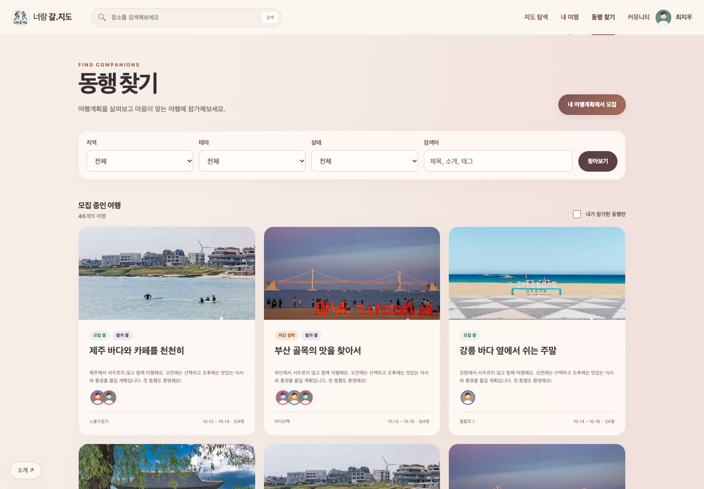

### 동행 참여와 참가 현황

카드를 열면 여행 소개, DAY별 경로·날씨, 방문 일정과 참가자 목록을 봅니다. **참가 신청**으로 참여하고 참여 후에는 **참가 취소**할 수 있습니다. 모집자는 모집글을 수정하고 **참여마감**할 수 있습니다. 정원 때문에 자동 마감된 여행은 참가 취소로 빈자리가 생기면 다시 모집하지만, 모집자가 직접 마감한 상태는 유지됩니다.

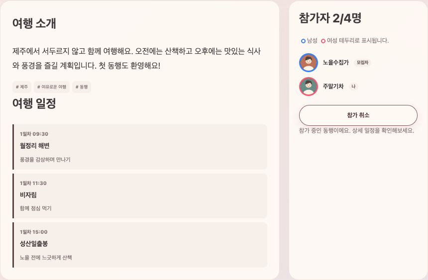

### 참가 전 질문과 답변

상세 맨 아래 **동행 질문과 답변**에서 여행에 관해 질문합니다. 로그인한 회원이면 참가 전에도 댓글·답글을 남길 수 있습니다. 종이비행기로 등록하며 작성자는 자기 댓글을 수정할 수 있습니다. 원댓글이 삭제되어도 달린 답글은 남습니다.

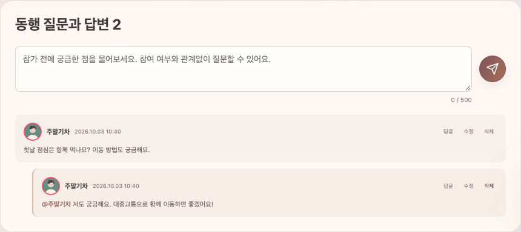

## 5. 커뮤니티 — 여행 경험을 글과 답글로 나누기

### 게시글 작성·수정·삭제

여행정보 공유·공지사항·관광 뉴스 탭에서 글을 검색하고 읽습니다. 로그인한 회원은 여행정보 공유에서 **＋ 글쓰기**로 분류·제목·내용을 작성합니다. 본인이 작성한 글의 상세에서 **수정 / 삭제**할 수 있으며 공지사항과 관광 뉴스 작성은 운영자 계정에서 가능합니다.

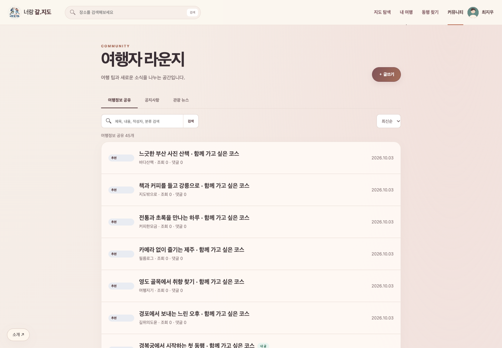

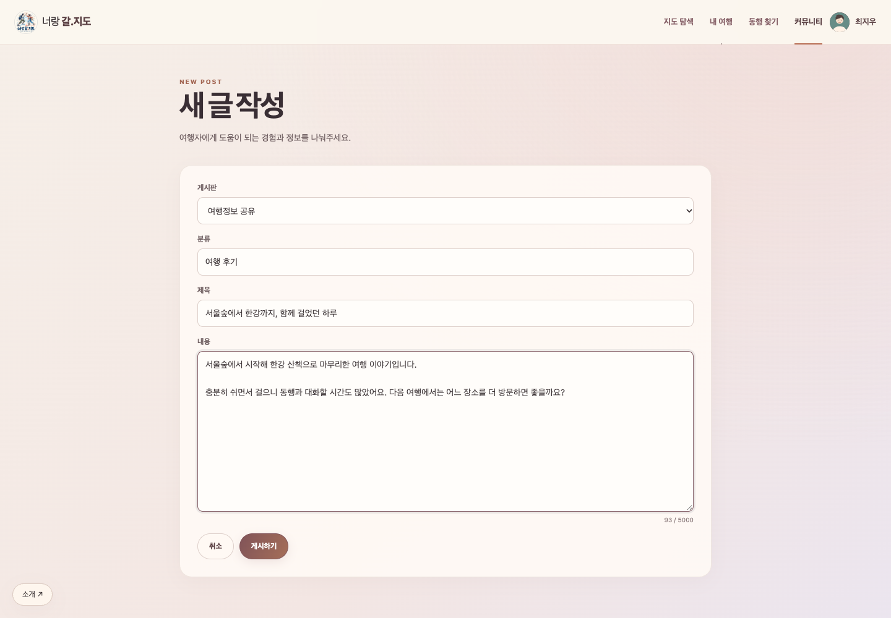

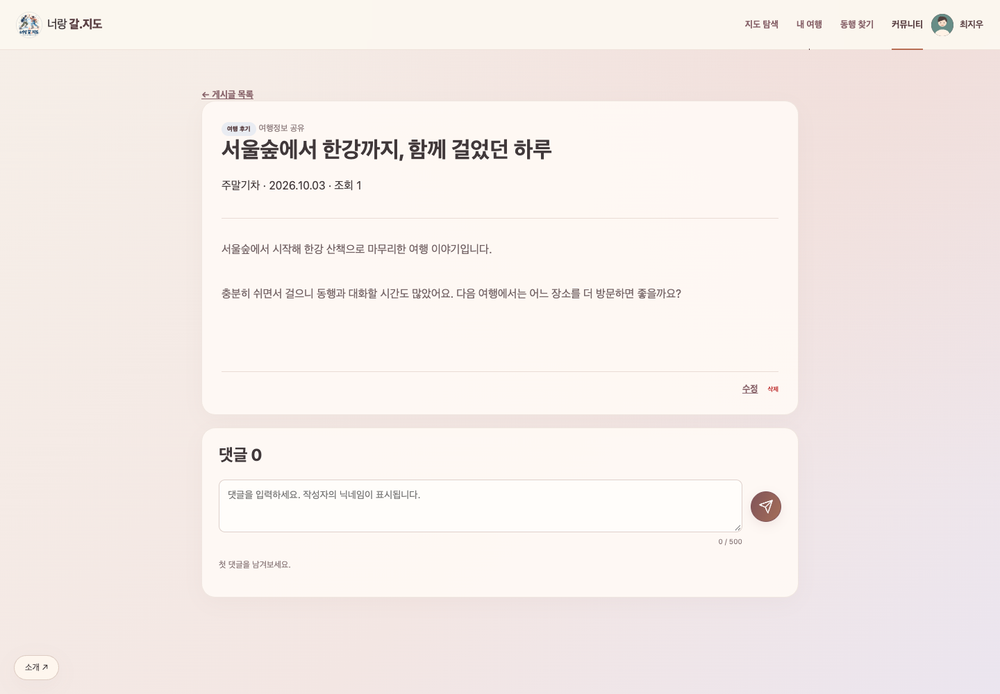

### 댓글과 대댓글

게시글 아래에서 댓글을 입력하고 종이비행기를 눌러 등록합니다. 댓글의 **답글**을 누르면 대댓글을 작성할 수 있고 답글은 해당 원댓글 아래에 표시됩니다. 수정은 댓글 작성자만, 삭제는 댓글 작성자·게시글 작성자·운영자가 할 수 있습니다. 답글이 있는 원댓글을 삭제하면 답글을 보존하고 원댓글에 삭제 표시를 남깁니다.

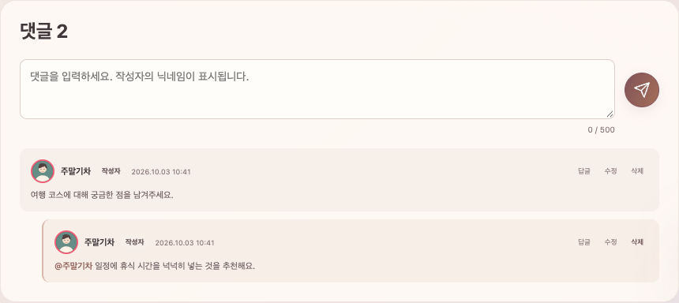

## 6. 회원가입 — 내 여행을 저장할 계정 만들기

1. 우측 프로필에서 회원 화면을 열고 **회원가입** 탭을 선택합니다.
2. 이메일, 비밀번호와 확인, 이름, 닉네임, 생년월일, 성별을 입력합니다. 프로필 사진은 선택 사항입니다.
3. 영문·숫자를 포함한 8자 이상 비밀번호를 사용합니다. 만 14세 이상 가입할 수 있으며 서버 DB에서 이메일과 닉네임 중복을 검사합니다.
4. 가입을 완료하면 로그인 상태가 되어 내 여행과 동행·게시판 기능을 이용할 수 있습니다. 로그인 때문에 이동했다면 하던 화면으로 돌아갑니다.

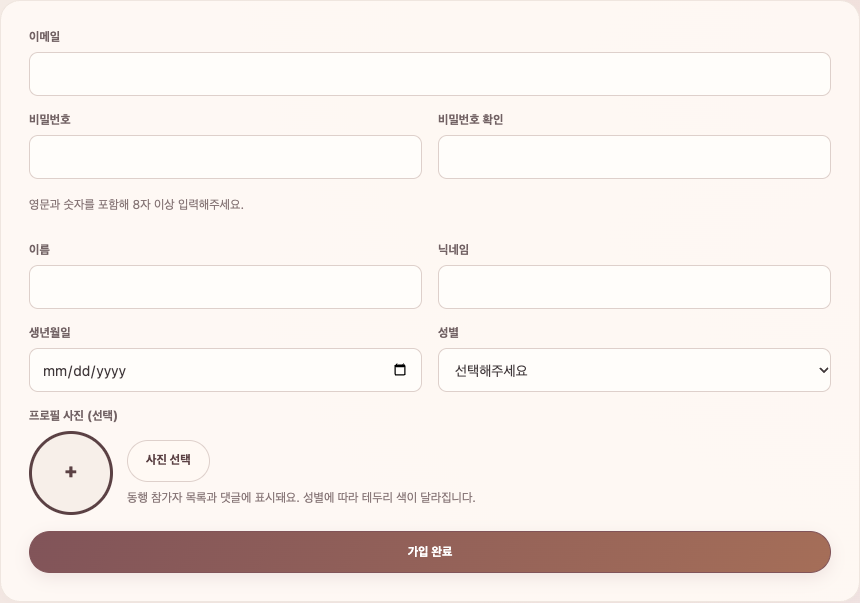

## 7. 로그인과 마이페이지 — 프로필과 내 활동 관리하기

### 로그인

회원 화면의 **로그인** 탭에서 가입한 이메일과 비밀번호를 입력합니다. 서버 시연 계정은 `traveler1@mapmates.test`부터 `traveler10@mapmates.test`까지이며 공통 비밀번호는 `travel1234`입니다. 10번째 계정은 운영자입니다. 로그인 후 서버 세션 쿠키로 인증하며 비밀번호는 PBKDF2 해시로 DB에 저장합니다. 아래 기존 캡처의 계정 목록은 프론트 단독 데모 촬영 당시 화면입니다.

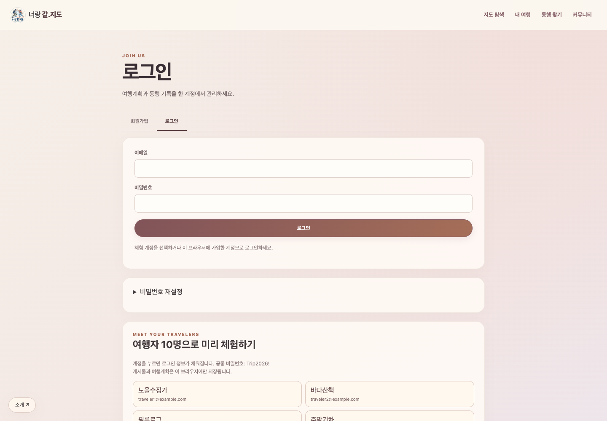

### 로그인 후 닉네임과 프로필 사진 수정

로그인 후 우측 프로필을 누르면 **마이페이지**가 열립니다. 닉네임을 바꾸거나 **사진 선택 → 프로필 저장**으로 사진을 등록할 수 있습니다. 프로필 변경은 내가 작성한 글·댓글·모집글과 참가자 목록에 반영됩니다. 설정에서 비밀번호 변경과 회원탈퇴도 가능합니다.

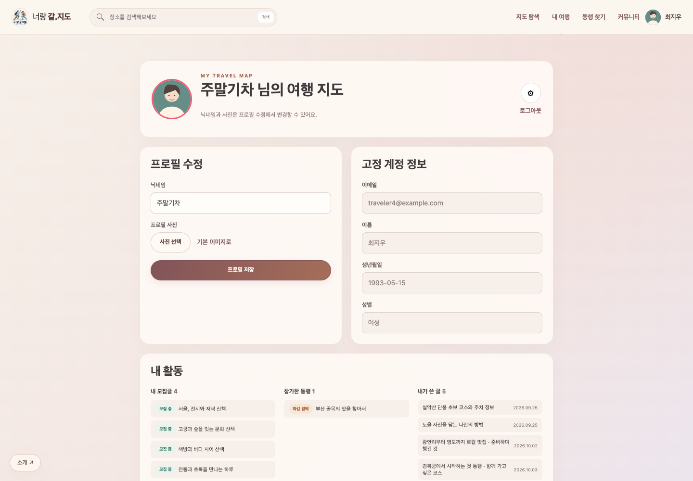

**내 활동**에서 내 모집글, 작성한 글, 참가 중인 동행을 확인하고 해당 콘텐츠로 이동합니다.

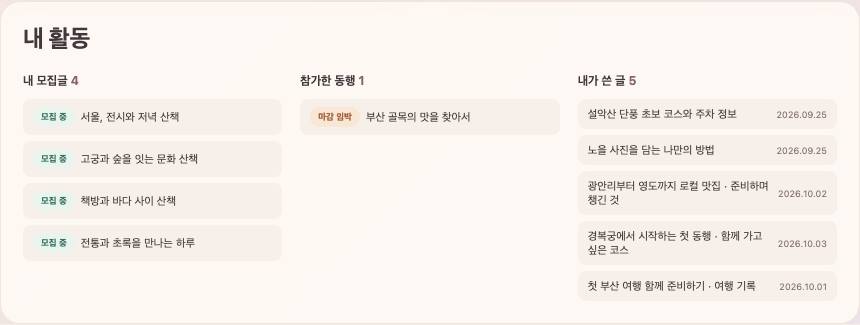

## 백엔드·DB 연동 후 실제 실행 화면

기존 사용법 캡처에 더해, **2026-11-08 서버와 MySQL에 연결한 화면**을 함께 남겼습니다. 별도의 브라우저 세션 두 개로 계획 저장·동행 참여·질문·게시글·댓글이 공유되는 것을 확인했습니다.

### 카카오맵과 DB 관광지

실제 카카오 지도 타일 위에 MySQL 관광지 조회 결과를 표시합니다. 관광지 데이터는 동봉한 공공 관광정보 50,915행에서 조회하며, 카카오맵에는 JavaScript 키와 등록 도메인이 필요합니다.

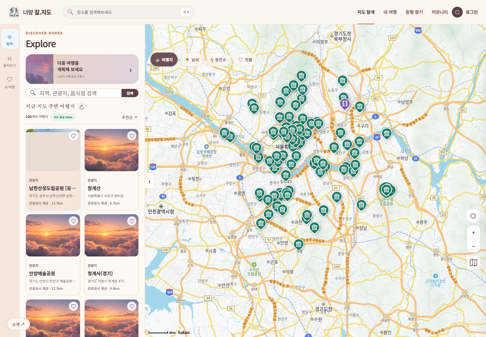

### 계획 저장·동행 공유·다른 회원의 참가

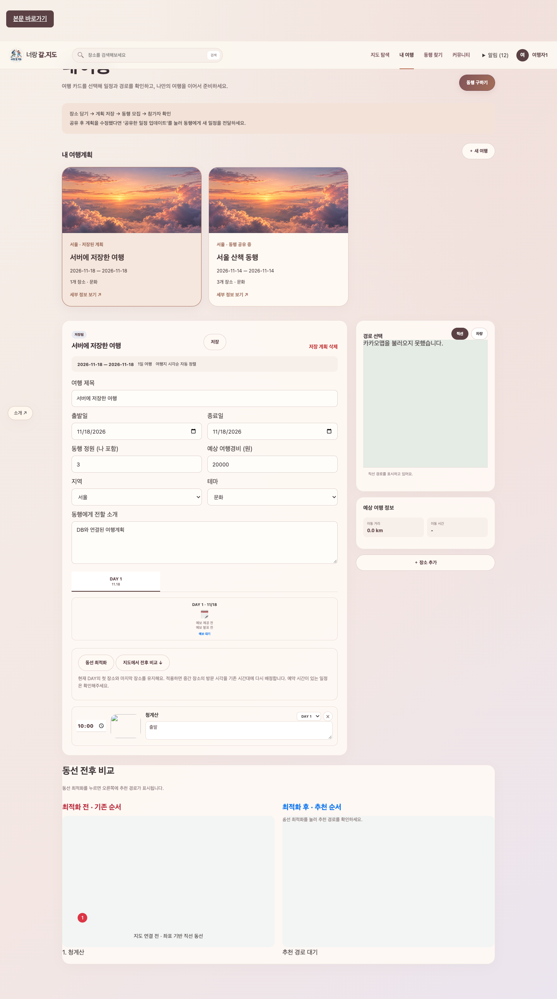

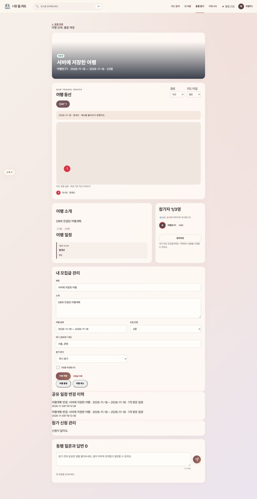

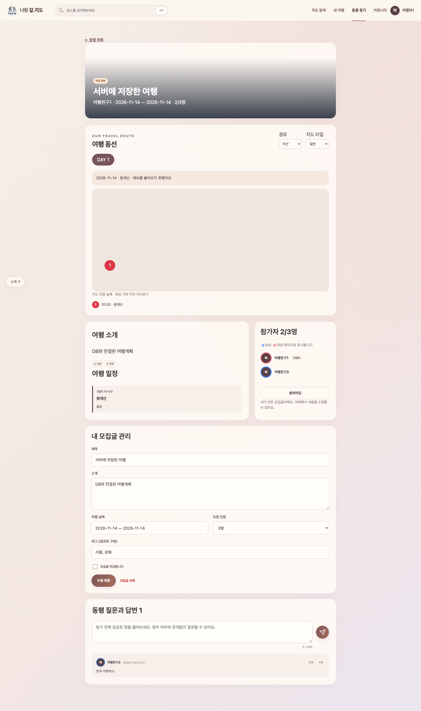

### 게시글·댓글 공유와 모바일

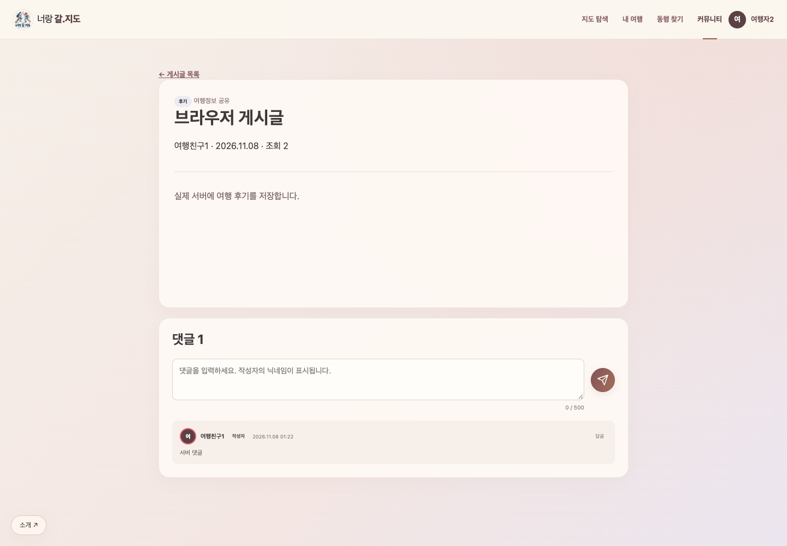

<details>
<summary>모바일 동행 목록 보기</summary>

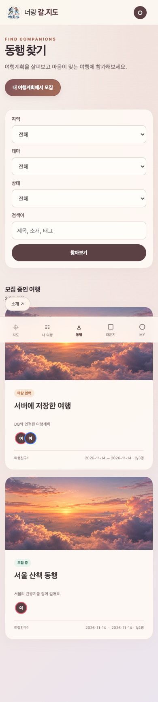

</details>

## 화면 캡처 안내

화면별 사용법의 기존 이미지는 2026-10-03 당시 앱을 별도 Chrome 브라우저에서 직접 조작해 캡처했습니다. 기존 캡처는 기능의 사용 순서를 보여주며, 현재 서버 연동 검증 화면은 바로 위 절에 구분해 실었습니다. 지도·날씨·충전소·로드뷰는 실제 API 화면이고, 회원·여행계획·질문·게시글은 브라우저 체험 데이터입니다. 촬영을 위한 가입·작성·참가 작업은 사용자의 기존 브라우저 데이터를 변경하지 않습니다. 외부 API 응답, 지도 위치, 로그인 계정과 데이터에 따라 표시 내용은 달라질 수 있습니다.

주변 여행지·필터·충전소·핫플 4개 캡처는 **2026-10-15 용산구 중심, 지도 하단 축척 막대 500m**로 다시 촬영했습니다. 충전소와 핫플은 검색 패널과 일반 여행지 핀을 숨겨 해당 핀이 잘 보이게 했습니다. 관광지·지도·충전 현황은 실제 API 응답이며, 핫플 집계는 실제 관광지 좌표를 담은 별도 브라우저의 촬영용 체험 계획을 사용했습니다.

날씨·지도 타입·로드뷰 도로 표시도 같은 용산구 범위로 갱신했습니다. 로드뷰 팝업은 광화문광장에서 광화문을 바라본 화면이며, 둘러보기는 로드뷰를 끈 일반 지도입니다. 동행 참가·내 여행의 동선 확인 화면은 카카오모빌리티 응답으로 실제 차량 경로를 표시한 상태로 촬영했습니다.

종류별 지도 아이콘 적용 후 메인 지도 캡처를 다시 촬영했으며, 일반·위성·지형도 3종도 동일한 용산구 중심과 축척으로 비교할 수 있게 추가했습니다.

## 알고리즘 적용

내 여행의 **동선 최적화**는 비트마스크 DP로 첫 장소와 마지막 장소를 유지하면서 하루 방문 순서를 추천합니다. 적용 전에 직선거리와 새 방문 시각을 비교하고, 적용 직후 되돌릴 수 있습니다. 프론트 단독 데모의 **핫플 TOP 10**은 최소 힙으로 상위 장소를 선정하고, 서버 모드의 핫플은 전체 회원의 DB 계획을 집계합니다.

기존 8개 장소 예시에서 직선거리 **31.0% 감소**, 합성 후보 10만 개의 TOP 10 선정에서 비교 횟수 **93.4% 감소**를 확인했습니다. 측정 조건·제한과 구현 내용은 [알고리즘 적용 기획 및 정량 검증](./front/docs/ALGORITHM_IMPROVEMENTS.md)을 참고하세요.

## API 성능 개선 실측

관광지 50,915행과 임시 계획 50개·일정 500개로 개선 전후를 직접 측정했습니다. 같은 로컬 Docker 환경에서 시나리오별 워밍업 10회 후 60회 순차 요청했으며, 네 요청의 응답 내용이 전후 일치하는 것도 확인했습니다.

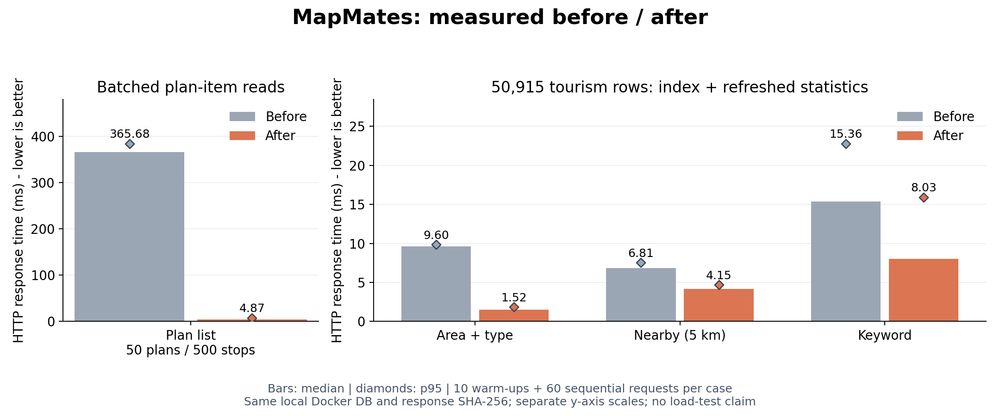

| 요청 | 개선 전 중앙값 / p95 (ms) | 개선 후 중앙값 / p95 (ms) | 중앙값 감소율 |
|---|---:|---:|---:|
| 내 여행계획 50개·일정 500개 | 365.68 / 384.17 | 4.87 / 7.78 | 98.7% |
| 서울 음식점 목록 | 9.60 / 9.85 | 1.52 / 1.86 | 84.1% |
| 서울 중심 5km 주변 관광지 | 6.81 / 7.53 | 4.15 / 4.71 | 39.1% |
| 관광지 이름에 박물관 포함 | 15.36 / 22.78 | 8.03 / 15.93 | 47.7% |

계획별 일정 조회를 일괄 조회로 바꾸고, 관광지 페이지 정렬용 복합 인덱스와 통계 갱신을 적용했습니다. 그래프의 막대는 중앙값, 마름모는 p95이며 두 패널의 세로축 범위는 다릅니다. 단일 로컬 실행 결과이며 운영 부하 성능을 의미하지 않습니다. 주변·키워드 검색은 통계와 실행 환경 영향을 포함한 비교 항목입니다. [측정 조건·원시 표본·재현 방법](./docs/benchmarks/README.md)을 공개합니다.

## 구현 스택

| 구분 | 사용 기술·역할 |
| --- | --- |
| 화면·스타일 | HTML5, CSS3, 반응형 레이아웃 |
| 프론트엔드 | Vanilla JavaScript, ES Modules, Fetch API |
| 화면 상태 | 서버 API 데이터 초기화, 작성 초안·지도 설정용 Web Storage |
| 백엔드 | Java 17, Jakarta Servlet 6.0, Tomcat 10.1, MVC 구조 |
| API·직렬화 | JSON API, Jackson, Java Time |
| DB 접근 | JDBC, HikariCP 연결 풀, PreparedStatement, Service 트랜잭션 |
| 데이터베이스 | MySQL 8.0.46, InnoDB, utf8mb4, PK·FK·UNIQUE·CHECK·INDEX |
| 인증 | HttpSession, HttpOnly·SameSite 쿠키, PBKDF2-HmacSHA256 |
| 지도·경로 | Kakao Maps JavaScript SDK, Kakao Mobility Directions API·서버 프록시 |
| 관광 데이터 | 한국관광공사 관광정보 덤프 50,915행, 단독 데모의 TourAPI 연동 |
| 날씨·기타 | 기상청 단기·중기예보, 전기차 충전소 API, Sunrise-Sunset API |
| 빌드·실행 | Maven WAR, Docker 다단계 빌드, Docker Compose |
| 검증 | JUnit, 실제 HTTP 통합 테스트, Playwright·Chrome, MySQL 검증 SQL |

## 백엔드와 DB에 추가한 내용

| 영역 | 저장·처리 내용 |
| --- | --- |
| 회원·인증 | 가입·중복 검사·로그인·프로필·비밀번호 변경·탈퇴, 서버 세션과 비밀번호 해시 |
| 관광지 | 시도·구군·종류·검색어·지도 주변 조회, 누락 장소 등록 후 FK 참조 |
| 여행계획·찜 | 여러 계획과 일정 저장·조회·수정·삭제, 계획과 일정 일괄 저장 및 실패 시 롤백 |
| 동행 | 계획당 모집글 하나, 재공유 시 참가자·직접 마감 유지, 참가·취소·모집 마감·재개 |
| 정원 동시성 | 계획 행 `FOR UPDATE`와 READ COMMITTED로 마지막 자리 동시 참가 검사 |
| 게시판·댓글 | 작성자·운영자 권한, 공지·뉴스 관리, 검색·정렬·페이지 처리, 댓글·대댓글·삭제 표시 |
| 인기 장소 | 전체 회원의 계획을 관광지별로 집계해 현 지도 범위 TOP 10 반환 |
| 외부 API 설정 | 브라우저용 `/config.js`와 서버용 REST 키 분리, 길찾기 프록시 |

사진 등록형 핫플은 현재 서비스의 계획 기반 인기 장소로 변경했습니다. 뉴스 자동 크롤링은 이번 범위에서 제외하고 운영자 수동 작성을 지원합니다. 비밀번호 찾기는 이메일로 받은 20분 유효 일회용 링크를 사용합니다. 로컬에서는 Mailpit에서 메일을 확인하고, 운영에서는 인증된 SMTP를 설정합니다. 요청·응답 형식은 [API 명세](./docs/API.md)에 정리했습니다.

### 추가 기능과 기술 보완

- 모집자가 **즉시 참가 / 승인제**를 선택합니다. 승인제에서는 참가 소개를 보내고 모집자가 승인·거절합니다. 마지막 자리의 동시 승인도 정원을 초과하지 않습니다.
- 신청·승인·댓글·일정 변경은 상단 알림함에서 확인하고 읽음 처리합니다. 여행의 진행·종료·취소 상태와 공유 일정 변경 이력을 제공합니다.
- 여러 탭에서 같은 계획을 수정하면 버전 충돌을 알려 이전 저장 내용을 보호합니다. 종료된 여행의 참가 기록은 유지합니다.
- 게시글·동행·댓글을 신고하고 회원을 차단할 수 있습니다. 마이페이지에서 차단을 해제하고 신고 결과를 확인하며, 운영자는 별도 관리 화면에서 처리 사유를 기록합니다.
- DB 연결 풀, 목록 일괄 조회와 서버 페이지 검색을 적용했습니다. 비밀번호 복구·로그인 요청을 제한하고 비밀번호 변경 시 기존 세션을 무효화합니다.
- GitHub/GitLab CI, 상태 확인 API, 백업·분리 DB 복구, Caddy HTTPS 배포 구성을 추가했습니다. **현재는 로컬 실행이며 공개 서버에 배포하지 않았습니다.**

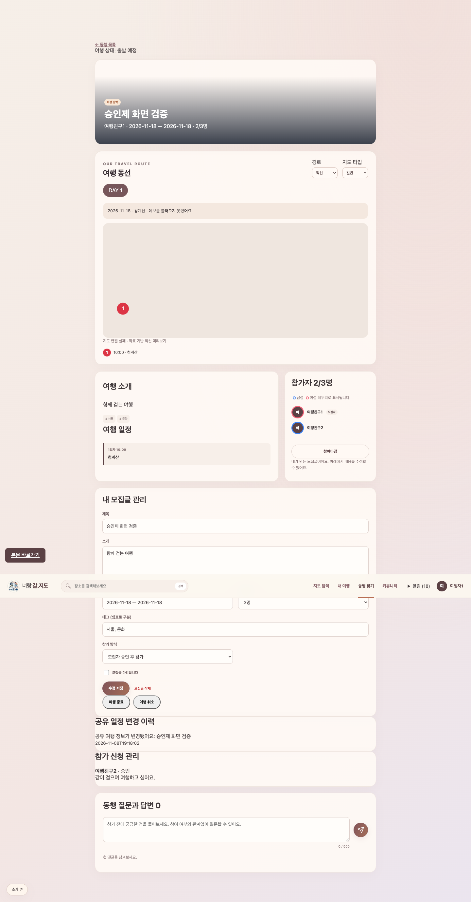

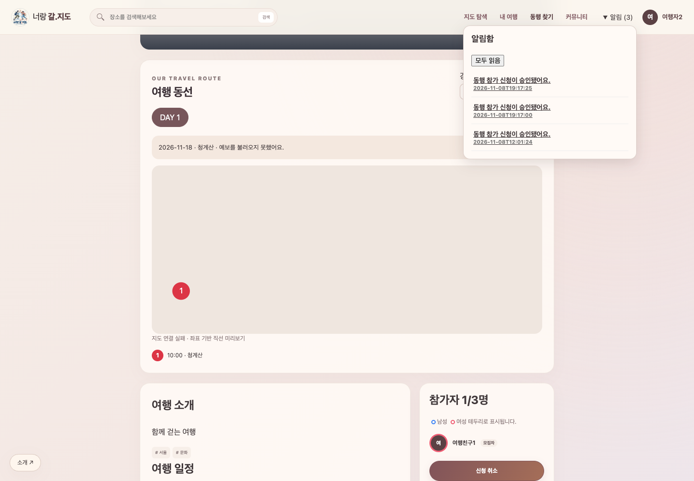

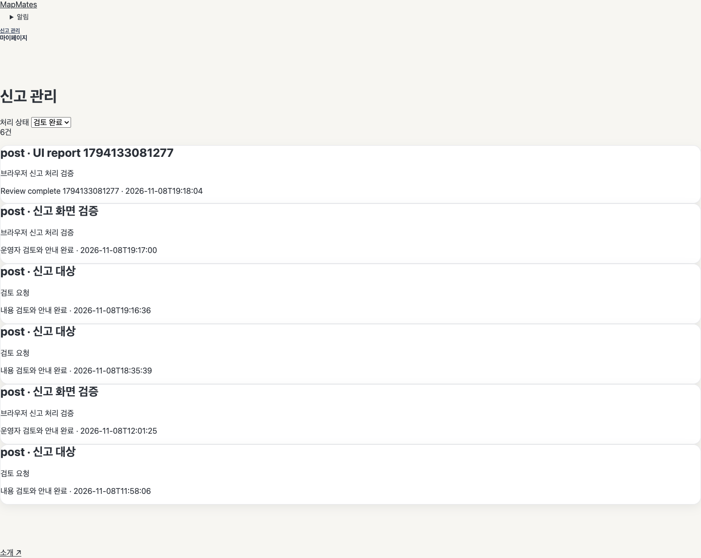

320px·390px 모바일에서 승인·알림·신고와 이메일 복구 흐름을 검증했습니다. 알림함의 화면 경계·닫기 동작·터치 영역과 요청 중 중복 제출 방지를 보완했습니다. [모바일 화면](./docs/screenshots/mobile/02-notifications.png) · [모바일 복구 검증](./docs/validation/2026-11-08-mobile-recovery.txt)

GitLab 파이프라인은 프로젝트에 활성 Runner가 없어 대기 중입니다. 로컬과 GitHub Actions에서 검증하며 공개 배포는 진행하지 않습니다. [운영·마이그레이션·백업·CI 안내](./docs/OPERATIONS.md)

## 데이터베이스 설계 — ERD

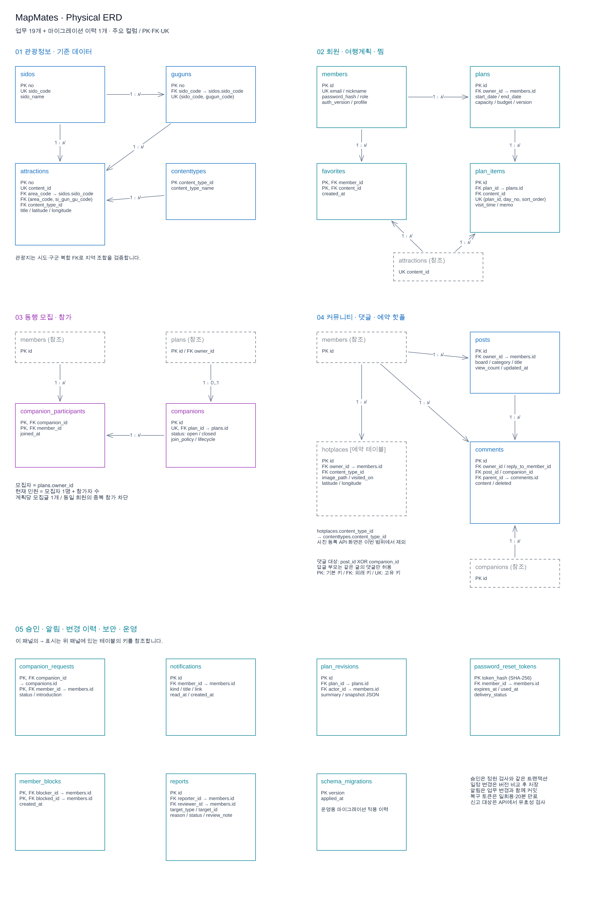

[ERD 크게 보기](./docs/diagrams/erd.png) · [편집 가능한 ERD 원본](./docs/diagrams/erd.excalidraw) · [전체 컬럼·자료형·제약조건 DDL](./db/schema-current.sql)

그림은 주요 컬럼과 FK 관계를 도메인별로 나누어 보여줍니다. 점선의 참조 카드는 같은 테이블을 다른 패널에서 다시 표시한 것이며 테이블이 추가되는 것은 아닙니다. `hotplaces`는 기존 설계·검증 이력과 호환되는 예약 테이블로 현재 사진 등록 API·화면은 연결하지 않습니다. 관계의 NULL 허용 여부와 전체 컬럼·인덱스는 DDL이 최종 기준입니다.

| 구분 | 테이블 |
| --- | --- |
| 관광정보·기준 데이터 | `sidos`, `guguns`, `contenttypes`, `attractions` |
| 회원·계획·찜 | `members`, `plans`, `plan_items`, `favorites` |
| 동행 | `companions`, `companion_participants` |
| 커뮤니티 | `posts`, `comments` |
| 승인·알림·변경 이력 | `companion_requests`, `notifications`, `plan_revisions` |
| 복구·신고·차단 | `password_reset_tokens`, `reports`, `member_blocks` |
| 스키마 이력 | `schema_migrations` |
| 예약 | `hotplaces` |

시도·구군은 복합 FK로 올바른 지역 조합을 검증하고, 계획당 모집글은 UNIQUE로 제한합니다. 참가·찜은 복합 PK로 중복을 막고, 댓글은 게시글 또는 동행 중 한 대상만 참조하도록 CHECK를 둡니다. 여행 기간은 1~14일, 동행 정원은 모집자 포함 2~10명입니다. [AI 검토·개선 기록](./db/AI_REVIEW.md)과 [SQL 검증 결과](./docs/validation/2026-11-08-sql.txt)를 함께 제공합니다.

## 프로젝트 구조

```text
mapmates/
├─ front/                       # 기존 HTML·CSS·JavaScript 화면
│  ├─ index.html                # 지도 탐색·여행 둘러보기·내 여행
│  ├─ planner.html              # 여행계획·일정 편집
│  ├─ companions.html           # 동행 목록
│  ├─ companion-detail.html     # 참가·모집 관리·질문과 답변
│  ├─ community.html            # 커뮤니티·공지·뉴스
│  ├─ post-*.html               # 게시글 작성·상세
│  ├─ signup.html / mypage.html # 계정·프로필
│  ├─ js/server-api.js          # API 통신·서버 데이터 초기화
│  ├─ js/shared.js              # 공통 화면 상태·초안
│  ├─ css/ · assets/ · tests/
│  └─ docs/                     # 기존 캡처·알고리즘·트러블슈팅
├─ back/
│  ├─ pom.xml                   # Java 17·Maven WAR
│  └─ src/
│     ├─ main/java/com/mapmates/
│     │  ├─ common/             # 설정·세션·필터·트랜잭션·JSON
│     │  ├─ member/             # 회원·인증
│     │  ├─ catalog/            # 관광지·지역·인기 장소
│     │  ├─ travel/             # 계획·찜·동행
│     │  └─ community/          # 게시판·댓글
│     └─ test/                  # JUnit 검증
├─ db/
│  ├─ schema.sql                # 정식 DDL
│  ├─ seed.sql                  # 서버 시연 데이터
│  ├─ ref/                      # 공공 관광정보 원본
│  └─ init/ · verify/           # 초기 적재 보완·SQL 검증
├─ docs/                        # API·설계·검증 결과
│  ├─ diagrams/                # 구조도·ERD 이미지와 원본
│  └─ screenshots/backend/     # 서버 연동 후 실제 화면
├─ scripts/                     # HTTP·브라우저·실제 지도 검증
├─ Dockerfile · Dockerfile.mysql
├─ compose.yaml                # Tomcat·MySQL 실행 구성
└─ .env.example                # 키·DB 환경변수 예시
```

## 실행 방법

Docker Desktop 실행 후 저장소 루트에서:

```sh
docker compose up -d --build
```

http://localhost:8080/mapmates/index.html 에 접속합니다. 첫 빌드는 이미지·Maven 의존성을 다운로드하며 DB 초기화에는 관광지 50,915행을 적재합니다. 기존 MySQL이 필요하지 않고 호스트에 DB 포트를 공개하지 않습니다. 데이터는 Docker 볼륨에 보존됩니다. 로컬 복구 이메일은 http://localhost:8026 에서 확인합니다. 종료는 `docker compose down`으로 합니다.

시연 계정은 `traveler1@mapmates.test` ~ `traveler10@mapmates.test`, 비밀번호는 `travel1234`입니다. 10번은 운영자입니다. 초기 데이터는 회원 10명, 계획·동행 각 1개, 게시글 2개, 댓글 1개입니다. 프론트 단독 실행의 체험 데이터와 별개입니다.

### 카카오맵과 외부 API

루트 `.env`에 로컬 키를 넣습니다. `.env`는 커밋하지 않습니다.

```dotenv
MAPMATES_KAKAO_JS_KEY=발급받은_JavaScript_키
MAPMATES_KAKAO_REST_KEY=발급받은_모빌리티_REST_키
MAPMATES_WEATHER_API_KEY=기상청_키
MAPMATES_EV_CHARGER_API_KEY=충전소_키
```

설정 변경 후 `docker compose up -d web`으로 반영합니다. 카카오 JavaScript SDK 도메인에는 **`http://localhost:8080`**, **`http://127.0.0.1:8080`**을 등록합니다. `https://`와 `http://`는 다르며 `/mapmates` 경로는 도메인 등록에 넣지 않습니다. 카카오맵 서비스 활성화도 필요합니다.

`/mapmates/config.js`는 브라우저용 설정만 제공합니다. 모빌리티 REST 키는 서버에서만 사용합니다. 관광지 검색은 동봉한 관광정보 DB를 사용하므로 TourAPI 키 없이 동작합니다. 지도·날씨·충전 현황 등 외부 서비스는 해당 키와 API 사용 권한이 필요합니다.

### Docker 없이 실행하기

Docker 없이 실행하려면 새 MySQL 8 DB에 `db/schema-current.sql`, `USE ssafy_trip;`를 `USE mapmates;`로 바꾼 관광지 덤프, `db/init/03-clean.sql`, `db/seed.sql` 순으로 적재합니다. **스키마 전체 파일은 새 DB 구축용이며 기존 서비스 DB에 재실행하지 않습니다.** 기존 Docker DB는 `python3 scripts/migrate.py`로 미적용 변경만 반영한 뒤 웹 이미지를 다시 빌드합니다. 전체 DDL은 기준 스키마와 변경 SQL에서 생성한 파일입니다.

환경변수 `MAPMATES_DB_URL`, `MAPMATES_DB_USER`, `MAPMATES_DB_PASSWORD`를 설정하거나 `back/src/main/resources/application.properties.example`을 복사해 설정합니다. Java 17 이상과 Maven으로 `mvn -f back/pom.xml verify` 후 `back/target/mapmates.war`를 Tomcat 10.1에 배포합니다.

프론트만 확인하려면 `node front/dev-server.js`를 사용합니다. 이 경우 브라우저 데모 모드이며 서버에 데이터를 저장하지 않습니다. 서버 모드는 DB 장애를 데모 데이터로 숨기지 않습니다.

### 프론트 단독 데모 실행과 기존 설정

기존 프론트 개발 서버·설정 예시도 유지합니다. 이 모드는 브라우저 체험 데이터로 동작합니다.

```sh
cp front/config.example.js front/config.js
node front/dev-server.js
```

[http://localhost:5500](http://localhost:5500)에서 확인합니다. 프론트 전용 `config.js`의 지도·TourAPI·날씨·충전소 설정과 사용법은 [기존 프론트 안내](./front/README.md#실행-방법)에 보존했습니다. 서버 모드에서는 루트 `.env`와 `/mapmates/config.js`를 사용합니다.

## 데이터 저장 방식

| 데이터 | 서버 실행 | 프론트 단독 데모 |
| --- | --- | --- |
| 회원·프로필·비밀번호 | MySQL, 비밀번호는 PBKDF2 해시 | 기존 브라우저 체험 데이터 |
| 로그인 | 서버 HttpSession·쿠키 | 브라우저 데모 상태 |
| 저장 계획·일정·찜 | MySQL | localStorage |
| 동행·참가·게시글·댓글 | MySQL, 다른 브라우저와 공유 | 같은 브라우저의 체험 상태 |
| 작성 중 초안·지도 설정 | 사용자별 localStorage | localStorage |
| 인기 장소 | 전체 회원 DB 계획 집계 | 현재 브라우저의 계획 집계 |

서버 모드는 기존 데모 계정·평문 비밀번호를 자동으로 서버에 옮기지 않습니다. 브라우저 저장소를 지워도 DB에 저장한 데이터는 유지됩니다. 초기 시연 데이터의 규모와 계정은 위 실행 방법을 참고하세요.

## 검증과 트러블슈팅

```sh
python3 scripts/test_api.py
python3 scripts/test_features.py
python3 scripts/schema_snapshot.py --check
# 별도 Playwright 설치 필요. 기존 모듈은 PLAYWRIGHT_MODULE로 지정 가능
node scripts/test_browser.cjs
node scripts/test_features_browser.cjs
node scripts/test_map.cjs
node front/tests/algorithms.cjs
```

API 테스트는 별도 검증 계정을 만들고 종료 시 삭제합니다. 브라우저 테스트는 시연 계정으로 생성한 계획·게시글을 정리합니다. 기존 DB 검증은 별도 `mapmates_erd_check` 스키마에서 실행합니다.

Java 단위 테스트 4개, SQL 33개, HTTP 통합 7개 시나리오, 브라우저 12개 항목이 통과했습니다. 추가 기능 API 9개 시나리오와 기능 브라우저 8개 항목도 통과했으며 실제 카카오 SDK·지도 타일·DB 관광지 표시도 확인했습니다. [통합 검증 보고서](./docs/VALIDATION.md)에 결과와 화면을 정리했습니다. 외부 날씨·충전소·차량 경로는 각 서비스의 키와 사용 권한이 필요합니다.

프론트 단계의 기존 검증과 문제 해결 과정도 보존합니다. [기능 검증 보고서](./front/docs/FEATURE_AUDIT.md), [트러블슈팅](./front/docs/TROUBLE_SHOOTING.md), [알고리즘 검증](./front/docs/ALGORITHM_IMPROVEMENTS.md)을 참고하세요.

## 데이터 출처와 저장소

- [한국관광공사 국문관광정보 서비스](https://www.data.go.kr/data/15101578/openapi.do)
- [카카오 지도 Web API](https://apis.map.kakao.com/web/) · [카카오모빌리티 길찾기 API](https://developers.kakaomobility.com/docs/navi-api/directions/)
- [기상청 단기예보](https://www.data.go.kr/data/15084084/openapi.do) · [중기예보](https://www.data.go.kr/data/15059468/openapi.do)
- 한국환경공단 전기자동차 충전소 정보 · [Sunrise-Sunset API](https://sunrise-sunset.org/api)
- [기존 SGIS API 참고 자료](https://sgis.kostat.go.kr/developer/html/main.html)
- [GitHub — 기록용 저장소](https://github.com/77romin/mapmates)
- [SSAFY GitLab — 과제 제출 저장소](https://lab.ssafy.com/s16/a11/project/6.database/3-kkm-mye)
