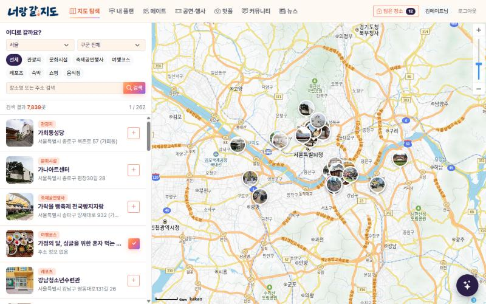
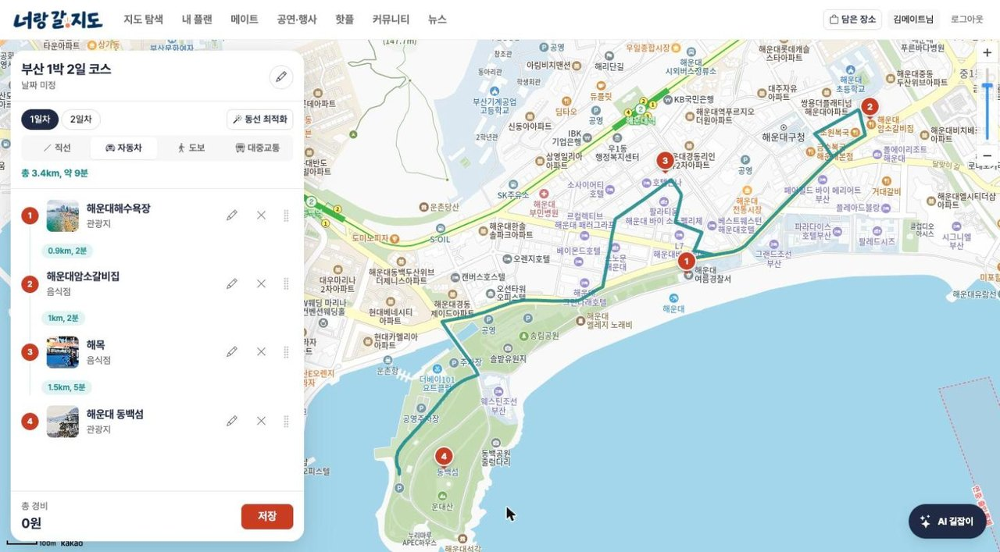
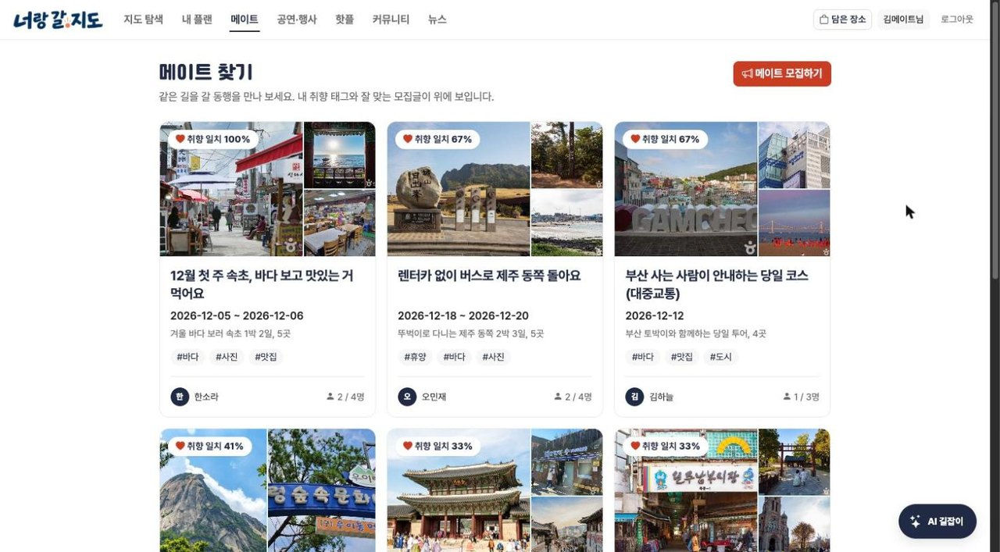
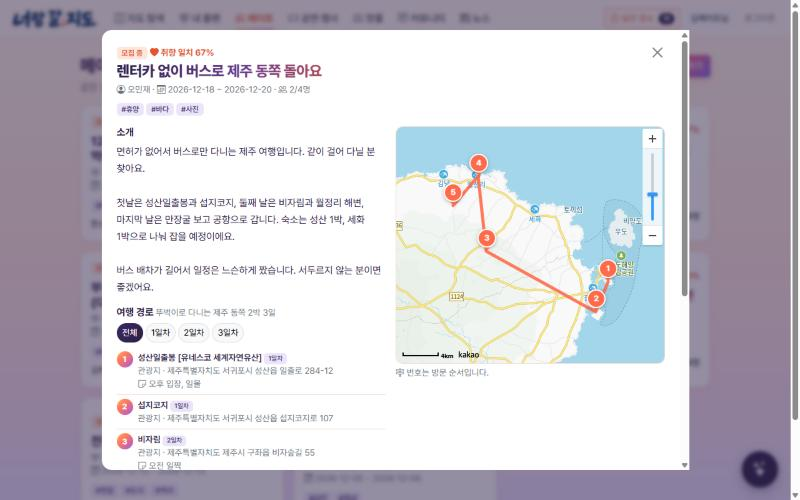
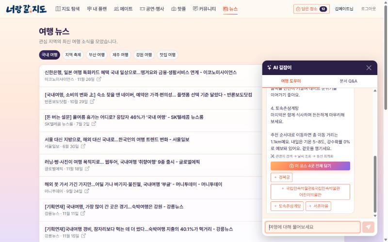
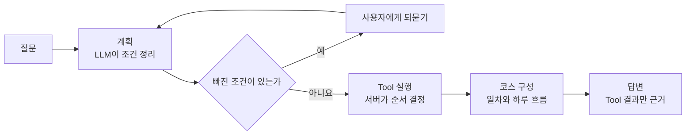
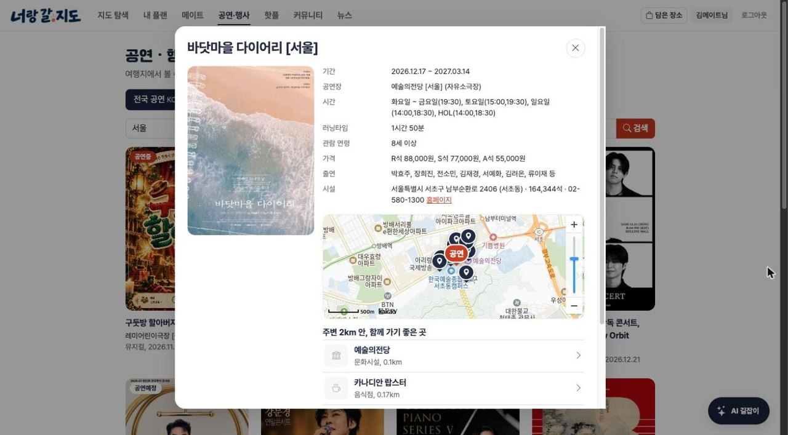
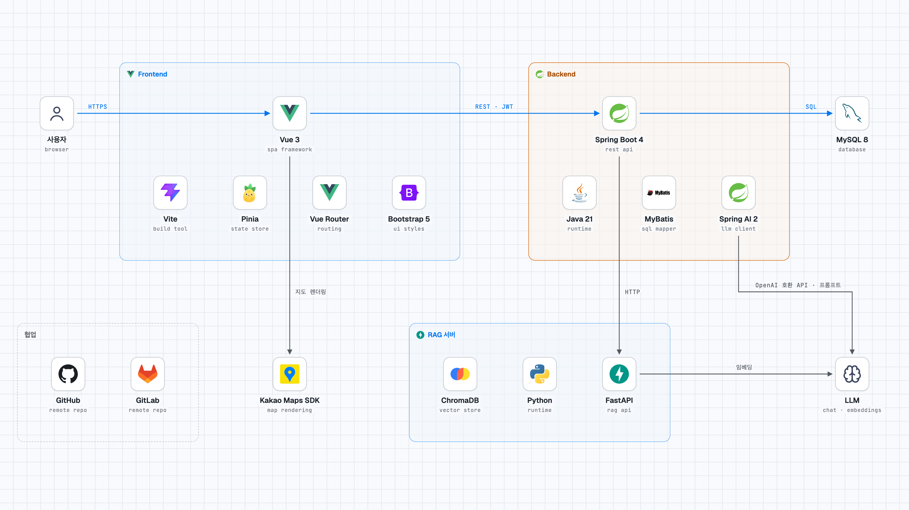

<div align="center">


# 너랑 갈.지도 · mapmates

**너랑 갈 다음 여행을 지도 위에**

지도 한 장 위에서 여행 경로를 짜고, 같이 갈 메이트를 만나고, AI에게 코스를 묻는 여행 플래너




</div>

## 왜 만들었나

여행을 준비할 때 관광지, 날씨, 공연, 충전소 정보를 서비스마다 따로 찾아야 했고, 담아 둔 장소를 어떤 순서로 돌지는 손으로 정해야 했습니다. 같이 갈 사람을 구하더라도 계획은 메신저로 따로 맞춰야 했습니다.

너랑 갈.지도는 이 세 가지를 지도 한 장 위에서 해결합니다.

- 흩어진 여행 정보를 지도 위에 모읍니다.
- 버튼 하나로 동선을 정리합니다.
- 계획 자체를 매개로 동행을 만나고, 같은 계획을 함께 고칩니다.
- AI가 추측이 아니라 실제 데이터에 근거해 코스를 제안합니다.

## Route · 지도 위에서 경로 짜기

장소를 찾아 담고, 일정으로 엮고, 순서와 이동 수단까지 정합니다.



| 기능 | 설명 |
| --- | --- |
| 지도 탐색 | 시도·구군·유형별 관광지 5만여 건을 사진 핀으로 봅니다. 가까운 핀은 묶어서 개수로 보여주고, 지도를 옮기면 보이는 영역 안에서 필터가 적용됩니다. |
| 장소 상세 | 사진, 날씨, 일출·일몰, 소개 글과 함께 주변 축제·상권, 전기차 충전소를 확인합니다. |
| 플랜 보드 | 일차 탭으로 일정을 나누고 드래그로 순서를 바꿉니다. 방문지별 경비를 더해 예산과 비교합니다. |
| 동선 최적화 | 방문지 12곳 이하는 비트마스크 DP로 최적해를, 그보다 많으면 최근접 이웃 + 2-opt로 근사해를 구합니다. |
| 이동 수단별 경로 | 자동차·도보는 실제 도로 경로와 구간별 거리·시간을 보여주고, 대중교통은 구간별 길찾기로 연결합니다. |

## Mates · 함께 갈 사람 만나기

플랜을 공개해 메이트를 모으고, 수락된 메이트와 같은 계획을 함께 고칩니다.

<table>
<tr>
<td width="50%"></td>
<td width="50%"></td>
</tr>
<tr>
<td align="center">메이트 찾기 · 취향 일치도가 높은 모집글부터</td>
<td align="center">모집 상세 · 소개 글과 일차별 경로</td>
</tr>
</table>

| 기능 | 설명 |
| --- | --- |
| 취향 일치도 | 내 취향 태그와 모집글 태그의 코사인 유사도를 %로 보여주고 높은 순으로 정렬합니다. |
| 모집과 신청 | 모집글에서 경로를 확인하고 한마디를 남겨 신청합니다. 모집자가 수락하거나 거절합니다. |
| 공동 편집 | 수락된 메이트는 같은 플랜을 함께 고칩니다. |
| 중간 집결지 | 메이트들의 출발지에서 이동 거리 합이 가장 작은 지점(기하 중앙값)을 구하고 그 주변 장소를 추천합니다. |

## AI 길잡이 · 근거 있는 코스 추천

코스를 일차별로 짜서 지도에 바로 보여주고, 그대로 플랜으로 만듭니다.



| 기능 | 설명 |
| --- | --- |
| 되묻기 | 지역, 일수, 여행 속도, 동행이 빠져 있으면 임의로 정하지 않고 사용자에게 묻습니다. |
| 하루 구성 | 오전, 점심, 오후, 저녁 순서로 배치합니다. 여행 속도에 따라 하루 볼거리가 3곳, 5곳, 6곳으로 달라집니다. |
| 지도 표시 | 만든 코스를 메인 지도에 번호 핀과 경로선으로 그리고, 일차별 일정과 소개 글을 함께 보여줍니다. |
| 코스로 플랜 만들기 | 일차 구분을 유지한 채 플랜으로 생성합니다. |
| 문서 Q&A | 업로드한 문서를 근거로 답하고, 근거가 약하면 일반 답변으로 구분합니다(RAG). |



LLM은 계획과 문장을 맡고, 데이터 조회와 순서 계산은 서버가 합니다. DB에 등록된 장소만 사용하므로 없는 장소를 지어내지 않습니다.

## 공연·행사와 커뮤니티



| 기능 | 설명 |
| --- | --- |
| 공연·행사 | KOPIS의 공연 목록·상세·시설 정보와 서울시 문화행사를 보여줍니다. 공연장 주변 2km의 음식점·관광지를 추천하고 바로 플랜에 담습니다. |
| 커뮤니티 | 공지사항, 공유 게시판, 댓글. 게시글 조회수는 같은 사용자에 대해 24시간에 한 번만 셉니다. |
| 핫플레이스 | 지도에서 위치를 고르고 사진을 올려 다녀온 곳을 등록합니다. |
| 여행 뉴스 | 주제별 여행 뉴스를 모아 보여줍니다. |

## 구조



| 구분 | 기술 |
| --- | --- |
| Frontend | Vue 3, Vite, Pinia, Vue Router, Bootstrap 5, Kakao Maps SDK |
| Backend | Java 21, Spring Boot 4, MyBatis, Spring AI 2 |
| AI 서버 | Python, FastAPI, ChromaDB (RAG) |
| Database | MySQL 8 (14개 테이블) |
| 인증 | JWT(HS256), PBKDF2 비밀번호 해시 |
| 외부 데이터 | 한국관광공사 관광정보, 기상청 단기예보, 한국환경공단 전기차 충전소, KOPIS 공연 정보, 서울 열린데이터 광장, OSRM 경로 탐색, 뉴스 RSS |
| LLM | SSAFY GMS (OpenAI 호환) |
| 협업 | GitHub, GitLab |

| 저장소 | 내용 |
| --- | --- |
| [`front`](https://lab.ssafy.com/s16/a11/project/finalproject/mapmates_3-kkm-mye/front) | Vue 3 프론트엔드 |
| [`back`](https://lab.ssafy.com/s16/a11/project/finalproject/mapmates_3-kkm-mye/back) | Spring Boot 4 백엔드 (REST API, Spring AI Tool·Planner) |
| `allfiles` (여기) | 설계 산출물, DDL·더미 데이터, FastAPI RAG 서버, 발표 자료 |

GitHub에서는 세 저장소를 [77romin/mapmates](https://github.com/77romin/mapmates) 하나로 관리한다.

## 산출물 목록

| 구분 | 파일 |
|---|---|
| 요구사항 정의서 | [docs/01_요구사항정의서.md](docs/01_요구사항정의서.md) |
| Usecase Diagram | [docs/02_유스케이스_다이어그램.md](docs/02_유스케이스_다이어그램.md) |
| WBS | [docs/03_WBS.md](docs/03_WBS.md) |
| ERD | [docs/04_ERD.md](docs/04_ERD.md) · DDL [sql/schema.sql](sql/schema.sql) · 초기 데이터 [sql/data.sql](sql/data.sql) · 더미 데이터 [sql/dummy_community.sql](sql/dummy_community.sql), [sql/dummy_mates.sql](sql/dummy_mates.sql) |
| API 설계서 | [docs/05_API설계서.md](docs/05_API설계서.md) |
| Class Diagram | [docs/06_클래스_다이어그램.md](docs/06_클래스_다이어그램.md) |
| 화면 정의서 | [docs/07_화면정의서.md](docs/07_화면정의서.md) · 와이어프레임 [docs/wireframes](docs/wireframes) |
| 알고리즘 적용 기획서 | [docs/08_알고리즘_적용_기획서.md](docs/08_알고리즘_적용_기획서.md) |
| AI 고찰 보고서 (RAG, Spring AI) | [docs/09_AI_고찰보고서.md](docs/09_AI_고찰보고서.md) |
| 발표 자료 | [presentation/너랑갈지도_발표.pptx](presentation/너랑갈지도_발표.pptx) |
| 시연 영상 | [presentation/너랑갈지도_시연영상.mp4](presentation/너랑갈지도_시연영상.mp4) (2분 35초, 자막·배경음악 포함) |
| 실행 화면 캡처 | [docs/screens](docs/screens) |
| 기술 스택 다이어그램 | [docs/stack.png](docs/stack.png) |
| AI 서버 | [ai-server](ai-server) |

다이어그램은 Mermaid로 작성해 GitLab에서 바로 렌더링된다.

## 명세별 충족 현황

| 명세 | 핵심 요구 | 반영 위치 |
|---|---|---|
| 01 Java | 관광지 목록·조건 검색·상세, XML 파싱, 축제·상권 | 지도 탐색·상세 화면, `NewsService`(RSS XML 파싱), 주변 축제·상권 탭 |
| 02 ChatBot | 챗봇 UI, fetch, 문서 업로드, 벡터 검색, RAG, 고찰 | `front` ChatWidget(문서 Q&A), `ai-server`, 고찰 보고서 1부 |
| 03 Front | 관광지 조회, 회원, 계획, 핫플, 게시판, 반응형, 폼 검증, 로컬 스토리지 | `front` 전체 |
| 04 Algorithm | 알고리즘 2개 이상 + 기획서 | 동선 최적화, 메이트 추천, 중간 집결지 + 기획서 |
| 05 Backend | MVC 백엔드, 요구사항·Usecase·Class Diagram | `back`, 문서 01·02·06 |
| 06 DB | ERD, DDL, 초기 데이터, Service·DAO | 문서 04, `sql/`, `back` |
| 07 Spring | Spring + REST API + MyBatis | `back` |
| 09 Spring AI | Tool 구조, 단일·다중 Tool, Planner, 고찰 | `back`의 `tool`·`planner`, 고찰 보고서 2부 |

01(Swing)·05(Servlet/JSP)가 지정한 기술은 별도 버전을 만들지 않고, 기능 요구사항을 최종 웹 애플리케이션에 반영했다.

## 전체 실행 방법

사전 준비: JDK 21, Node 20+, Python 3.12, MySQL 8 (`ssafy` 계정), SSAFY 제공 `ssafy_trip` 관광지 DB

```bash
# 1) DB 생성 + 관광지 데이터 적재 (back 저장소)
mysql -ussafy -p --default-character-set=utf8mb4 < back/src/main/resources/sql/schema.sql
mysql -ussafy -p --default-character-set=utf8mb4 < back/src/main/resources/sql/data.sql

# 2) 백엔드 (http://localhost:8080)
cd back
cp src/main/resources/application-private.properties.example src/main/resources/application-private.properties   # 키 입력
./mvnw spring-boot:run

# 3) AI 서버 (http://localhost:8000)
cd allfiles/ai-server
pip install -r requirements.txt
cp .env.example .env    # GMS_KEY 입력
uvicorn main:app --port 8000

# 4) 프론트엔드 (http://localhost:5173)
cd front
npm install
cp .env.example .env.local    # VITE_KAKAO_MAP_KEY 입력
npm run dev
```

필요한 키: SSAFY GMS 키, 공공데이터포털 인증키(기상청 단기예보, 한국환경공단 전기차 충전소), KOPIS 서비스 키, 서울 열린데이터 광장 인증키, 카카오 지도 JavaScript 키(Web 플랫폼에 `http://localhost:5173` 등록).

시연용 계정은 서버 최초 기동 시 자동 생성된다: `admin`(관리자), `mate1`, `mate2`. 비밀번호는 `back`의 `DataInitializer`에 있다.

## AI 서버 (ai-server)

FastAPI + ChromaDB 기반 RAG 서버다. 문서를 문단 단위로 청킹하고 임베딩해 벡터 DB에 저장하며, 유사도 0.30 이상인 청크만 근거로 답한다.

```
ai-server/
├── main.py            # /chat, /upload, /search, /documents, /health
├── requirements.txt
├── .env.example       # GMS 키, 모델, 청크 크기, 유사도 기준
├── data/              # 업로드 문서 (기본: 여행_준비_가이드.md)
└── chroma_data/       # 벡터 DB (실행 시 생성, git 제외)
```

## 검증 결과 (2026-11-27 ~ 28, 로컬)

| 항목 | 결과 |
|---|---|
| 백엔드 컴파일·기동 | 성공 (Spring Boot 4.1.2, 약 3초) |
| 프론트엔드 빌드 | 성공 (`vite build`) |
| API 통합 호출 | 플랜 생성 → 모집글 → 신청 → 수락 → 중간 집결지, 게시글·댓글, 권한 오류(401·403·404·409) 응답 확인 |
| 동선 최적화 | 부산 8곳 87.4km → 68.9km (Held-Karp) |
| 날씨·충전소 | 기상청·한국환경공단 실데이터 응답 확인 |
| 뉴스 수집 | RSS 30건 수집·저장 확인 |
| Spring AI | simple, single, multi, planner 4개 모드 응답 확인 |
| RAG | 문서 참고 응답 2건, 일반 응답 1건 구분 확인 |
| 이동 수단별 경로 | 자동차 51.6km·81분, 도보 53.9km 실제 도로 경로 표시, 대중교통 구간 링크 확인 |
| 공연 정보 | KOPIS 공연 목록·상세·시설 실데이터 응답, 공연장 주변 장소 추천, AI 공연 검색 Tool 확인 |
| 지도 | 탐색 핀, 플랜 번호 핀·경로선, 충전소 핀, 핫플 위치 선택·등록 확인 |
| 서울시 문화행사 | 요청에 User-Agent를 추가한 뒤 실데이터 응답 확인 (11-28) |
| AI 코스 | 빠진 조건 되묻기, 일차별 구성, 지도 표시, 코스로 플랜 생성 확인 (11-28) |
| 게시글 조회수 | 같은 사용자의 24시간 내 재조회는 세지 않는 것 확인 (11-28) |
| 화면 | 로그인, 회원가입, 지도 탐색·상세, 플랜 보드, 메이트, 공연 상세, 핫플 등록, AI 길잡이 동작 확인 |

확인하지 못한 것

- 휴대폰 폭(390px) 화면은 검증하지 않았다.
- 게시판 화면, 사진 첨부 업로드, 모바일 화면 세부는 직접 눌러 보지 않았다.
- 자동화 테스트 코드는 없다.

알려진 데이터 특성: 제공 관광지 덤프 50,915건 중 94건은 좌표가 국내 범위를 벗어나 있어 지도 표시에서 제외한다.

## 역할 분담

| 영역 | 김강민 ([77romin](https://github.com/77romin)) | 마예은 ([yeeunma](https://github.com/yeeunma)) |
|---|---|---|
| 핵심 주제 | **경로(Route)와 AI** | **동행(Mates)과 커뮤니티** |
| 지도 | 지도 탐색, 사진 핀, 지도 영역 검색, 관광지 상세 | 핫플레이스 등록(지도 위치 선택, 사진 업로드) |
| 여행 계획 | 플랜 보드, 동선 최적화, 이동 수단별 경로 | 메이트 모집·신청·수락, 공동 편집, 모집 상세(지도·경로) |
| 알고리즘 | 동선 최적화(비트마스크 DP, 2-opt) | 취향 일치도(코사인 유사도), 중간 집결지(기하 중앙값) |
| 외부 데이터 | 날씨, 일출·일몰, 충전소, 경로 탐색(OSRM), 관광공사 사진 보충 | KOPIS 공연·서울 문화행사, 주변 장소 팝업, 여행 뉴스 수집 |
| AI | Spring AI Tool·Planner, AI 코스 추천, RAG 서버(FastAPI·ChromaDB), 문서 Q&A | AI 길잡이 챗봇 화면(대화 UI, 코스 전체 담기) |
| 회원·게시판 | - | 회원 가입·로그인·비밀번호 찾기, JWT 인증, 마이페이지, 공지사항, 공유 게시판, 댓글 |
| 공통 | DB 설계(관광지·플랜), 백엔드 구조, 저장소 관리 | DB 설계(회원·메이트·커뮤니티), 초기 화면 테마·모션, 로고 |
| 문서 | API 설계서, 클래스 다이어그램, 알고리즘 기획서, AI 고찰 보고서 | 요구사항 정의서, 유스케이스, 화면 정의서, ERD, WBS, 발표 자료 |
