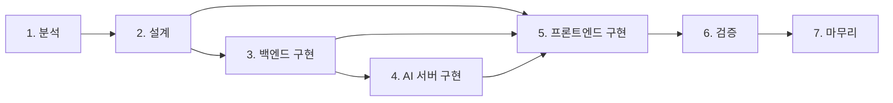

# WBS (Work Breakdown Structure)

| ID | 단계 | 작업 | 산출물 | 저장소 | 상태 |
|---|---|---|---|---|---|
| 1 | 분석 | | | | |
| 1.1 | | 명세서 8종(01~07, 09) 요구사항 분석 | 요구사항 정의서 | allfiles | 완료 |
| 1.2 | | 서비스 컨셉·차별 기능(메이트) 정의 | 요구사항 정의서 | allfiles | 완료 |
| 1.3 | | 유스케이스 도출 | Usecase Diagram | allfiles | 완료 |
| 2 | 설계 | | | | |
| 2.1 | | DB 모델링(14개 테이블), 인덱스·제약조건 | ERD, schema.sql | allfiles, back | 완료 |
| 2.2 | | REST API 설계 | API 설계서 | allfiles | 완료 |
| 2.3 | | 계층 구조·클래스 설계 | Class Diagram | allfiles | 완료 |
| 2.4 | | 화면 구조·와이어프레임·디자인 토큰 | 화면 정의서 | allfiles | 완료 |
| 2.5 | | 알고리즘 선정(동선 최적화, 추천, 집결지) | 알고리즘 적용 기획서 | allfiles | 완료 |
| 3 | 백엔드 구현 | | | | |
| 3.1 | | Spring Boot·MyBatis 설정, 데이터 적재 | 소스 | back | 완료 |
| 3.2 | | 회원·JWT 인증 | 소스 | back | 완료 |
| 3.3 | | 관광지 조회·부가정보(날씨, 일출일몰, 충전소, 주변) | 소스 | back | 완료 |
| 3.4 | | 여행 계획·동선 최적화·중간 집결지 | 소스 | back | 완료 |
| 3.5 | | 메이트 모집·신청·수락·추천 | 소스 | back | 완료 |
| 3.6 | | 핫플레이스·게시판·공지·뉴스 수집 | 소스 | back | 완료 |
| 3.7 | | Spring AI Tool 6종·Planner·챗 API | 소스 | back | 완료 |
| 3.8 | | KOPIS 공연·서울시 문화행사 연동 | 소스 | back | 완료 |
| 4 | AI 서버 구현 | | | | |
| 4.1 | | FastAPI RAG(업로드, 청킹, 임베딩, 검색, 응답) | 소스 | allfiles/ai-server | 완료 |
| 5 | 프론트엔드 구현 | | | | |
| 5.1 | | Vue 3·Bootstrap 설정, 공통 레이아웃·지도 컴포넌트 | 소스 | front | 완료 |
| 5.2 | | 지도 탐색·관광지 상세 | 소스 | front | 완료 |
| 5.3 | | 플랜 보드 | 소스 | front | 완료 |
| 5.4 | | 메이트·핫플레이스·커뮤니티·뉴스 | 소스 | front | 완료 |
| 5.5 | | 회원 화면(로그인, 가입, 비밀번호 찾기, 마이페이지) | 소스 | front | 완료 |
| 5.6 | | AI 길잡이 챗봇 위젯 | 소스 | front | 완료 |
| 5.7 | | 공연·행사 화면 | 소스 | front | 완료 |
| 6 | 검증 | | | | |
| 6.1 | | API 통합 호출 테스트, AI 4개 모드 검증 | 검증 결과(README) | allfiles | 완료 |
| 6.2 | | 화면 동작 확인 | 실행 화면 | allfiles | 완료 |
| 7 | 마무리 | | | | |
| 7.1 | | README, 고찰 보고서 | 문서 | 전체 | 완료 |
| 7.2 | | 발표 자료 | PPT | allfiles | 완료 |
| 7.3 | | 시연 영상(약 3분) 촬영 | UCC | allfiles | 예정 |

## 작업 순서와 의존 관계

- 백엔드의 Spring AI(3.7)는 관광지·플랜 서비스(3.3, 3.4)를 Tool로 재사용하므로 그 뒤에 진행했다.
- 문서 검색 Tool은 AI 서버(4.1)의 `/search`를 호출하므로 두 작업을 이어서 진행했다.
- 프론트엔드는 API가 확정된 뒤 화면 단위로 구현했다.
