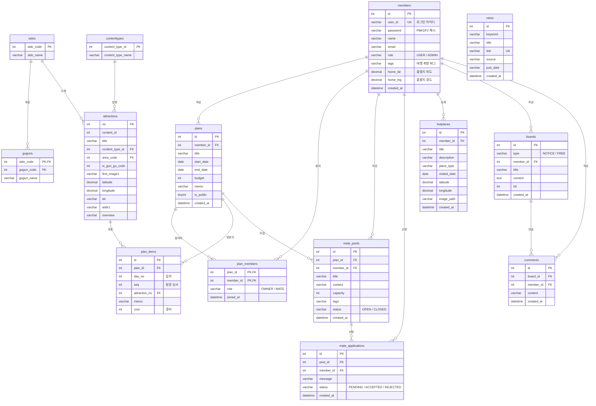

# ERD

DDL은 [`sql/schema.sql`](../sql/schema.sql), 초기 데이터 적재는 [`sql/data.sql`](../sql/data.sql)에 있다.

## 설계 근거

| 항목 | 내용 |
|---|---|
| 정규화 | 지역(시도·구군)과 콘텐츠 유형을 코드 테이블로 분리했다. 플랜과 방문지는 1:N, 플랜과 회원은 N:M이므로 `plan_members`로 풀었다 |
| 메이트 모델 | 메이트 수락 = `plan_members`에 행 추가. 권한 검사(공동 편집)와 인원 집계가 한 테이블로 해결된다 |
| 무결성 | 회원·플랜·게시글 삭제 시 하위 데이터는 `ON DELETE CASCADE`. `mate_applications(post_id, member_id)`에 UNIQUE를 걸어 중복 신청을 막는다 |
| 조회 성능 | `attractions(area_code, si_gun_gu_code, content_type_id)` 복합 인덱스로 지역+유형 필터를 처리하고, `(latitude, longitude)` 인덱스로 주변 검색의 사각형 범위 조건을 처리한다 |
| 기본값 | `role='USER'`, `status='OPEN'/'PENDING'`, `budget=0`, `created_at=CURRENT_TIMESTAMP` |
| 뉴스 중복 방지 | `news.link`에 UNIQUE를 걸고 `INSERT IGNORE`로 재수집 시 중복을 건너뛴다 |
| 구군 PK | 제공 덤프의 구군 코드는 시도마다 1부터 다시 시작하므로 `(sido_code, gugun_code)` 복합 PK로 정의했다 |

## 초기 데이터

- 제공 덤프의 약 25%(12,800여 건)는 대표 사진이 비어 있다. 상세 조회 시 한국관광공사 API에서 사진을 찾으면 `attractions.first_image1`에 채워 넣는다.

- 관광지 50,915건, 시도 17건, 구군 234건, 콘텐츠 유형 8건 (SSAFY 제공 한국관광공사 덤프)
- 더미 회원 3명(관리자 1, 일반 2)과 공지 1건은 서버 최초 기동 시 `DataInitializer`가 생성한다
- 시연용 더미 스크립트: `dummy_community.sql`(회원 6명, 공지 5건, 게시글 15건, 댓글 37건), `dummy_mates.sql`(플랜 7건과 방문지 31곳, 모집글 7건, 참여·신청 내역). 여러 번 실행해도 중복되지 않는다

## 생성형 AI를 활용한 스키마 검증에서 반영한 점

- 구군 테이블의 단일 컬럼 PK가 중복될 수 있다는 지적 → 복합 PK로 변경
- 주변 검색이 전체 테이블을 훑는다는 지적 → 좌표 인덱스 추가 및 사각형 범위 선필터 적용
- 제공 덤프의 콘텐츠 유형 39번 이름이 '관광지'로 잘못 들어 있음 → `data.sql`에서 '음식점'으로 보정
