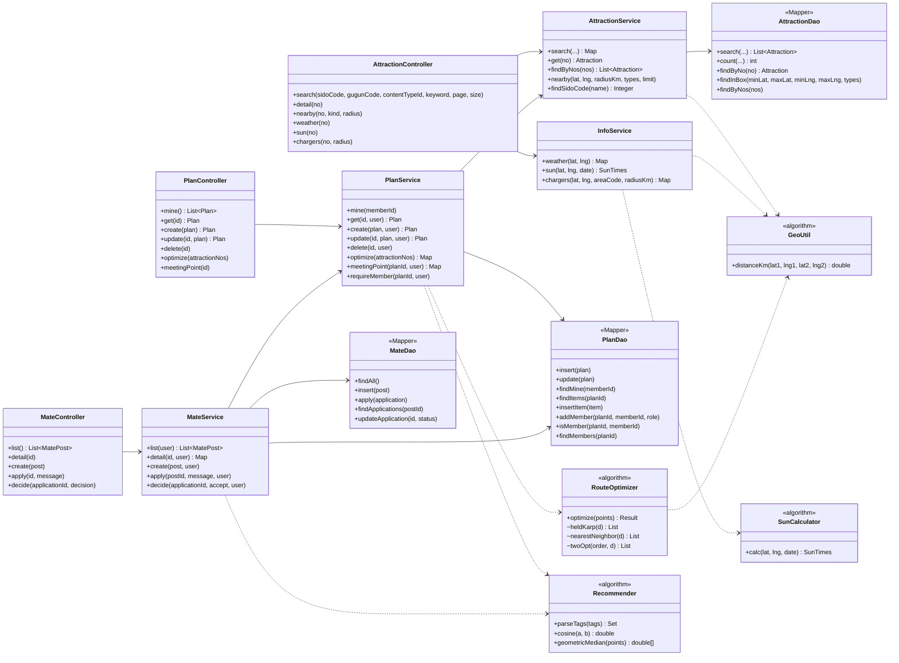
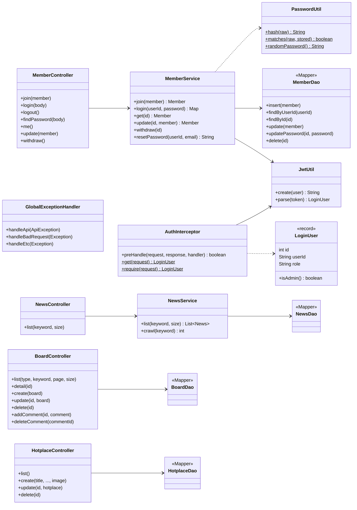
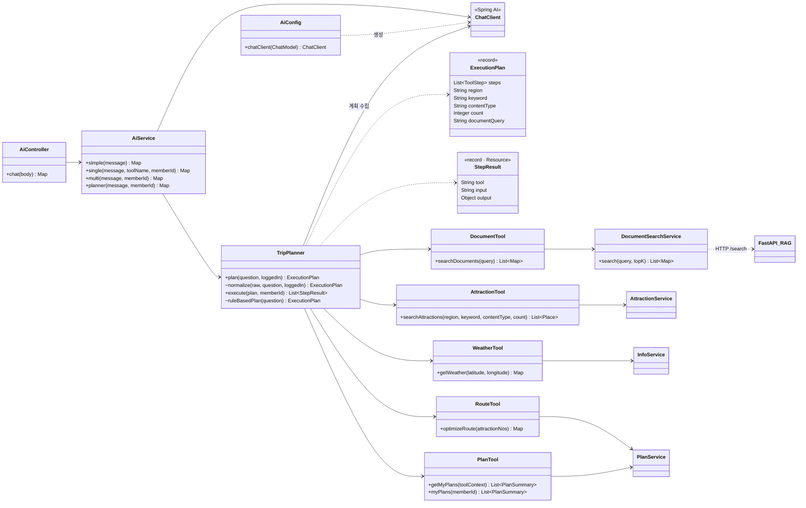
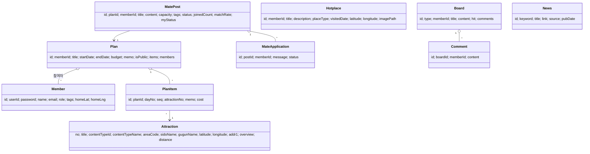

# Class Diagram (Spring & MyBatis)

패키지: `com.ssafy.mapmates`

| 패키지 | 역할 |
|---|---|
| `controller` | REST 요청 수신, 인증 사용자 확인, 서비스 호출 |
| `service` | 비즈니스 로직, 외부 API 연동, 트랜잭션 |
| `dao` | MyBatis Mapper 인터페이스 (SQL) |
| `dto` | 테이블·응답 데이터 객체 |
| `tool` | LLM이 호출할 수 있는 기능 단위 (`@Tool`), 로직은 service에 위임 |
| `planner` | 다중 Tool 호출 순서 계획·검증·실행 |
| `algorithm` | 동선 최적화, 추천, 거리·일출일몰 계산 |
| `config` | Web(CORS, 인터셉터), Spring AI(ChatClient, Prompt), 초기 데이터 |
| `common` | JWT, 비밀번호 해시, 인증 인터셉터, 예외 처리 |

## 1. 계층 구조 (여행 도메인)

## 2. 회원 · 인증 · 커뮤니티

공연·문화행사는 `CultureController → CultureService`(KOPIS XML, 서울 열린데이터 JSON 연동)로 구성하고, 주변 장소 추천은 `AttractionService.nearby`를 재사용한다. AI에서는 `CultureTool`이 `CultureService`를 호출한다.

게시판·핫플레이스는 단순 CRUD라 Controller가 Mapper를 직접 사용한다. 권한 검사와 입력 검증은 Controller에서 수행한다.

## 3. Spring AI (Client / Tool / Resource / Prompt / Planner)

| 역할 | 구현 |
|---|---|
| Client | `AiController` + `AiService` — 요청 수신, 호출 흐름 선택, 최종 응답 조립 |
| Tool | `tool` 패키지 5종 — 한 Tool은 한 가지 책임만, 실제 로직은 Service에 위임 |
| Resource | `StepResult` — Tool 실행 결과. 다음 Tool의 입력과 최종 Prompt의 근거로 사용 |
| Prompt | `resources/prompts/system.txt`, `planner.txt` + `AiService`의 결과 통합 프롬프트 |
| Planner | `TripPlanner` — 계획(LLM) → 검증(서버) → 실행(서버) |

## 4. DTO

