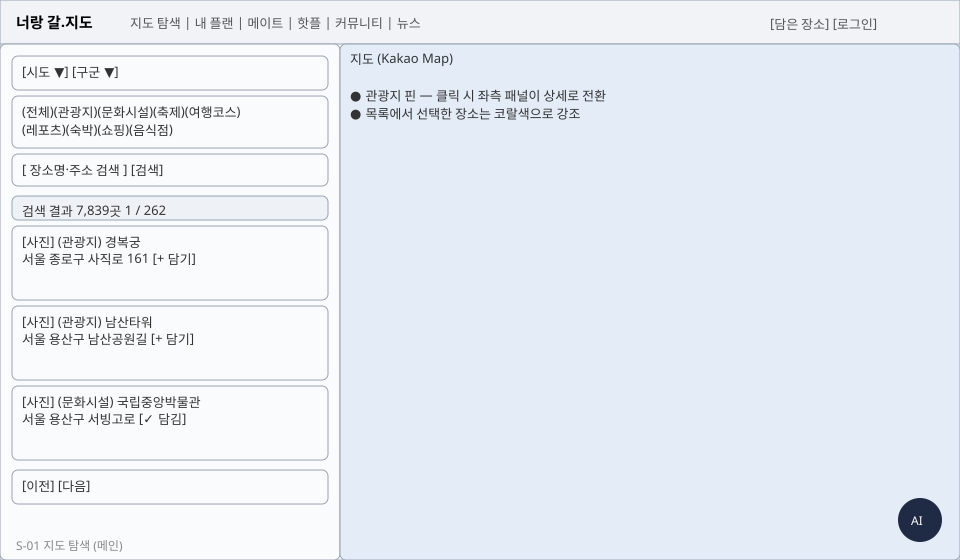
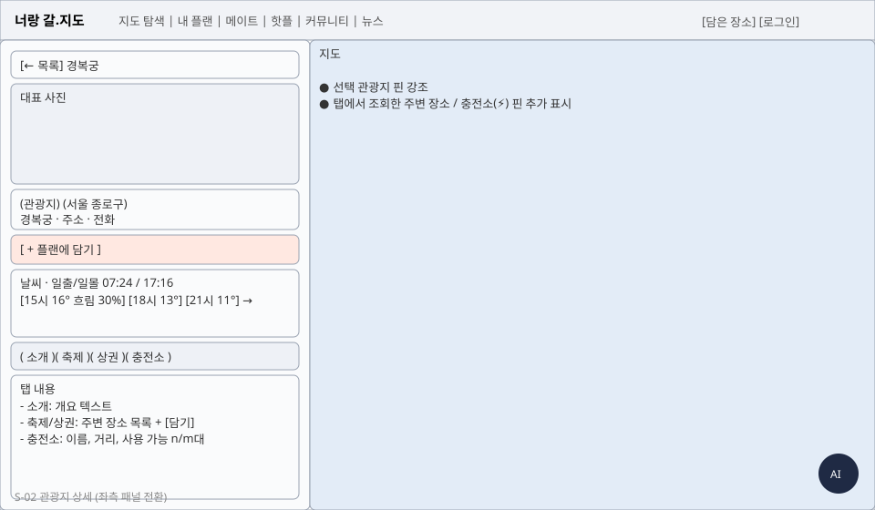
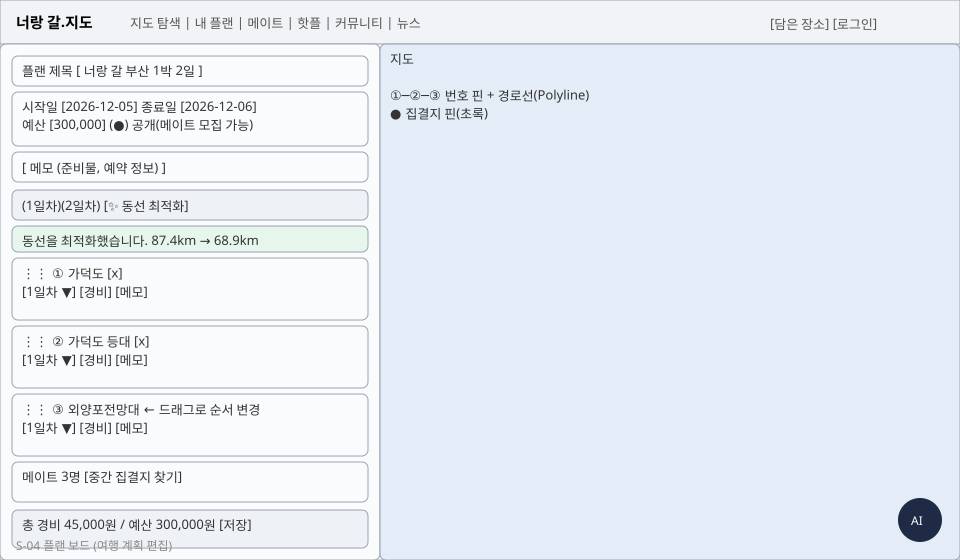
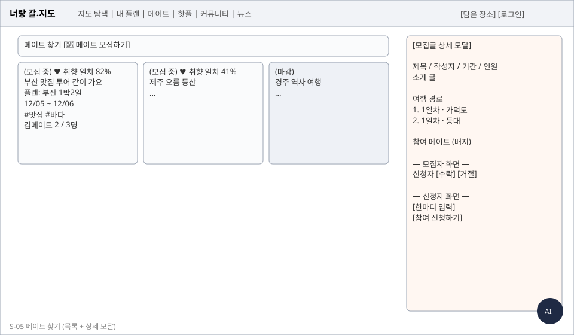
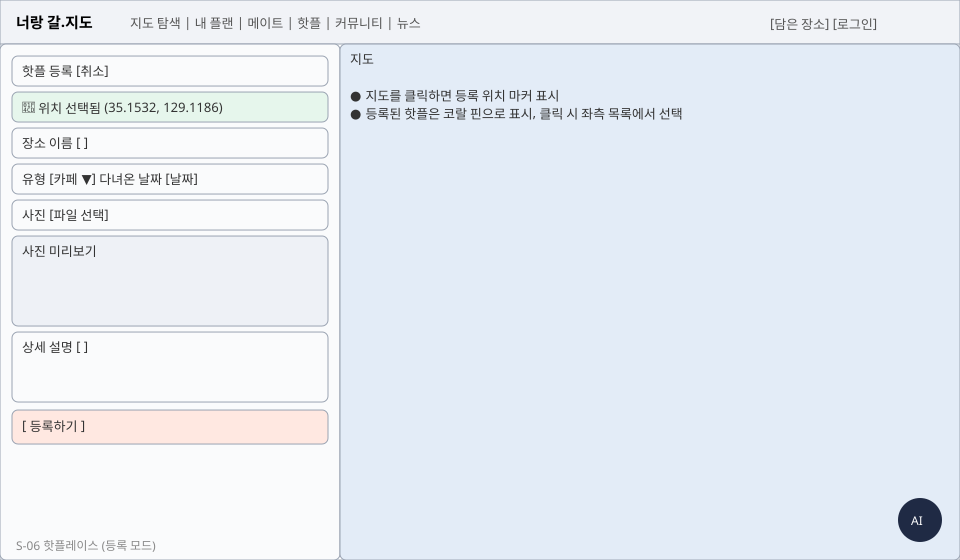
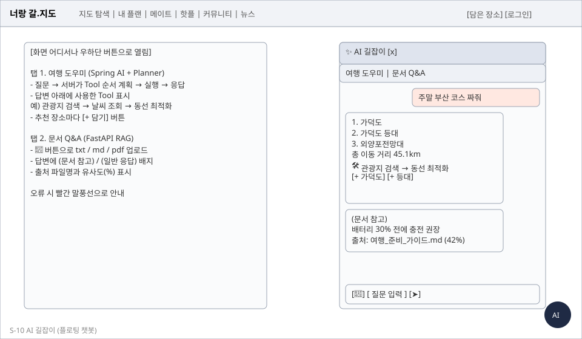
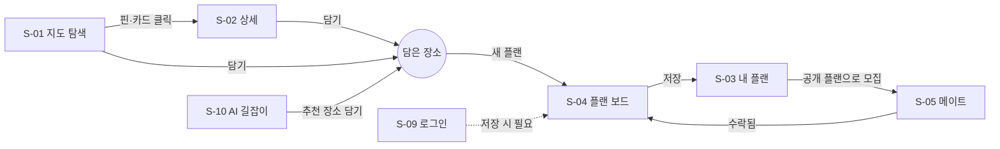

# 화면 정의서

## 1. UI/UX 원칙

| 원칙 | 적용 |
|---|---|
| 지도 우선 | 탐색·플랜·핫플 화면은 지도가 화면 대부분을 차지하고, 왼쪽 패널이 목록 → 상세 → 편집으로 전환된다. 페이지를 이동하지 않아 지도 맥락이 유지된다 |
| 먼저 써 보고 나중에 가입 | 비로그인도 탐색과 '담기'가 가능하다. 담은 장소는 로컬 스토리지에 보관하고, 저장 시점에만 로그인을 요구한다 |
| 상태를 숨기지 않기 | 모든 목록에 로딩·빈 상태·오류 문구가 있고, 빈 상태에는 다음 행동(버튼)을 함께 둔다 |
| 근거 보여주기 | AI 답변 아래에 사용한 도구(관광지 검색 → 동선 최적화)와 문서 참고 여부·출처를 표시한다 |
| 반응형 | 768px 미만에서는 지도가 위(42vh), 패널이 아래로 배치되고 메뉴는 햄버거로 접힌다 |
| 접근성 | 폼 라벨 연결, 아이콘 버튼 aria-label, 포커스 링, 상태 메시지 role, 색만으로 상태를 구분하지 않음(배지 문구 병기) |

## 2. 디자인 토큰

| 항목 | 값 | 용도 |
|---|---|---|
| 배경 | `#FFF9F2` (크림) | 페이지 배경 |
| 텍스트·보조 강조 | `#1F2A44` (네이비) | 본문, 선택된 필터, 챗봇 헤더 |
| 포인트 | `#FF6B4A` (코랄) | 주요 버튼, 지도 핀, 선택 상태 |
| 구분선 | `#ECE3D6` | 카드·패널 테두리 |
| 서체 | Pretendard | 전체 |
| 로고 | "너랑 갈📍지도" | 마침표 자리에 지도 핀 |

## 3. 화면 목록

| ID | 화면 | 경로 | 로그인 | 주요 기능 | 관련 요구사항 |
|---|---|---|---|---|---|
| S-01 | 지도 탐색 | `/` | - | 시도·구군·유형 필터, 검색, 목록, 지도 핀, 담기 | F101~F103 |
| S-02 | 관광지 상세 | `/` (패널 전환) | - | 사진, 소개, 날씨, 일출·일몰, 축제, 상권, 충전소 | F103-2, F111~F116 |
| S-03 | 내 플랜 | `/plans` | 필요 | 플랜 카드 목록, 열기, 삭제 | F104 |
| S-04 | 플랜 보드 | `/plans/new`, `/plans/:id` | 필요 | 일자 탭, 드래그 정렬, 경비, 동선 최적화, 집결지 | F104, F104-1, F122, F124 |
| S-05 | 메이트 | `/mates` | 일부 | 모집 카드, 일치도, 상세 모달, 신청, 수락·거절, 모집 작성 | F120~F123 |
| S-11 | 공연·행사 | `/culture` | - | 전국 공연(KOPIS)·서울시 문화행사 탭, 지역·검색, 포스터 카드, 상세 모달(시설 정보, 지도, 주변 장소 목록) → 주변 장소를 누르면 장소 정보 팝업(사진, 유형, 주소, 전화, 현재 날씨, 소개, 카카오맵 링크)에서 플랜에 담기 | F117~F119 |
| S-06 | 핫플레이스 | `/hotplaces` | 일부 | 지도 핀, 목록, 지도 클릭 위치 선택, 사진 업로드 | F105 |
| S-07 | 커뮤니티 | `/board` | 일부 | 공지·공유 게시판 탭, 목록, 상세, 작성·수정, 댓글 | F109, F110 |
| S-08 | 여행 뉴스 | `/news` | - | 키워드 칩, 뉴스 목록(새 탭 열기) | F106 |
| S-09 | 로그인 / 회원가입 / 비밀번호 찾기 / 마이페이지 | `/login`, `/join`, `/find-password`, `/mypage` | - / 필요 | 폼 검증, 아이디 저장, 취향 태그, 출발지 지도 선택, 탈퇴 | F107, F108 |
| S-10 | AI 길잡이 | 전 화면 우하단 | - | 여행 도우미, 문서 Q&A, 업로드, 장소 담기 | F201~F206, F1201~F1206 |

## 4. 화면별 정의

### S-01 지도 탐색

| 영역 | 요소 | 동작 |
|---|---|---|
| 필터 | 시도·구군 선택 | 바꾸면 그 지역으로 지도가 이동해 검색된다 |
| | 지도 영역 유지 | 지도를 직접 옮기거나 확대한 뒤에는 유형·검색어·페이지를 바꿔도 지도가 움직이지 않고, 보이는 영역 안에서 검색된다. 결과 수 옆에 "지도에 보이는 영역" 표시, 지도 위 "이 지역에서 다시 검색" 버튼 |
| | 유형 칩 9개 | 누르면 즉시 재검색. '전체'는 8개 유형을 고르게 섞어 보여준다 |
| | 검색어 입력 | 장소명·주소 부분 일치 |
| 목록 | 관광지 카드 | 클릭 → S-02 상세. 사진이 없으면 아이콘 표시 |
| | 담기 버튼 | 담기/취소 토글. 상단 '담은 장소' 배지 숫자에 반영 |
| | 이전·다음 | 30건 단위 |
| 지도 | 사진 핀 | 장소 대표 사진을 원형 핀으로 표시(사진이 없으면 유형 아이콘 핀). 클릭 → 상세. 선택된 핀은 코랄 테두리로 확대되고 지도 중심으로 이동. 마우스를 올린 핀은 맨 위로 올라와 겹친 핀도 확인 가능 |
| 상태 | 로딩 / 결과 없음 / 오류 | "지역이나 유형을 바꿔 보세요", "다시 시도" 버튼 |

### S-02 관광지 상세

| 요소 | 동작 |
|---|---|
| 플랜에 담기 | 담기/취소 토글 |
| 날씨 카드 | 3시간 간격 예보를 가로 스크롤로 표시. 키 미설정·실패 시 사유 문구 |
| 일출·일몰 | 좌표와 오늘 날짜로 계산한 시각 |
| 탭: 축제 / 상권 | 주변 장소 목록 + 지도에 핀 추가. 각 항목에서 바로 담기 |
| 탭: 충전소 | 이름, 거리, 사용 가능 n/m대. 지도에 ⚡ 핀 |

### S-04 플랜 보드

| 요소 | 동작 | 검증·예외 |
|---|---|---|
| 제목·기간·예산·공개 | 기간을 입력하면 일차 탭 수가 자동 결정된다 | 제목 필수, 종료일 ≥ 시작일 |
| 일차 탭 | 해당 일차 방문지만 목록과 지도에 표시 | |
| 방문지 카드 | 손잡이를 드래그해 순서 변경, 일차 이동, 경비·메모 입력, 삭제 | |
| 동선 최적화 | 현재 일차의 순서를 재배치하고 "87.4km → 68.9km (18.5km 단축)" 안내 | 3곳 미만이면 안내 문구 |
| 이동 수단 | 직선 / 자동차 / 도보 / 대중교통 선택. 총 거리·소요 시간과 카드 사이 구간별 거리·시간 표시. 대중교통은 구간마다 카카오맵 길찾기 링크 | 방문지 2곳 미만이면 안내, 조회 실패 시 다시 시도 |
| 지도 | 번호 핀과 경로선(자동차·도보는 실제 도로, 대중교통은 점선) | |
| 메이트 카드 | 참여자 배지, 중간 집결지 찾기 → 지도에 초록 핀 + 주변 장소 | 출발지 등록자 2명 미만이면 안내 |
| 하단 바 | 총 경비 / 예산, 저장 | 예산 초과 시 빨간 글씨로 초과 금액 표시 |

### S-05 메이트

| 요소 | 동작 |
|---|---|
| 모집 카드 | 상태 배지, 취향 일치 %, 플랜명, 기간, 태그, 인원. 로그인 시 일치도 높은 순 |
| 상세 모달 | 왼쪽에 소개 글, 일차별 여행 경로(방문 순서 번호, 메모), 참여 메이트. 오른쪽에 지도(번호 핀과 경로선). 일차 버튼으로 하루치만 볼 수 있다. 모집자는 신청 목록에서 수락·거절, 신청자는 한마디와 함께 신청 |
| 신청 상태 | 수락 대기 중 / 참여 확정 / 거절됨. 확정되면 "함께 플랜 편집하기" 버튼 |
| 모집 작성 모달 | 플랜 선택, 제목, 소개, 정원(2~10), 태그(최대 3개) |

### S-06 핫플레이스

| 요소 | 동작 | 검증 |
|---|---|---|
| 등록 버튼 | 패널이 등록 폼으로 전환되고 지도가 클릭 가능해진다 | 비로그인 시 로그인으로 이동 |
| 위치 선택 | 지도 클릭 → 마커 표시, 좌표 안내 문구가 초록색으로 바뀜 | 미선택 시 등록 불가 |
| 사진 | 선택 즉시 미리보기 | 이미지 파일, 10MB 이하 |
| 날짜 | 다녀온 날짜 | 오늘 이후 선택 불가 |

### S-10 AI 길잡이

| 요소 | 동작 |
|---|---|
| 플로팅 버튼 | 모든 화면 우하단. 누르면 채팅 창이 열린다 |
| 여행 도우미 탭 | Spring AI Planner 호출. 답변 아래에 사용한 도구 순서, '이 코스 전체 담기' 버튼, 장소별 '담기' 버튼. 직전 대화를 기억해 "한 곳만 바꿔줘" 같은 후속 요청 가능 |
| 문서 Q&A 탭 | fetch로 FastAPI `/chat` 호출. '문서 참고' / '일반 응답' 배지, 출처와 유사도 |
| 📎 업로드 | txt·md·pdf를 `/upload`로 전송, 완료 시 청크 수 안내 |
| 오류 | 서버 연결 실패·API 오류를 빨간 말풍선으로 안내 |

### S-07 ~ S-09 (폼 화면 공통 규칙)

| 화면 | 검증 규칙 |
|---|---|
| 회원가입 | 아이디 영문·숫자 4~20자, 비밀번호 8자 이상, 비밀번호 확인 일치, 이메일 형식. 입력란을 벗어날 때 항목별로 즉시 표시 |
| 로그인 | 빈 값 검사, 실패 시 사유 표시, 아이디 저장 체크박스 |
| 비밀번호 찾기 | 아이디 + 가입 이메일 일치 시 임시 비밀번호 표시 |
| 마이페이지 | 이름·이메일 검증, 새 비밀번호는 입력했을 때만 변경, 지도 클릭으로 출발지 설정, 탈퇴 전 확인 |
| 게시글 | 제목·내용 필수. 공지 작성 버튼은 관리자에게만 보임 |

## 5. 화면 흐름

