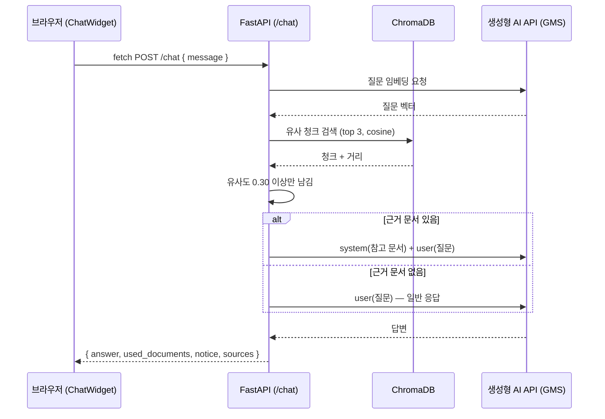
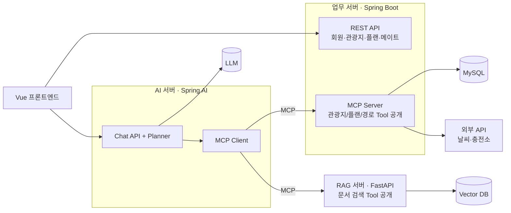

# AI 고찰 보고서

1부는 ChatBot(RAG) 과제, 2부는 Spring AI 과제의 고찰이다.
수치와 응답 예시는 2026-11-27 로컬 환경에서 실제로 호출해 얻은 결과다. (LLM: SSAFY GMS `gpt-6-luna`, 임베딩: `text-embedding-3-large`)

---

# 1부. RAG 챗봇 고찰 (F207, F208)

## 1.1 생성형 AI API 호출 흐름

브라우저는 `fetch` + `async/await`로 JSON을 주고받는다. 네트워크 오류(`TypeError`)와 서버 오류(HTTP 상태)를 구분해 안내 문구를 다르게 보여준다.

## 1.2 문서 업로드 전후 응답 차이

기본 문서 `여행_준비_가이드.md`(메이트 규칙, 동선, 전기차, 날씨, 안전 수칙)를 색인한 상태에서 호출한 결과다.

| 질문 | 문서 참고 | 유사도 | 응답 요약 |
|---|---|---|---|
| 전기차 충전은 언제 하는 게 좋아? | O | 0.418 | "배터리 잔량이 30% 아래로 내려가기 전에", 급속 30~40분·완속 4시간 이상 — 문서의 수치를 그대로 인용 |
| 메이트 경비는 어떻게 나눠? | O | 0.377, 0.352 | "숙박비와 교통비는 인원수대로, 식비는 각자" — 서비스 고유 규칙을 답함 |
| 파이썬 리스트 정렬 방법 알려줘 | X | 기준 미달 | 일반 지식으로 답하고 "일반 생성형 AI 답변"임을 표시 |

문서가 없으면 "메이트 경비 분담"처럼 서비스에만 있는 규칙은 모델이 알 수 없어 일반론으로 답한다. 문서를 올리면 문서의 표현과 수치가 답변에 반영된다. 문서와 무관한 질문은 유사도 기준에서 걸러져 문서를 억지로 끌어오지 않는다.

## 1.3 청킹 방식과 유사도 기준의 영향

**청킹 (F207)**: 고정 길이로 자르면 문장·항목 중간이 끊긴다. 수집한 문서가 제목과 문단으로 구성된 가이드이므로 **문단 우선 청킹**을 적용했다. 빈 줄과 마크다운 제목 기준으로 문단을 나누고 500자를 넘지 않게 이어 붙이며, 한 문단이 500자를 넘을 때만 글자 수로 자르고 80자를 겹친다.

| 설정 | 영향 |
|---|---|
| 청크 크기 500자 | 기본 문서(약 1,000자)가 2개 청크로 나뉘었다. 한 청크에 여러 주제(동선·전기차·날씨·안전)가 함께 들어가 "전기차" 질문의 유사도가 0.42에 그쳤다 |
| 청크를 더 작게 (예상) | 주제별로 분리되어 유사도는 오르지만, 한 청크에 담기는 문맥이 줄어 답에 필요한 앞뒤 설명이 빠질 수 있다 |
| 겹침 80자 | 긴 문단을 자를 때 경계에 걸친 문장이 양쪽 청크에 모두 남는다 |

**유사도 기준**: 코사인 유사도 0.30으로 정했다. 관련 질문은 0.35~0.44, 무관한 질문은 기준 미달이었다. 기준을 올리면(예: 0.45) 위 관련 질문들이 모두 탈락해 문서가 있는데도 일반 응답이 나오고, 내리면 무관한 청크가 섞여 엉뚱한 근거를 인용할 위험이 커진다. 이 값은 임베딩 모델과 문서 성격에 따라 달라지므로 `.env`의 `SIMILARITY_THRESHOLD`로 조정할 수 있게 했다.

**한계**: 위 관찰은 문서 1개, 질문 3개와 검색 1건으로 얻은 것이다. 청크 크기를 바꿔 가며 비교한 실험은 하지 못했고, 표의 "청크를 더 작게" 행은 예상이다. 정량 평가(정답셋 기반 검색 적중률, 답변 충실도)는 수행하지 못했다.

## 1.4 RAG의 장점과 한계

| 장점 | 한계 |
|---|---|
| 모델을 다시 학습시키지 않고 문서만 올려 최신·내부 정보를 답하게 할 수 있다 | 검색이 틀리면 답도 틀린다. 검색 단계의 품질이 상한이다 |
| 출처(파일명, 유사도)를 함께 보여줘 답을 검증할 수 있다 | 문서 품질에 그대로 의존한다. 오래되거나 모순된 문서가 있으면 그 내용을 인용한다 |
| 근거가 없을 때 "일반 응답"으로 구분해 알릴 수 있다 | 여러 청크에 흩어진 내용을 종합해야 하는 질문(요약, 비교)에 약하다 |
| | PDF의 표·그림·다단 구성은 텍스트 추출 단계에서 깨진다 |

## 1.5 데이터 품질이 응답에 미치는 영향

- 문단 하나에 한 주제만 쓰고 수치를 명시한 문서는 정확히 인용된다("30%", "4~5곳").
- 같은 내용을 다르게 쓴 문서가 여러 개면 어느 청크가 뽑히느냐에 따라 답이 달라진다.
- 스캔 PDF처럼 텍스트가 추출되지 않는 문서는 청크가 0개가 되어 검색되지 않는다. 업로드 응답에 청크 수를 표시해 사용자가 확인할 수 있게 했다.

## 1.6 개선·확장 방향

1. **평가 체계**: 질문-정답 청크 쌍을 만들어 Recall@k를 측정하고, 청크 크기·기준값을 수치로 비교한다.
2. **제목 메타데이터**: 청크에 소속 제목(예: "전기차 여행")을 붙여 임베딩하면 주제가 섞인 청크의 검색 정확도가 오른다.
3. **하이브리드 검색**: 고유명사·숫자에 강한 키워드 검색(BM25)과 벡터 검색을 함께 쓴다.
4. **재순위화**: 상위 10개를 뽑은 뒤 질문과의 관련도를 다시 평가해 3개만 남긴다.
5. **문서 관리**: 문서 삭제·버전 관리, 회원별 문서 분리.

---

# 2부. Spring AI 고찰 (F1207 ~ F1209)

## 2.1 구조

| 역할 | 구현 | 책임 |
|---|---|---|
| Client | `AiController`, `AiService` | 요청 수신, 호출 방식 선택, 응답 조립 |
| Tool | `AttractionTool`, `WeatherTool`, `RouteTool`, `PlanTool`, `DocumentTool` | LLM이 호출할 수 있는 기능 단위. 로직은 Service에 위임 |
| Resource | `StepResult` | Tool 실행 결과. 다음 Tool의 입력, 최종 Prompt의 근거 |
| Prompt | `prompts/system.txt`, `prompts/planner.txt` | 역할, 근거 사용 규칙, 계획 수립 규칙 |
| Planner | `TripPlanner` | 계획(LLM) → 검증(서버) → 실행(서버) |

LLM 호출은 `ChatModel` 추상화 위의 `ChatClient`만 사용한다. 벤더를 바꿀 때는 starter 의존성과 `application.properties`만 바꾸면 된다.

## 2.2 단일 Tool vs 다중 Tool (F1207)

같은 서버에서 호출한 결과다.

| 구분 | 단일 Tool (`mode=single`) | 다중 Tool · LLM 주도 (`mode=multi`) | 다중 Tool · Planner (`mode=planner`) |
|---|---|---|---|
| 질문 | 부산 관광지 3곳 알려줘 | 부산 관광지 3곳을 찾고 최적 동선으로 정렬해줘 | 이번 주말 부산 1박2일 코스 짜줘. 날씨도 알려줘 |
| 호출된 Tool | 관광지 검색 | 관광지 검색 → 동선 최적화 | 관광지 검색 → 날씨 → 동선 최적화 |
| 순서 결정 | - | LLM | 서버(고정 순서 + 검증) |
| LLM 호출 횟수 | 2회(호출 결정, 응답) | Tool 수 + 1회 | 2회(계획, 응답) |
| 응답 시간 | 5.4초 | 4.0초 | 5.9초 |
| 결과 | DB의 실제 장소 3곳과 주소 | 3곳을 재정렬, 총 2.9km | 6곳을 이틀로 나눔, 총 45.1km |

- **단일 Tool**: 구조가 단순하고 검증이 쉽다. 한 가지 데이터만 필요한 질문에 적합하다. 여러 정보가 필요한 질문은 처리하지 못한다.
- **다중 Tool(LLM 주도)**: 코드가 가장 짧다. 그러나 어떤 Tool을 몇 번, 어떤 순서로 부를지 모델이 정하므로 실행마다 달라질 수 있고, Tool이 늘수록 LLM 왕복 횟수와 비용이 늘며, 중간 과정을 서버가 통제하기 어렵다.
- **Planner(서버 주도)**: LLM은 "무엇이 필요한지"만 구조화된 계획으로 답하고, 서버가 순서를 고정해 실행한다. 앞 단계 결과를 다음 단계 입력으로 넘기는 과정이 코드에 드러난다(검색 결과의 좌표 → 날씨, 검색 결과의 번호 → 경로). LLM 호출은 Tool 개수와 무관하게 2회다. 대신 새로운 흐름을 추가하려면 Planner 코드를 고쳐야 한다.

**불필요한 호출 방지 확인**: "안녕"에는 계획이 빈 배열이 되어 Tool을 하나도 호출하지 않았고(2.7초), "내 여행 계획 뭐 있어?"에는 `GET_MY_PLANS` 하나만 호출했다. 서버 검증 단계에서 중복 단계, 선행 결과가 없는 단계(검색 없이 날씨·경로), 비로그인 상태의 내 플랜 조회를 제거한다.

**추측 방지 확인**: 공공데이터 키를 넣기 전 호출에서 날씨 Tool이 "키 미설정"을 반환하자 모델은 날씨를 지어내지 않고 "조회할 수 없다"고 답했다. 프롬프트에 "결과에 없는 사실은 만들지 말 것"을 명시하고 Tool 결과만 근거로 넘긴 효과다.

## 2.3 Spring AI 적용의 장점과 한계 (F1208)

| 장점 | 한계 |
|---|---|
| `ChatClient` 하나로 LLM 호출, 구조화 출력(`entity`), Tool 호출을 일관되게 작성한다 | 버전 간 변화가 크다. 2.0에서 설정 키와 옵션 API가 달라져 예제와 문서를 다시 확인해야 했다 |
| 기존 Service·DAO를 `@Tool` 메서드로 감싸기만 하면 LLM이 쓸 수 있다 | 모델별 제약이 추상화 밖으로 새어 나온다. 사용한 모델은 Tool 호출 시 `reasoning-effort=none` 설정이 필요했다 |
| 벤더 종속이 설정 파일로 한정된다 | LLM 주도 Tool 호출은 내부 루프가 감춰져 있어 호출 순서·횟수를 통제하거나 추적하기 어렵다 |
| `ToolContext`로 사용자 식별값을 서버가 주입해, 모델이 다른 회원의 번호를 지어내 조회하는 일을 막는다 | 응답 시간이 3~6초로 일반 API보다 길다. 스트리밍과 캐시가 필요하다 |

## 2.4 AI Server 분리 시 확장 구조 (F1209)

현재도 RAG는 별도 서버(FastAPI)로 분리되어 있고, Spring은 `DocumentTool → DocumentSearchService → /search`로 호출한다. 이 구조를 넓히면 다음과 같다.

- **분리 기준**: LLM 호출과 Planner는 AI 서버로, 데이터 접근은 업무 서버에 남긴다. 응답이 느리고 사용량 변동이 큰 AI 부하를 따로 확장할 수 있다.
- **MCP 적용**: 업무 서버가 Tool을 MCP Server로 공개하면 AI 서버는 Tool 구현을 몰라도 목록을 받아 호출할 수 있다. 지금의 `tool` 패키지가 그대로 MCP Server의 Tool이 되고, Service·DAO는 바뀌지 않는다.
- **인증**: 사용자 토큰을 AI 서버가 업무 서버로 전달해, Tool이 항상 요청한 사용자의 권한으로만 실행되게 한다. 지금 `ToolContext`로 하는 일을 서버 간 호출로 옮기는 것이다.
- **운영**: Tool 호출 기록(계획, 입력, 소요 시간)을 저장해 추적하고, 같은 질문의 Tool 결과를 캐시한다.
