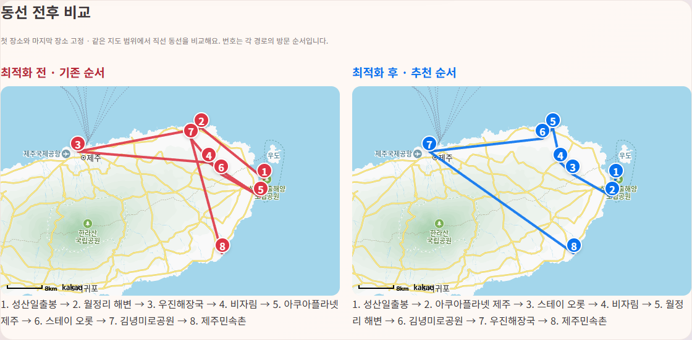

# MapMates 알고리즘 적용 기획 및 검증

2026-10-15 구현. 기존 Vanilla JavaScript / ES Modules 구조에서 동작하며, 별도 서버나 API 키 없이 알고리즘 자체를 검증할 수 있다.

## 1. 비트마스크 DP를 이용한 하루 여행 동선 추천

### 문제와 서비스 적용

기존 내 여행은 방문 시각으로 장소를 정렬한 뒤 그 순서 그대로 경로를 그렸다. 사용자가 장소를 담은 순서에 따라 같은 지역을 반복해서 지나갈 수 있었다.

`planner.html`의 DAY별 일정 위에 **동선 최적화**를 추가했다. 현재 날짜의 첫 장소와 마지막 장소를 고정한 채 중간 장소의 방문 순서를 계산한다. 직선거리 전후 비교와 추천 방문 시각·장소를 미리 보여주고, **추천 순서 적용**으로 반영한다. 적용 직후 **최적화 되돌리기**가 가능하며, 계획 저장 후 다시 열어도 적용 순서가 유지된다.

### 알고리즘과 자료구조

- 구현: [route-optimizer.js](../js/route-optimizer.js), 화면 연결: [planner.js](../js/planner.js)
- 장소 간 Haversine 직선거리를 `n × n` 행렬로 계산한다.
- 중간 장소 수를 `m = n - 2`라고 할 때, 방문 여부를 정수 비트마스크로 표현한다.
- `dp[mask][j]`는 출발지에서 시작해 `mask`에 포함된 중간 장소를 방문하고 `j`에서 끝나는 최소 거리다.
- 점화식: `dp[mask][j] = min(dp[mask without j][k] + distance[k][j])`.
- 마지막에 도착지까지의 거리를 더하고, 부모 상태 배열로 방문 순서를 복원한다.
- `Float64Array`에 비용, `Int16Array`에 이전 장소를 저장한다.
- 시간 복잡도 `O(n² + m² × 2^m)`, 공간 복잡도 `O(n² + m × 2^m)`.

모든 순열을 조사하는 `m!` 방식과 달리 중복 부분 문제를 한 번 계산한다. 하루 3~12곳을 지원하며, 12곳이면 DP 비용·부모 배열은 각각 10,240칸이다. 동일 거리에서는 기존 순서를 유지한다.

### 일정에 반영하는 방법과 제한

현재 지도·동행·계획 카드가 모두 방문 시각으로 정렬하므로, 기존 시각을 시간대 슬롯으로 유지하고 추천 순서에 따라 장소를 배정한다. 메모와 DAY는 해당 장소와 함께 유지한다. 예약 시각도 바뀔 수 있음을 화면에 안내하고 적용 전에 새 배정을 보여준다. 시각이 없거나 중복되면 먼저 수정을 안내한다.

실제 위경도가 없거나 범위를 벗어나면 계산을 중단한다. 기존 지도 표시용 가상 좌표는 최적화에 사용하지 않는다. 날짜·계획 전환 또는 일정 편집 시 미리보기와 되돌리기를 초기화해 오래된 계산을 적용하지 않도록 한다.

### 지도에서 전후 비교

`route-comparison.js`는 기존 순서와 추천 순서를 같은 위경도 범위의 두 카카오 지도에 표시한다. 기존 경로는 빨강, 추천 경로는 파랑이며 번호 핀과 장소명 목록으로 순서 변화를 확인한다. 적용 전에도 두 경로를 비교할 수 있고 적용 직후에는 비교를 유지한다. 되돌리기·날짜 전환·일정 편집 시 추천 경로를 지워 오래된 제안을 남기지 않는다. 지도 SDK 연결 전에는 같은 좌표 범위의 SVG 직선 동선으로 대체하며 화면에 이를 명시한다. `지도에서 전후 비교` 링크로 해당 영역에 바로 이동한다.



**최소값 보장은 고정된 양 끝점과 직선거리 행렬에 한정된다.** 도로 최단거리, 교통량, 체류시간, 영업시간, 예약시간은 목적함수에 포함하지 않는다. 실제 차량 동선은 적용 후 기존 카카오모빌리티 경로 기능으로 확인한다. 화면의 이동시간 추정은 이번 거리 최적화의 성능 지표가 아니다.

### 정량 검증

입력은 `js/data.js`의 첫 8개 장소이며 첫 장소와 마지막 장소를 고정했다. 인위적으로 만든 나쁜 순서가 아니라 파일의 기존 순서를 기준으로 비교했다.

| 지표 | 기존 | 적용 후 | 변화 |
| --- | ---: | ---: | ---: |
| 직선 이동거리 | 126.4434 km | 87.2432 km | 39.2002 km, **31.0% 감소** |
| 계산시간 중앙값 | 완전탐색 0.1269 ms | DP 0.0438 ms | 약 2.9배 빠름 |

추천 순서: 성산일출봉 → 아쿠아플라넷 제주 → 스테이 오롯 → 비자림 → 월정리 해변 → 김녕미로공원 → 우진해장국 → 제주민속촌.

작은 입력의 시간 측정은 런타임·환경에 민감하며 실제 여행의 도로거리나 소요시간 감소율을 뜻하지 않는다. 별도로 3~8개 장소의 무작위 입력 30개를 완전탐색과 비교해 DP의 최소 거리가 일치함을 검증했다.

## 2. 최소 힙을 이용한 지도 범위별 핫플 TOP 10 선정

### 문제와 서비스 적용

기존 핫플은 저장 계획을 훑어 지도 범위에 있는 장소를 집계하고, 후보 전체를 정렬한 뒤 앞의 10개를 선택했다. 표시할 수는 10개로 고정되어 있으므로 전체 순위를 계산할 필요가 없다.

지도 핫플 화면의 사용 방식과 순위 기준을 유지하면서, 상위 K개를 힙에 보관하는 방식으로 교체했다. 순위는 **추가한 회원 수 내림차순 → 계획 수 내림차순 → 장소명 한국어 오름차순**이다.

### 알고리즘과 자료구조

- 구현: [top-k.js](../js/top-k.js), 집계 연결: [popular-places.js](../js/popular-places.js)
- `Map`으로 장소를 묶고 `Set`으로 같은 회원의 중복 집계를 방지한다.
- 같은 계획에 같은 장소가 반복돼도 계획 수는 한 번만 증가한다.
- 후보를 순회하며 최대 K개를 힙에 보관한다. 루트는 보관한 후보 중 순위가 가장 낮은 장소다. 인기 점수 관점에서 최소 힙이며, 비교 함수 관점에서는 가장 뒤에 오는 항목을 루트에 둔다.
- 새 후보가 루트보다 상위이면 교체하고 아래로 내려 힙을 복구한다.
- 마지막 K개만 정렬해 화면에 전달한다. 전체 후보 객체 배열 대신 generator로 전달한다.
- 모든 순위 조건이 같은 경우 입력 순서로 동점을 처리해 기존 안정 정렬의 결과도 유지한다.

전체 일정 항목 수를 `S`, 집계된 장소 수를 `P`라 하면:

| 구분 | 기존 | 적용 후 |
| --- | --- | --- |
| 집계 | 평균 `O(S)` | 평균 `O(S)` |
| 상위 순위 선정 | `O(P log P)` | `O(P log K + K log K)` |
| 순위 선정용 보관 공간 | `O(P)` | `O(K)` |

집계용 Map·Set의 메모리는 여전히 필요하며, 지도 이동 시 전체 계획을 집계하는 기존 동작도 유지한다. 이번 개선은 순위 선정 단계에 해당한다. 현재 소규모 체험 데이터에서 눈에 띄는 화면 속도 향상을 보장하지 않는다.

### 정량 검증

고정 seed 42를 사용하는 테스트에서 생성한 합성 후보 100,000개, K=10을 사용했다. 회원 수·계획 수·이름의 동일 비교 함수를 사용하고, 전체 정렬 결과와 힙 결과의 모든 항목이 같은지 확인했다.

| 지표 | 전체 정렬 | 힙 TOP 10 | 변화 |
| --- | ---: | ---: | ---: |
| 비교 함수 호출 수 | 1,529,197회 | 100,410회 | **93.4% 감소** |
| 실행시간 중앙값 | 17.3889 ms | 0.6126 ms | **96.5% 감소**, 약 28.4배 빠름 |
| 순위 선정에서 보관하는 후보 | 100,000개 | 최대 10개 | 후보 수 기준 99.99% 감소 |

후보 보관 수는 실제 프로세스 메모리 측정치가 아니다. 시간은 집계·DOM 렌더링·네트워크를 제외한 순위 선정만 측정했으며 브라우저 전체 응답시간 개선율로 해석하면 안 된다.

## 재현 방법

Node.js v26.5.0, Windows에서 측정했다. 시간은 워밍업 5회 후 31회 실행의 중앙값이다. seed는 각 테스트가 순서대로 소비하므로 전체 스크립트를 실행해야 같은 합성 입력이 생성된다.

```bash
node tests/algorithms.cjs
node tests/popular-places.cjs
```

`tests/algorithms.cjs`는 거리와 실행시간, 비교 횟수를 출력한다. DP와 완전탐색의 일치, 중복 좌표, 좌표 오류, 개수 제한, 메모·시간대 보존, 여러 K값과 동점 순위를 검증한다. `tests/popular-places.cjs`는 지도 범위, 회원 중복 제거, 계획 내 중복, 순위를 검증한다.

개발 서버 실행 후 브라우저 검증:

```bash
node dev-server.js
# 별도 터미널. 필요하면 PLAYWRIGHT_MODULE에 Playwright 절대 경로 지정
node tests/route-optimizer-ui.cjs
node tests/hotplaces-ui.cjs
```

동선 UI 테스트는 미리보기 단계에서 원본 유지, 적용·되돌리기, 날짜 전환 시 미리보기 폐기, 계획 저장·재접속, 모바일 가로 넘침, JavaScript 오류를 확인한다. API 키 없이 테스트하므로 실제 차량 경로 응답은 검증 범위에 포함하지 않는다.

이번 실행에서는 알고리즘 테스트, 기존 핫플 집계 테스트, 동선 UI 테스트, 문법·diff 검증을 통과했다. 동선 UI 테스트는 소켓 접근 제한 환경에서도 실행하도록 Playwright가 저장소 파일을 직접 제공한다. 실제 지도 API가 필요한 기존 `hotplaces-ui.cjs`는 로컬 서버 연결 제한으로 완료하지 못했다.
