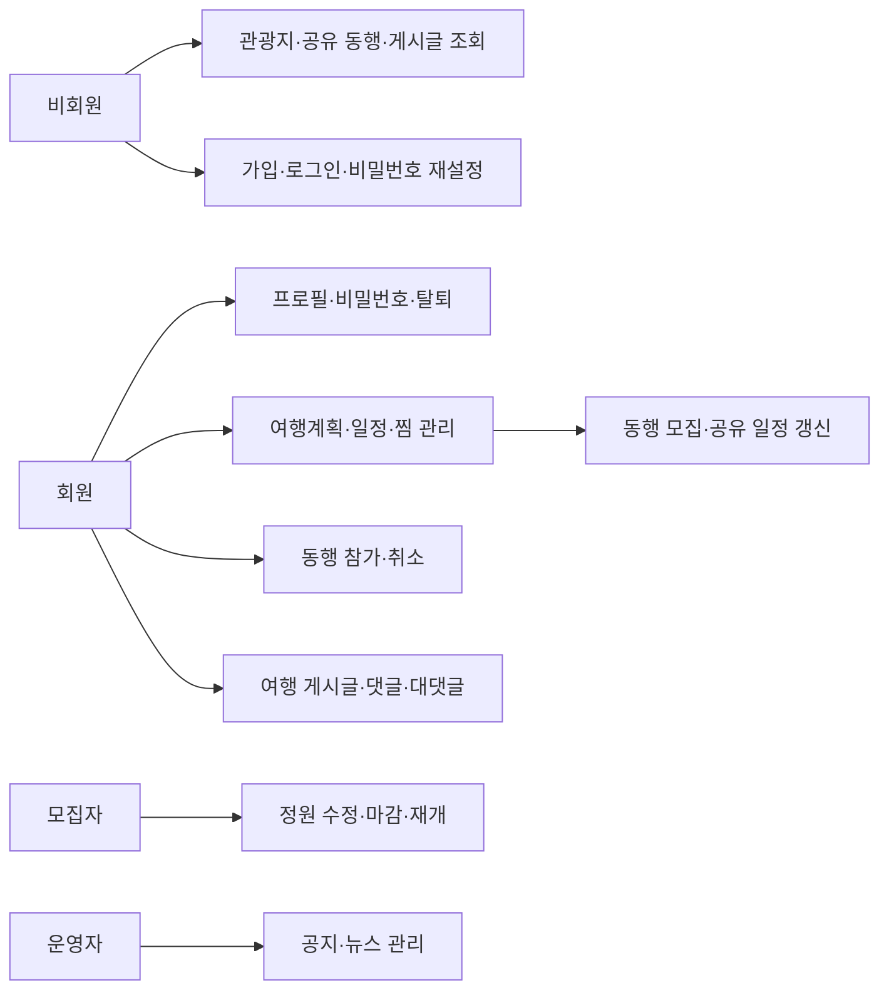
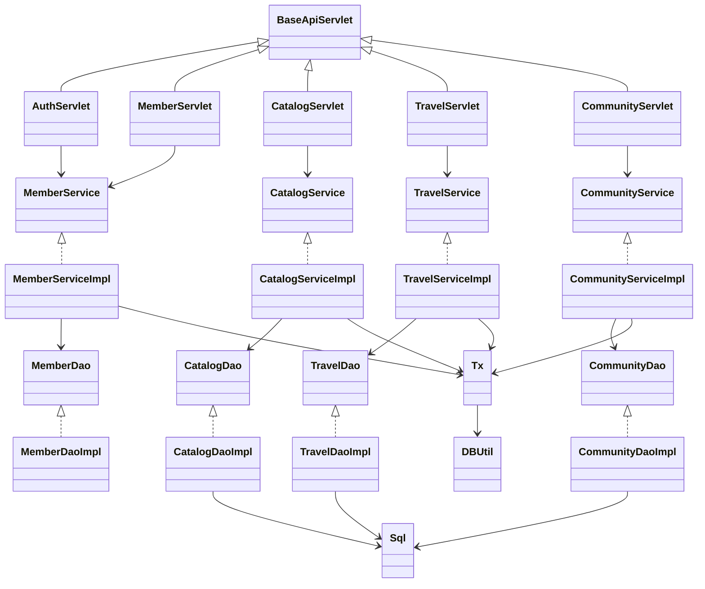
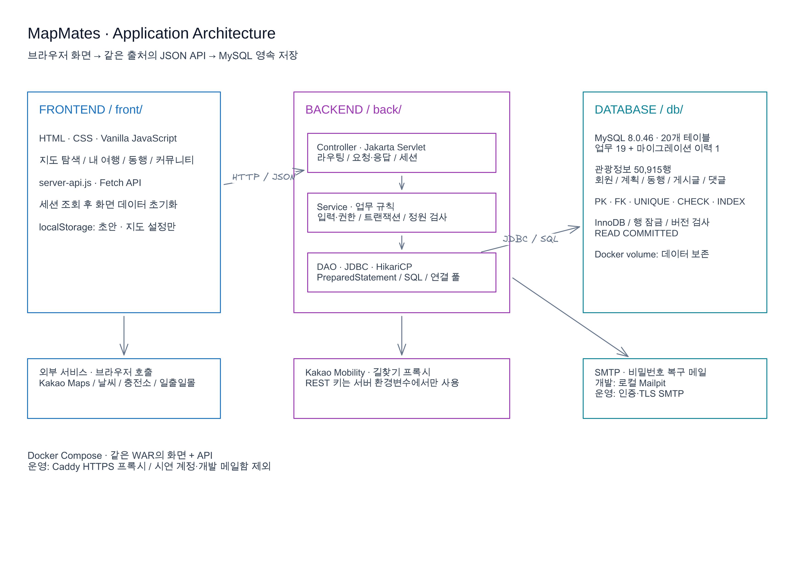
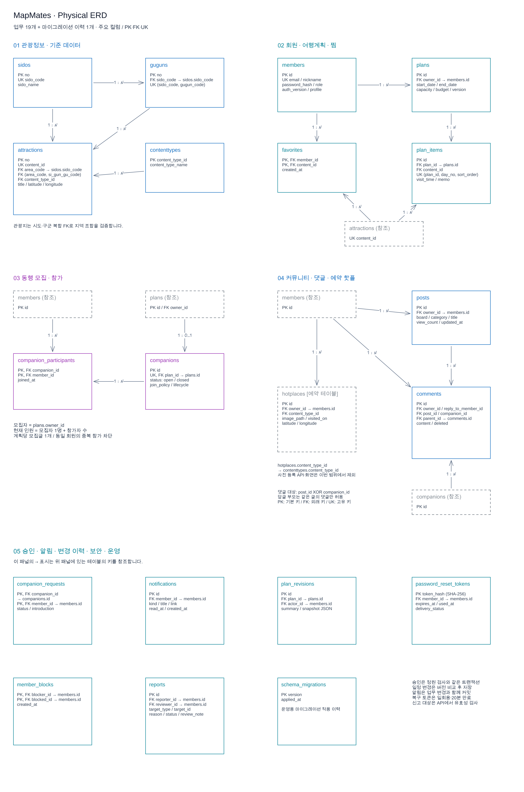
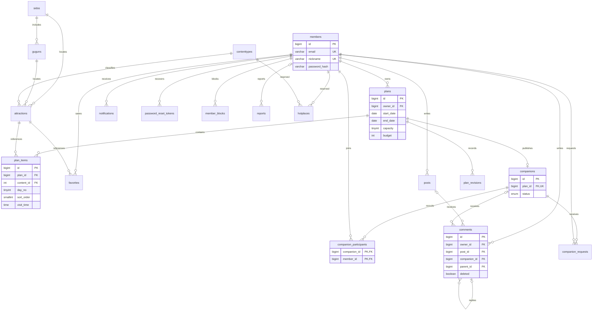

# MapMates 백엔드·DB 설계

기존 Servlet MVC 설계를 이어 Java 17, Jakarta Servlet 6/Tomcat 10.1, JDBC, MySQL 8.0.46을 사용한다. 화면은 기존 HTML/JS를 유지하고 같은 WAR에 배포한다. `gitlab/feature/board-yeeun`의 `f778489`를 이력 그대로 통합했다.

## 요구사항과 구현

| 요구사항 | 구현 |
|---|---|
| F101~F103 필수 | 시도·구군·콘텐츠별 관광지 조회, 검색, 페이지 처리, 좌표 범위+거리 기반 주변 조회 |
| F107~F108 필수 | 가입·중복 확인·프로필·탈퇴, 서버 세션 로그인·로그아웃·이메일 일회용 링크 비밀번호 재설정 |
| F104 추가 | 기간·예산·정원·일정 CRUD, 찜, 일정 변경 트랜잭션 |
| 동행 확장 | 계획 공유·일정 갱신·모집 마감/재개·참가/취소, 동시 참가 정원 검사 |
| F109~F110 심화 | 공지·뉴스 관리자 작성, 여행 게시판, 댓글·대댓글·검색·정렬·페이지 처리 |
| 변경된 F105 | 전체 회원의 저장 계획을 지도 범위별 집계하는 인기 장소 TOP 10 |
| F111~F114 기존 | 날씨·사진·일출일몰·충전소 화면 유지. 실시간 외부 API는 해당 키·서비스 응답이 필요 |
| 선택 범위 제외 | 사진 업로드형 핫플 등록 및 뉴스 자동 크롤링. 뉴스 게시판은 관리자 수동 작성 |

PDF는 개선한 요구사항을 허용한다. 현재 제품에서 제거된 핫플 등록 UI를 복원하지 않고 계획 기반 인기 장소로 명시한다. 기존 `hotplaces` 테이블은 검증 이력 호환을 위해 예약 테이블로 남긴다. 원본 과제 PDF는 저장소에 포함하지 않는다.

## Usecase

## Class Diagram

`catalog`는 관광지, `travel`은 여행계획·동행·찜의 연관 집합, `community`는 게시판·댓글을 담당한다. DTO는 요청 검증에 사용하고, DAO 조회 결과는 화면에 필요한 필드 이름으로 반환한다. SQL 파라미터는 PreparedStatement로 바인딩하며 정렬·테이블·열 이름은 코드의 허용 목록에서만 선택한다.

## 시스템 구조 이미지

[편집 원본](diagrams/architecture.excalidraw)

## ER Diagram

[큰 이미지](diagrams/erd.png) · [편집 원본](diagrams/erd.excalidraw) · [전체 DDL](../db/schema-current.sql)

전체 DDL의 업무 테이블 19개와 스키마 이력 테이블 1개 및 제약조건이 최종 기준이다. 구군은 `(sido_code,gugun_code)` 복합 키로 참조한다. 회원 이메일·닉네임과 계획당 모집글은 UNIQUE, 참가·찜은 복합 PK다. 댓글은 게시글 또는 동행 중 정확히 하나를 CHECK로 강제한다. 기간은 1~14일, 정원은 본인 포함 2~10명이며 실제 여행 기간 안의 일차인지 Service에서도 검사한다.

모집자 정보는 `plans.owner_id`에서 유도하며 참가자 테이블에는 모집자를 중복 저장하지 않는다. 현재 인원은 모집자 1명+참가자 수다. 장소는 관광지 테이블에 존재해야 하며 덤프에 없는 장소만 검증 후 등록한다. 기존 공공 관광지 데이터는 클라이언트 입력으로 덮어쓰지 않는다.

## 트랜잭션과 동시성

계획+일정 전체 교체는 한 트랜잭션이다. 참가·취소·정원 변경·마감은 계획 행을 `FOR UPDATE`로 잠그고 처리한다. 쓰기 격리 수준은 READ COMMITTED다. 기본 REPEATABLE READ에서는 잠금 전에 시작된 스냅샷이 다른 참가자의 커밋을 보지 못해 정원을 초과하는 것을 실제 HTTP 동시 요청으로 재현했고 수정했다.

직접 마감 상태와 정원 도달은 분리한다. 만석 동행은 취소하면 다시 참가 가능하지만 직접 마감한 동행은 취소 후에도 닫힌 상태다. 재공유는 기존 모집글과 참가자·마감 상태를 유지한다. 정원을 현재 인원보다 줄일 수 없다.

답글이 있는 댓글은 내용만 지우고 삭제 표시를 남긴다. 회원 탈퇴 시 본인 데이터는 FK CASCADE로 삭제하고 다른 회원의 답글은 부모와 멘션만 NULL로 남긴다. 게시글 수정 시에만 `updated_at`을 기록하므로 조회수 증가를 수정으로 표시하지 않는다.

## 클라이언트 저장과 보안

서버 배포에서는 세션을 조회한 뒤 API 데이터로 화면을 초기화한다. 기존 데모 회원·평문 비밀번호·콘텐츠를 서버에 자동 이관하지 않는다. `localStorage`에는 사용자별 작성 초안과 지도 설정만 남긴다. API 오류가 나면 성공 알림이나 다음 페이지 이동 전에 오류를 표시한다.

PBKDF2 해시, HttpOnly 세션 쿠키, 로그인 시 세션 재발급, 서버의 작성자·관리자 검사, Origin 및 JSON 쓰기 요청 검사, 허용 출처 CORS를 사용한다. 길찾기 REST 키와 DB 비밀번호는 서버 환경변수에만 둔다. `/config.js`는 지도 JavaScript 키 등 브라우저용 설정만 제공한다.

계정 복구는 암호학적 난수 32바이트 토큰을 이메일로 보내고 DB에는 SHA-256 해시만 저장한다. 만료는 20분이며 한 번만 사용할 수 있다. 이름·생년월일만으로 비밀번호를 바꾸는 방식은 서버에서 제거했다. SMTP는 제한된 비동기 큐와 재시도를 사용한다. 비밀번호 변경·복구는 `auth_version`을 증가시켜 기존 세션을 무효화한다. 로그인·복구의 IP/계정별 요청 제한은 단일 JVM 메모리 기준이며 여러 서버 운영 시 공유 저장소가 필요하다.

## 확장 기능의 데이터와 처리

`companion_requests`는 신청 상태와 소개를 보관하며 승인도 참가와 동일한 계획 행 잠금을 사용한다. `join_policy`는 즉시 참가/승인제를 구분한다. `lifecycle`과 여행 날짜로 예정·진행·종료·취소를 판단하며 출발 후 신규 모집을 막는다. 종료·취소된 여행은 참가 기록을 보존한다.

`plans.version`을 수정 요청의 버전과 비교해 오래된 탭의 덮어쓰기를 409로 거절한다. 동행 수정은 `expectedVersion`을 보낸다. 공유 일정 변경은 `plan_revisions`에 변경자와 스냅샷을 저장한다. 신청·승인·댓글·일정·여행 상태 알림은 원래 작업과 같은 트랜잭션에 저장한다.

`member_blocks`는 양방향의 신규 상호작용을 제한하고 목록에서 차단한 작성자를 숨긴다. 기존 참가를 자동 삭제하지 않는다. `reports`는 신고 대상 식별자·표시 스냅샷·사유·처리자·처리 의견을 보존하며 콘텐츠를 자동 삭제하지 않는다. 관리자 처리 API는 서버에서 역할을 검사한다.

DBUtil은 HikariCP 연결 풀(최대 10, 최소 유휴 1)을 공유하고 종료 시 해제한다. 동행 목록은 건수·기본 정보·일정·참가자를 페이지 단위로 일괄 조회하므로 페이지 항목 수에 따라 쿼리가 늘지 않는다. 프론트는 서버 필터와 페이지를 사용하며 모든 페이지를 시작 시 미리 받지 않는다.

`schema_migrations`와 `db/migrations/101~107`으로 기존 데이터의 순차 갱신을 관리한다. `schema-current.sql`은 기준 스키마와 변경 파일에서 생성하며 CI가 동기화를 검사한다. [운영 안내](OPERATIONS.md)에 기존 DB 갱신, 백업·복구, HTTPS와 CI 조건을 정리했다.

## 실측에 따른 조회 보완

계획 목록의 일정 조회를 500개 계획 단위로 묶어 N+1 조회를 제거했다. 각 계획의 빈 일정·정렬·소유자 격리는 HTTP로 검사했다. 관광지의 지역·유형·페이지 정렬용 복합 인덱스와 덤프 적재 후 통계 갱신을 `107_catalog_paging_index`에 반영했다. [원시 표본과 전후 그래프](benchmarks/README.md)에 실제 측정 조건·응답 일치 검사를 기록했다.
