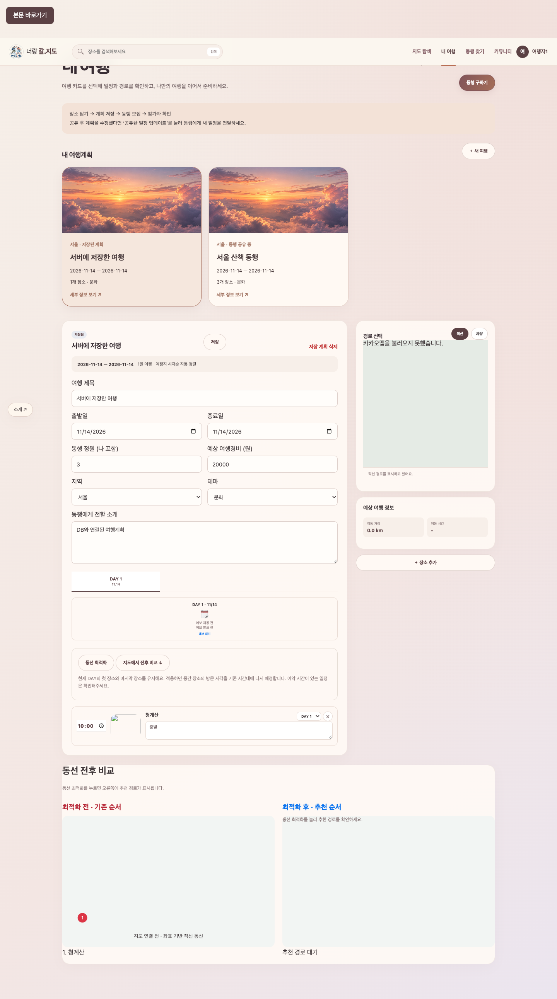
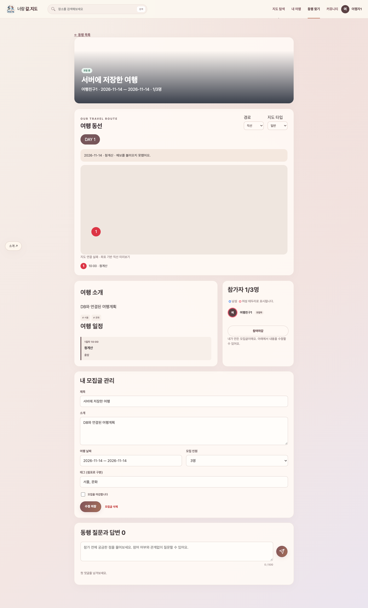
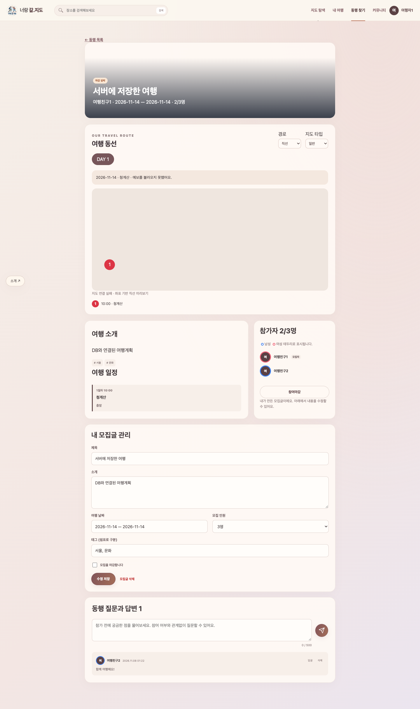
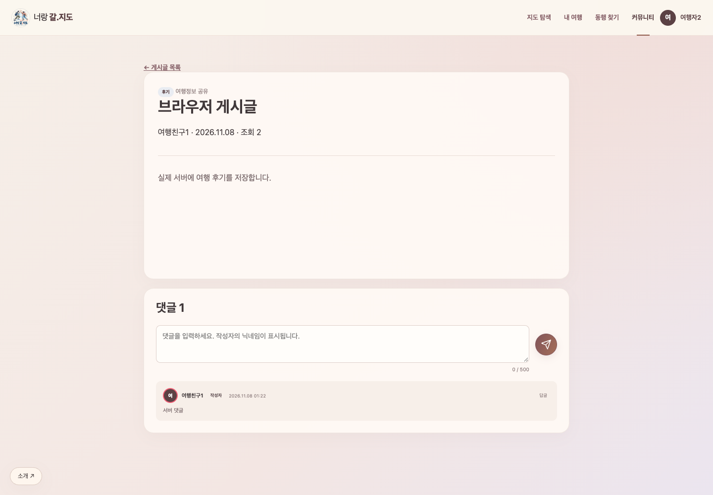
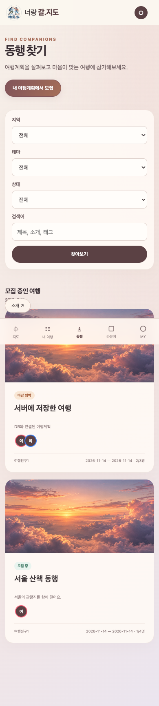
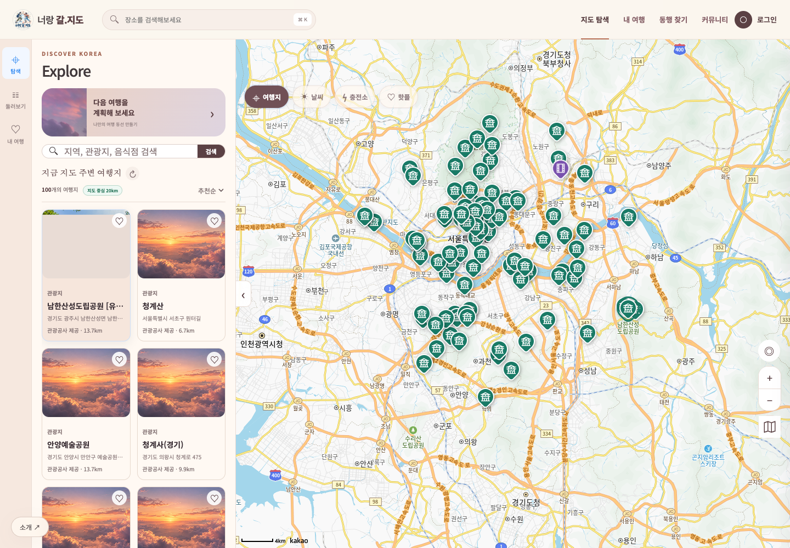

# 백엔드·DB 통합 검증 — 2026-11-08

Java 17, Tomcat 10.1, MySQL 8.0.46 및 설치된 Chrome으로 실제 실행했다. API는 `http://localhost:8080/mapmates/api`이며 브라우저 간 데이터 공유는 서로 다른 세션 두 개로 확인했다.

| 검증 | 결과 | 근거 |
|---|---|---|
| Maven WAR 빌드·JUnit | 4개 테스트, 실패 0 | Dockerfile의 `mvn -B -f back/pom.xml verify` |
| SQL 제약·프론트 대조 | 33개 PASS, FAIL 0 | [실행 기록](validation/2026-11-08-sql.txt) |
| HTTP 통합 | 7개 시나리오, 실패 0 | [실행 기록](validation/2026-11-08-api.txt) |
| 브라우저 통합 | 12개 항목 PASS, JS 오류 0 | [실행 기록](validation/2026-11-08-browser.txt) |
| 카카오맵 | 실제 SDK·지도 타일·DB 관광지 표시, JS 오류 0 | [화면](screenshots/backend/06-live-map.png), `scripts/test_map.cjs` |
| 빈 DB 설치 | 관광지 50,915행, 회원 한글, 음식점 유형 정정 확인 | 별도 `mapmates-install-check` Compose 프로젝트 |
| 기존 알고리즘 | 전수 경로 교차 검증·TOP K·메모 유지 통과 | `node front/tests/algorithms.cjs` |
| 변경 파일 | JS 구문 검사·`git diff --check` 통과 | 변경된 JS와 커밋 전 차이 검사 |

HTTP 시나리오는 인증·중복 가입·비밀번호 비노출·공지 권한·교차 출처 요청 거절, 관광지 조회·잘못된 좌표, 계획 권한·잘못된 일차 수정 거절, 병렬 동행 참가·마감·재개, 게시글·답글 대상·댓글 삭제·수정 시각, 찜 중복·인기 장소 집계, 비밀번호 오류·로그아웃·재로그인을 검증한다.

브라우저는 실제 로그인과 한글 프로필, 계획 수정 후 새로고침, 공유 동행 생성, 다른 브라우저의 참가·Q&A 공유, 게시글·댓글 저장, 브라우저 비밀번호 미저장, 모바일 목록, 메인 지도에서 참가·취소 반복, 서버 로그아웃을 검증한다. 테스트 종료 시 생성한 계획·게시글·검증 회원은 삭제한다.

동시 참가 테스트는 마지막 한 자리를 두 회원이 병렬 신청하게 해 200과 409가 하나씩 나오는지 확인한다. 첫 실행에서 기본 REPEATABLE READ의 오래된 스냅샷 문제가 재현되어 `Tx.write`에 READ COMMITTED를 설정한 뒤 통과했다. 새 DB 초기 적재는 모든 SQL에 UTF-8 연결 설정을 명시해 한글 깨짐도 수정했다.

## 실제 실행 화면

### 저장된 여행계획

### 동행 모집과 참가·질문 공유

### 커뮤니티

### 모바일

### 카카오맵과 관광정보 DB

외부 날씨·충전소·모빌리티의 실제 응답은 각각의 API 키와 서비스 권한에 의존한다. 이번 실행에서 실제 SDK·타일을 확인한 것은 카카오맵이며, 외부 기능 전체를 새로 실검증했다고 주장하지 않는다. 프론트 단독 데모 테스트의 과거 결과는 `front/docs/FEATURE_AUDIT.md`에 별도로 보존한다.
