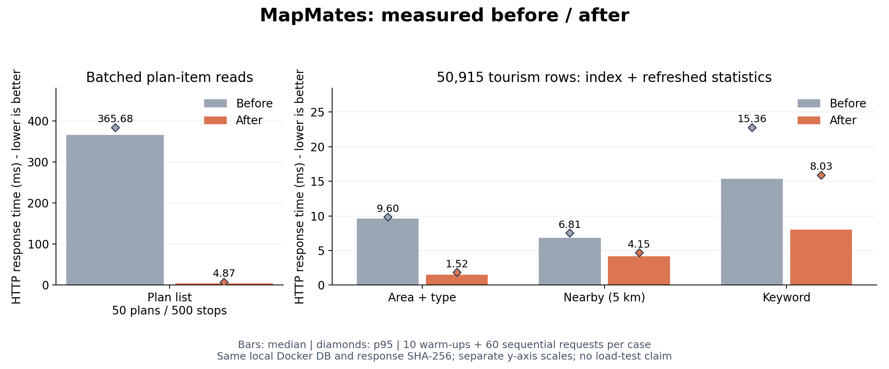

# API 성능 실측 — 2026-11-08



막대는 중앙값, 마름모는 p95이며 단위는 ms다. 두 패널의 세로축 범위는 다르다.

| 요청 | 개선 전 중앙값 / p95 (ms) | 개선 후 중앙값 / p95 (ms) | 중앙값 감소율 |
|---|---:|---:|---:|
| 내 여행계획 50개·일정 500개 | 365.68 / 384.17 | 4.87 / 7.78 | 98.7% |
| 서울 음식점 목록 | 9.60 / 9.85 | 1.52 / 1.86 | 84.1% |
| 서울 중심 5km 주변 관광지 | 6.81 / 7.53 | 4.15 / 4.71 | 39.1% |
| 관광지 이름에 박물관 포함 | 15.36 / 22.78 | 8.03 / 15.93 | 47.7% |

## 조건과 원시 데이터

- 개선 전 기준: `299cf6a`. 개선 후: 계획 일정 일괄 조회와 `107_catalog_paging_index` 적용.
- Mac Apple M6, Docker 12 CPU / 메모리 약 7.75GiB, Java 17·Tomcat 10.1·MySQL 8.0.46. 같은 로컬 Compose DB와 서버 설정을 사용했다.
- 공공 관광지 50,915행. 별도 임시 회원의 계획 50개와 일정 500개를 생성했다. 다른 회원 데이터는 변경하지 않았다.
- 시나리오당 워밍업 10회 후 60회, 동시성 1, 개선 전 전체 측정 후 개선 후 전체 측정. 서버 재시작 후에도 같은 워밍업 횟수를 사용했다.
- Python `perf_counter_ns`로 HTTP 요청 시작부터 본문 수신·JSON 파싱까지 측정한다. 그래프는 단일 순차 실행 결과이며 부하 테스트나 운영 환경의 성능 보장이 아니다. OS 부하·JIT·캐시·실행 순서 영향을 완전히 제거한 실험은 아니다.
- 네 요청 모두 응답 JSON의 키를 정렬한 SHA-256이 전후 일치했다. 목록 순서·내용·개수는 그대로 유지했다.
- 전체 표본은 [개선 전 JSON](before.json), [개선 후 JSON](after.json)에 보존한다. [벡터 그래프](comparison.svg)도 제공한다.

## 바꾼 부분과 실행 계획

여행계획 목록은 기존 계획 조회 1회 + 계획별 일정 N회에서 계획 조회 1회 + 일정 일괄 조회 1회로 바꿨다. 계획 50개 기준 업무 조회는 51회 → 2회다. 인증 조회는 양쪽에 동일하게 별도 포함된다. 500개를 넘는 계획은 IN 파라미터를 500개씩 나누고, 빈 일정·계획별 정렬·소유자 격리를 API 테스트로 검증했다.

관광지는 기존 `(area_code, content_type_id)` 인덱스를 `(area_code, content_type_id, content_id)`로 확장하고 덤프 적재 후 `ANALYZE TABLE`로 통계를 갱신했다. 서울 음식점 20개 진단 쿼리의 EXPLAIN ANALYZE에서 개선 전에는 유형 인덱스 15,826행을 읽고 지역 필터 후 정렬했지만, 개선 후에는 복합 인덱스에서 20행을 읽으며 별도 정렬이 없어졌다. 이 진단 SELECT는 대표 컬럼만 조회했고, 위 HTTP 수치는 실제 API 전체 컬럼·건수 조회를 포함한다.

주변·키워드 조회는 SQL 조건을 바꾸지 않은 비교 항목이다. 통계 갱신·실행 환경 영향을 포함한 관측값이며 해당 검색 알고리즘 자체를 개선했다고 주장하지 않는다. `%검색어%` LIKE를 전문 검색으로 바꾸지 않아 기존 부분 문자열 검색 의미를 유지했다.

## 재현

기존 서비스 DB에는 `python3 scripts/migrate.py`로 변경만 반영한다. 개선 전·후 비교는 별도의 로컬 테스트 환경에서 같은 임시 계정을 유지한 채 두 버전의 서버를 차례로 실행한다. 실제 사용자 DB의 변경 이력을 되돌리지 않는다.

```sh
python3 scripts/benchmark.py prepare --state /private/tmp/mapmates-benchmark-state.json
python3 scripts/benchmark.py measure --state /private/tmp/mapmates-benchmark-state.json --label before --output docs/benchmarks/before.json
# 테스트용 서버·DB를 개선 버전으로 갱신한 후
python3 scripts/benchmark.py measure --state /private/tmp/mapmates-benchmark-state.json --label after --output docs/benchmarks/after.json
python3 scripts/benchmark.py cleanup --state /private/tmp/mapmates-benchmark-state.json
python3 scripts/plot_benchmark.py
```

그래프 생성에는 matplotlib이 필요하다. fixture 상태 파일은 비밀번호를 포함하므로 권한 0600으로 임시 경로에 만들며 커밋하지 않는다. 측정 스크립트의 기본 API 주소는 로컬이며, 테스트 후 임시 회원을 탈퇴시켜 계획·일정을 정리한다.
